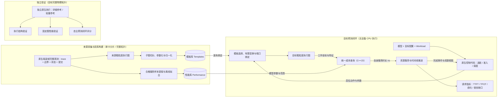
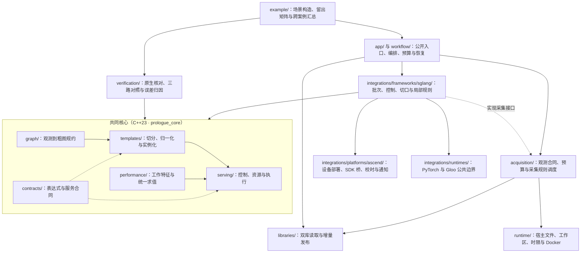

# 项目架构与长期路线

Prologue 从原生推理执行中提取必要语义、状态与硬件提交事实，规约为粗粒度执行图并编译参数化子图模板；在目标配置与请求下由原生控制代码驱动模板展开，结合独立性能库预测 LLM serving 的时序与吞吐。核心设计目标是**用户输入简洁、因果可解释、适配边界收敛**，在不重写完整推理框架的前提下覆盖多配置与多拓扑预测。

本文定义系统架构、模块所有权、核心不变量与扩展契约，不声明具体版本实现资格或实验结论。结构正确性、原生配置可运行、测量覆盖和性能精度各自独立取证。

## 一、端到端数据流与双库架构

一次任务输入包含一个固定模型（含实现配置与 dtype）、一组目标配置以及一组请求 workload。**目标逻辑拓扑**决定预测对象，**采集部署**决定物理取证方式（单卡分片 `single_device` 或完整拓扑 `full`）；两者解耦并共同沉淀到长期维护的**模板库**与**性能库**，通过不可变发布目录向预测与验证交接。

### 三条独立验证路径

| 验证路径 | 固定的条件 | 独立检验的结果 |
| --- | --- | --- |
| **执行结构验证** | 同一目标的请求、初态与经核对的真实时间条件 | 原生控制与核心自主生成的动作、工作、绑定、必要因果、资源效果与输出，对照真实原生图 |
| **固定图性能验证** | 真实执行已经发生的工作、特征、资源与依赖 | 用正式成本查询估计工作服务时长，重算事件时序与请求指标，定位成本误差沿既定结构的传播 |
| **自主预测闭环** | 目标配置、workload、初态与独立发布的双库 | 原生控制与核心自主生成动态执行结构与输出时刻，用独立轻量原生实测评分 |

- **共用与隔离**：结构验证与自主预测共用原生控制、模板展开、资源推进和完成反馈；固定图验证从经核对的真实目标图直接进入共同执行层，冻结控制决定并复用同一 C++23 成本查询合同。目标图仅作固定图输入与结构对照真值，与建库、拟合及自主预测严格隔离。给定统一耗时（`given_work_ns`）仅用于开发与程序测速。
- **局部构图验证**：可给定真实动作、批次和调用输入，由核心独立完成模板选择、参数求值与依赖连接；验证控制器时由原生代码产生动作与批次。任何被固定的查询、分配或外部交接均在报告中明示，验证资格限于仍由实现自主产生的行为。

## 二、三种抽象粒度与观测边界

| 粒度对象 | 定位与职责 |
| --- | --- |
| **流程动作** | 原生控制与核心执行之间的稳定交接单元，承载调用参数、状态效果与完成责任 |
| **粗图片段与子图** | 表达必要计算/搬运/通信工作、资源归属与对外可见端口，支持层次化组合、复用与有限变换 |
| **性能单元** | 具备清晰特征坐标与独立测量边界的计费对象，粒度可细于语义子图但与结构图保持清晰归属 |

### 1. 粗化优先与因果确立原则

- **先粗图后模板**：原始 trace 只是取证材料，正式图不维护逐 kernel、逐 CPU 函数或 SDK 内部细节，也不采用“先建全量细粒度 DAG 再事后折叠”的路线。
- **State 关系与 Signal 同步分开**：因果先确立必要语义边界与外部作用，不以所有微观命令具有唯一全序为前提。由原生参数、已注册存储与调用关系确立的数据生产消费（State 关系）与 runtime 观察到的硬件/流同步（Signal 关系）分别表达，不把数据前提冒充为实测硬件 fence，也不按时间戳先后猜测依赖边。
- **封闭封装与外部可见性**：内部工作可在资源、跨界依赖与中间消费者均核清的封闭区域内承接，异步尾部与成本责任不得丢失。片段内部可隐藏实现，但其输入输出、共享状态、所用资源、CPU 返回、设备完成、中间信号与跨 rank 交互必须完整外露；跨 stream 区域允许并发片段，禁止压成虚假全局串行节点。必须外露却缺少定位依据时明确报告证据不足，不得用封装或时间拟合掩盖。
- **模板身份与底层记录解耦**：内部记录数量与 kernel 名称不定义模板身份；已证明由片段承接的记录不必逐项对应算子，未确定的必要外部作用保留具体缺口，不以未知记录总数代替流程资格判断。

### 2. 本地业务窗口、静止初态与时钟口径

- **本地业务窗口**：采集与无设备控制共用同一业务窗口定义——首次请求开启，全部本地输入收到、原生逻辑空闲且模型发送队列已由原生循环清理后关闭。PP 的 proxy/output 发送仍持有模型工作；空请求转发不阻止窗口关闭；控制端禁止为提前报告 idle 主动清空发送队列。最终退出由核心在请求清理、执行图排空与参与者停驻后发起，适配器结束私有 CPU 等待，不向原生 PP/PD 消息流注入退出请求。局部窗口关闭不等于组同步或协议结束，观察边界不拥有请求进度或资源状态，也不丢弃在途工作。
- **无设备静止初态**：首次请求前，全部原生 worker 完成初始化且尚未交付 workload，输入所有者停驻于 idle，其余参与者阻塞在原生控制边界（PP 非输入 stage 可等待下一轮 metadata，不要求全员同时停在 `on_idle`）。该控制初态与采集侧真实设备预热分别负责控制状态与运行环境。
- **主机顺序与时间测量分离**：主机调用顺序与墙钟测量分开保存。Ascend 适配器以主机 CPU 计数器衔接语义区间、SDK 提交与原生 API，直接以 `CLOCK_MONOTONIC_RAW` 读数标定主机边界；设备内顺序使用 stream 坐标并配合独立时钟校准。SDK 导出时间须按原生产公式还原原始计数器，禁止以拟合偏移、邻近时间或经验容差猜配；无独立测量的内部端点保持未知，不把顺序坐标当耗时。

## 三、统一 Serving 流程与层次图合同

顶层 serving 流程覆盖**选择工作、准备输入、模型执行、结果处理和输出**；Prefill/Decode 构成模型计算主体，到达、等待与结束属于控制交互，不伪造收费工作。

| 阶段交接 | 业务含义与边界 |
| --- | --- |
| **选批完成** | 原生控制代码决定当前成员、阶段与 token 范围；空决定也可能承担必要的跨参与者协调 |
| **准备与预约** | 构造输入并通过核心资源服务取得槽位与 KV 页；逻辑预约不等于设备内容已就绪 |
| **提交与计算** | CPU 提交、CPU 返回与各 stream 的设备完成分别表达，不统一排空设备 |
| **结果可读与处理** | 按真实数据与等待关系读取结果，在对应端口提交生成或结束状态效果 |
| **请求输出** | 输出角色向下游发布 token；独立于内部状态提交，不包含 detokenizer、HTTP 或分词开销 |

### 核心结构不变量

- **语义边界与参数转发**：模型结构提供 embedding、重复层、attention、MLP、归一化/残差与输出角色等语义依据，原生实现提供融合、通信、KV 与同步边界；层号、调用次数和 rank 绑定不自动产生新结构种类。张量形状规则由实际边界声明，转发同一张量时沿显式调用参数绑定换算到消费者上下文，不得按观测值相等凑关系，也不得以别名、模型名或统一除以 TP 度代替来源依据。
- **调用边界与模板去重**：调用边界严格区分自身输入（由采集与控制共享框架 ABI 声明）与外层观测上下文；核心严格校验明确合同，不从上下文补默认值。模板在相同定义与绑定下只保留去重后的来源参数点（用于 guard、选择唯一性与局部覆盖），逐次调用及 scope 编号留在来源图。
- **层次化图归约与接口组合**：层次贯穿切分、简化、归一化与替换。子图声明的边界关系仍归子图持有；父图维护自身工作、子调用与边界连接，子图内部实现不渗入父图。调用接口统一声明端口、形状、边界别名、资源及边界因果，父层仅组合子层接口，不遍历子层内部推断连接。
- **并行与调度机制保真**：
  - **PP**：保留微批次、stage 间激活、输出/token 返回环与真实等待。
  - **PD 分离**：保留独立 Prefill/Decode 槽位与 KV 池，按请求连接预约、计算、KV 与 metadata 搬运、目的接入和源释放；发送入队、API 返回、数据可用与资源可释放四者分开。
  - **Chunked / Mixed / Prefix Cache**：中间 chunk 仅推进逻辑状态不提前输出；prefix cache 命中不等于已有本次 logits；混合组批、准入、撤回与优先级完全遵循原生策略，不自写理想化启发式。

## 四、状态、资源与时间的唯一所有者

| 系统对象 | 唯一所有者 | 关键边界约束 |
| --- | --- | --- |
| 请求进度、等待队列、组批、准入、控制分支 | 原生控制代码 | 仅通过共享接口输出动作与资源请求，不在核心复制调度逻辑 |
| 槽位、KV 页、驻留、前缀索引/淘汰与就绪 | 核心资源服务 | 维护唯一空闲队列、前缀树与物理页账；adapter 仅持只读视图 |
| 模板定义、参数关系、有限变换与绑定 | 模板与实例化层 | 维护不可变资产与候选选择，不维护可变请求/资源状态 |
| 目标图、资源前沿、在途工作与模拟时钟 | 图装配与执行器 | 维护相对窗口起点的整数纳秒时钟与事件回收 |
| 工作特征、成本适用性与服务时长 | 独立性能层 | Python 离线拟合、C++23 统一覆盖判定与求值 |
| 采集期真实请求、KV 与 worker 生命周期 | 原生推理框架 | 采样与取证由框架管理真实状态，不复写框架状态机 |
| 任务进程、预算、镜像、双库发布与恢复 | 外围应用与工作流 | 单任务单一写者、原子发布、累计预算跨恢复不清零 |

### 虚拟执行环境与控制反馈机制

1. **虚拟时钟与真实墙钟隔离**：核心提供统一的模拟时钟、事件推进、等待唤醒及受控条件交接。适配器仅将影响决策的时间读取、超时、消息和完成查询接入虚拟环境；CPU 自身工作按显式服务时间推进，宿主 Python/IPC 调度快慢不决定模拟时间。任务看门狗、日志和预算继续使用真实墙钟。
2. **资源 RPC 与动作执行解耦**：资源初始化由适配器一次声明槽位容量、请求字段和页复用策略（例如普通池归还前置 vs PD 池延迟合入排序），核心维护唯一队列并执行分配。资源 RPC 决定逻辑所有权，动作执行决定内容就绪与物理复用时机；动作须保留修改前的请求绑定与返回页，不能在构图时只读池后态。收到资源回复不代表设备工作已完成，下一次预约可早于上一动作的异步尾部。
3. **前缀树与数据在途保护**：前缀匹配、分裂、引用与淘汰由核心索引完成，适配器仅按当前页绑定构造原生所需的 CPU 元数据视图。共同依赖层维护张量版本、在途访问与 KV 页内区间，逻辑释放不抹除在途访问。
4. **消息交付与完成读取因果**：协议消息元数据由 adapter/broker 持有，交付可绑定一组生产者完成信号——核心待生产者事件就绪后通知 broker 入队并唤醒接收者，既不阻塞发送方也不在核心复制框架协议状态机。原生逻辑实际读取并消费的成功完成状态（`observation`）作为控制因果保留至下一次动作入口，未采用消息不产生前驱，false 读取不增加等待。
5. **安全等待边界与 PP 共识唤醒**：原生“仍有未完成请求”不等于“当前有可运行工作”。适配层仅在完整原生控制轮次（PP 含全部微批槽位）结束后的安全接收边界声明等待；共同控制按新请求、已入队协议消息、资源容量增加或已查询完成事件唤醒。PP 末级投递变化后的非空共识唤醒入口，协商缓冲区仅保留最近一次不可变载荷，唤醒保留至安全边界消费，不在中间槽位丢失。适配层不重算准入或复制共识算法。
6. **通信分组与事件回收**：CPU 消息交接与设备通信分别表达；TP/EP/PP 同步严格按实际参与组发生，不在普通 RPC 增加全 world 屏障。执行器可回收已完成历史事件，但完整保留在途引用、未配对消息、资源前沿与活跃值。共同控制接口不保留无消费者的轻量控制、批次回放或兼容分支。

## 五、分层架构、双语言职责与源码映射

系统依赖严格单向向内：**外围应用/工作流/验证 → 适配层（框架 / Runtime / 平台）→ 共同核心（C++23）**。Runtime 不反向依赖框架；公共核心（`contracts/`、`graph/`、`templates/`、`serving/`、`performance/`）禁止按具体框架名、模型名、kernel 名或私有函数添加业务分支。

### 1. Python 与 C++23 跨语言分工

| 语言与模块归属 | 唯一负责的计算与规则 |
| --- | --- |
| **C++23 模拟与模板核心** （`contracts/`、`graph/`、`templates/`、`serving/`、`performance/*.cpp`） | 粗图投影规约；模板编译、归一化、候选选择、局部补充与实例化；模拟资源服务（槽位、KV 页池、前缀树）、虚拟时钟、依赖与通信推进；统一的成本覆盖判定、求值与固定图时序重算。独立于具体框架构建。 |
| **C++23 框架声明桥** （`integrations/frameworks/sglang/*.cpp`） | 为 `prologue` 与 `prologue_local_graphs` 提供框架特有的模板域、worker 绑定与动作声明解析，封装为 `prologue_sglang` 静态库，不污染 `prologue_core`。 |
| **Python 应用、采集与拟合** （`app/`、`workflow/`、`acquisition/`、`runtime/`、`libraries/`、`performance/*.py`、`integrations/`） | 公开命令行装配与容器调度；探索任务、补库规划、预算与原子发布；接入原生框架观测与无设备控制；离线样本提取、时钟校准与成本模型拟合。 |
| **Python 正式验证** （`verification/`） | 独立核对原生参考证据、生成受控执行输入、执行结构对照/固定图归因/自主闭环评分；固定图成本求值与重算按图批量调用 C++23。 |
| **场景示例** （`example/`） | 公开预测与验证能力的组合调用、工作负载准备、留出矩阵编排与跨案例汇总。`src` 不导入 `example`，预测路径不导入 `verification`。 |

### 2. 当前仓库目录映射

| 目录 / 文件 | 核心职责 |
| --- | --- |
| [`src/prologue/app/`](../../src/prologue/app/) | 宿主 CLI（`cli.py`、`commands/`）、框架与平台注册（`registry.py`）、采集/控制容器内入口（`capture_worker.py`、`control_worker.py`）以及 C++ 可执行程序入口（`main.cpp`、`execution_trace.cpp`）。 |
| [`src/prologue/workflow/`](../../src/prologue/workflow/) | 单目标预测进程（`prediction.py`）与配置集探索（`exploration.py`）、目标状态（`targets.py`）、工作流调用选项（`options.py`）与摘要报告（`report.py`）。 |
| [`src/prologue/acquisition/`](../../src/prologue/acquisition/) | 通用观测合同（`observation/`）、采集规则与会话管理（`capture.py`、`rules.py`、`budget.py`）、离线图/模板生产（`production.py`）、协调缺项补采与发布（`replenishment.py`）、成本采样与拟合编排（`costs.py`、`fitting.py`）。 |
| [`libraries/`](../../src/prologue/libraries) / [`runtime/`](../../src/prologue/runtime) | 双库的读取、拼接与增量发布集中在库层。宿主底座负责文件、工作区锁、时限与容器。 |
| [`src/prologue/contracts/`](../../src/prologue/contracts/) | C++ 表达式与 serving 公共数据结构、Python workload 及条件 EP 路由校验（`workload/`）。 |
| [`src/prologue/graph/`](../../src/prologue/graph/) | 共同图数据结构、状态访问与原生观测到粗图的投影规约（`projection.cpp`）。 |
| [`src/prologue/templates/`](../../src/prologue/templates/) | 模板编译、接口导出、绑定、归一化、局部叶复用、候选选择、局部证据补充与实例化。 |
| [`src/prologue/serving/`](../../src/prologue/serving/) | 控制交互（`controller/`）、唯一资源服务（`resources/`）、事件时间线与依赖/通信推进（`execution/`）、会话编排（`session.cpp`）及耗时/执行输入接入。 |
| [`src/prologue/performance/`](../../src/prologue/performance/) | C++23 统一工作特征提取与成本求值（`work_features.cpp`、`work_costs.cpp`、`service_model.cpp`）；Python 离线拟合、模型族注册与样本合同（`fitting.py`、`models.py`、`backends.py`、`requirements.py`、`samples.py`）。 |
| [`src/prologue/integrations/`](../../src/prologue/integrations/) | SGLang 在 `shared/` 定义批次、KV、角色及坐标合同，`observation/` 在原生 worker 内采集，`control/` 执行无设备决策，`acquisition/` 在宿主选择部署与局部采样规则。Ascend 的 `runtime/` 记录原始事件，`analysis/` 解释设备工作与端口，`host/` 管理物理部署，`reference/` 依据原始记录独立核对。PyTorch/Gloo 的调用边界由 `runtimes/` 维护。 |
| [`src/prologue/verification/`](../../src/prologue/verification/) | `core/` 核对原生事实与来源资格，`structure/` 在实测条件下比较展开，`fixed/` 在真实图上比较服务成本，`autonomous/` 比较闭环发布与调度。`runner.py` 维护共同验证生命周期，`core/adapters.py` 定义框架和平台证据的接入点。 |

- **条件 EP 路由与拓扑规范化**：条件 EP 路由归属 workload 合同，采集与控制共用实现；框架适配器按原生 MoE 块配对路由器与专家模块取得逐层 top-k、层号和专家数，禁止从首个 router 推断全模型。原生参数规范化若改写用户请求的拓扑，须在启动 worker 前报错，不得将改写结果记为原配置成功。

## 六、来源泛化与多框架 / 多硬件扩展路线

### 1. 来源域、代表角色与多机演进

- **同域有限变换 vs 跨域新建来源**：同一模型/实现域内，通过目标长度、成员、KV 范围与状态重组展开模板；模型、dtype、TP/PP/EP、backend、原生实现/依赖或页布局变化须取得新来源。能力边界以实际合同为准，不把未实现写成理论不可能，也不靠修改配置数字宣称跨域支持。
- **物理放置与逻辑拓扑解耦**：本地分片可隔离时可在单卡依次观察代表角色，PP/EP/PD 协议需实际进程时运行原生组；代表复用须在采集前减少观察次数，不以采后去重冒充节省。等价 rank 共享结构定义但独立维护权重、KV、资源与绑定；单卡分片不授予多卡通信时延或争用资格。
- **多机与性能演进**：多机沿节点/设备位置与通信接口扩展，部署、网络连接与传输实现下沉到适配层，核心保持统一依赖与资源模型，不预建重型集群调度平台。性能建设严格分离服务时间与等待、避免父子重复计费，结构通过不自动授予性能精度资格。

### 2. 新框架 / 新硬件平台的接入契约

新增推理框架（如 vLLM）或硬件平台（如 CUDA）时，**不修改 `prologue_core` 的公共算法主线**，仅按职责在 `integrations/` 下实现对应契约（核心确实缺少公共抽象时，同步修订公共合同、既有适配器与新适配器）：

| 扩展维度 | 目标目录 | 须实现的最小契约 |
| --- | --- | --- |
| **新推理框架** | `integrations/frameworks/<name>/` | ① 模型配置、并行角色、KV 页布局与 MoE 层几何的唯一解释器；② 统一流程动作切口与语义观测 hooks；③ 无设备控制适配（接入核心资源视图、虚拟时钟与 broker）；④ 框架专属局部采集规则登记；⑤ C++ 模板域与动作声明桥。 |
| **新硬件平台** | `integrations/platforms/<name>/` | ① 物理设备可见性与容器部署映射；② 独立 SDK/Profiler 原生采集桥（在推理镜像内单独按 C++23 构建，不链入 `prologue_core`）；③ 主机 RAW 时钟与设备流时间校准及不确定性输出；④ 设备队列/事件/集合通信与同步搬运事实解释。 |
| **公共运行时** | `integrations/runtimes/<name>/` | 跨框架可复用的张量构造语义、CPU 进程组协议（如 Gloo）与容器调度接口，严禁反向导入具体框架。 |
