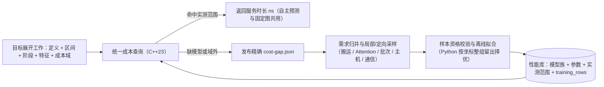

# 性能边界、按需采样与成本模型

性能层回答一个聚焦问题：**一项明确工作在给定特征与运行条件下需要多少自身服务时间（整数纳秒）**。执行器依据服务时间、资源占用与因果依赖推进起止时刻，控制器消费完成事件；性能层不修改执行图结构或调度策略。

## 一、与执行结构的交接及统一求值合同

- **自身服务与等待分离**：执行器交付目标图中工作区间、参数及资源条件，换取整数纳秒的自身服务时间；等待与纯逻辑边界由依赖推进，不另收服务成本。给定耗时（`given_work_ns`）属显式假设，缺值即失败、不回退来源时长；假设改变后须从合法初态重算，因为时延会影响后续组批。
- **双端特征一致性**：对同一组调用参数，从原生观测图提取的成本特征必须与从模板展开图提取的特征逐项一致。模板分别保留原生分支条件与张量空/非空条件，成本特征取自本次调用的数据端口、原生分支与实际读写（例如 Decode 读 2,048 个已有 token 时，上下文长度进入计算特征，KV 池总页数仅用于端口形状校验）。
- **语义区域与性能单元解耦**：一个语义区域可含多项 CPU、设备与搬运工作；重复模型层共享工作模型但调用次数独立。如需更细性能单元，由提供者聚合为区间成本，不要求结构图恢复逐 kernel 节点；父区域只计自身服务，严禁叠加子区域或设备成本。结构可变换与代表选择资格不自动授予成本外推或跨配置共享资格。
- **双语言唯一求值入口**：Python 负责离线样本整理、模型留出择优与参数发布；**C++23 唯一承担覆盖判定与耗时求值**，补采规划、固定图性能验证与自主预测共用同一入口。任一特征超出发布模型的实测范围时直接报告缺项，不静默外推。

## 二、六类工作特征与计费边界

| 工作类别 | 必须保留的特征与边界 | 独立测量对象与互斥约束 |
| --- | --- | --- |
| **CPU 自身服务** | 稳定起止切口、线程/角色、阶段、实际成员及工作量 | 相同切口的本线程 CPU 服务，排除等待与观察器开销 |
| **设备计算** | 片段覆盖的计算与实现、shape、dtype、布局及影响算法的操作数 | 同边界内设备服务；内部细分与片段整体计费互斥 |
| **同步传输** | 方向、字节数、两端条件及明确 driver 边界 | 排除前序依赖等待的实际传输服务 |
| **异步 DMA** | 实际设备工作、字节数与执行资源 | 设备侧搬运服务，CPU 发起单独归属主机 |
| **通信（Collective / P2P）** | 操作类型、物理操作数、数据量、参与者、拓扑与 transport | 实际通信服务；与内部物理子任务分解互斥 |
| **提交与运行时命令** | 对应调用、参数与资源归属 | 主机自身提交工作，不包含等待期间墙钟 |

### 关键计费细则

- **Attention 特征粒度**：query 长度、context 长度、head 数与 cache 布局构成核心特征，整段 Decode 长度不是独立成本类型。相同 shape 若对应不同索引、页布局、原生分支或内容相关工作须分开表达；缺必要操作数时保留合同缺口，严禁按 kernel 名加补偿分支。
- **有张量操作数的同步搬运**：按自身字节坐标建模。采集端在同一次原生调用内核对源地址、方向与完整长度，模板记录操作数名称、dtype、元素宽度与形状规则，构图时要求规则算出的字节数与驱动记录相等，实例化时复用同一规则求字节数。结果读回的 token 张量兼担调度端口，页释放读取的索引张量仅提供几何信息（释放与后继依赖归资源合同）。仅覆盖整次复制的区间才能使用整次字节数；结构观测中的驱动边界留给真实图对照，可复用服务模型使用预热、输入就绪后的轻量计时（两者差距在固定图与自主闭环中评价）。
- **禁止错误标签**：等待、事件与逻辑标记先表达因果，禁止迁移来源 CPU gap，禁止用 `run_batch` 墙钟减去设备总时间冒充 CPU 服务标签。

## 三、CPU 路径建模与低扰动测量

1. **路径表达**：按提交、入队、worker、等待、结果处理与输出端口保留稳定作用。改变外部结构的循环与分支交由模板和控制表达，封闭内部循环只保留工作量特征；普通 Python 调用树与 observer 碎片不自动变成新成本类别，不逐原生 Python 函数建模。
2. **自身服务测量与校准**：性能观察复用结构已确定的同名切口，父子嵌套只计自身部分。线程时钟读取与回调开销须独立校准并保留原始记录，低于时钟分辨率或受首次编译影响的点不得作为有效标签。
3. **真实无插桩对照**：校准无法消除全部 profiler、缓存、线程调度与 SDK 扰动，必须用真正未安装对应观察器的对照核对开销（停写记录但仍执行回调不等于无插桩）。若 SDK 将就绪等待与服务封装在不可分入口内，如实说明局部近似与资格边界，禁止手调倍率、固定 gap 或端到端残差掩盖。

## 四、按需与局部采样的统一要求

所有性能采样方法必须同时满足四项工程合同：

1. **对象一致**：性能与语义采集共享原生模型分片、backend 与底层执行，按真实工作与完整特征关联；仅同名、同 shape 或入口相同不足以证明等价。
2. **适配简单**：由原生框架管理请求、KV、槽位与 worker，不为调用 ModelRunner 或 batch 入口复制框架状态机，不假定所有框架提供 `bench_one_batch`。
3. **特征可构造**：从目标工作范围构造有限短请求或公共原语配方，并回读核对实际命中的成员、shape、context、实现与角色；发出请求不等于命中目标特征。
4. **开销有界**：在同一常驻原生会话内合批运行多点与重复观测、合并相同配方；分账记录初始化/预热、有效采样、后处理、导出量、保留量与磁盘峰值；相同配方无新增证据即停，不反复启动完整 serving 补点。

### 已落地的局部与定向采样模式

同一并发批次的样本只能证明其实际执行的形状和工作。成员分开到达时，单成员 Prefill 的输入长度与合批后 Decode 的总上下文都可能变化。采集适配器在冷任务内生成有限的原生局部测量，结构探针保留工作及端口，独立 CPU 探针按同一成员进度取时。对内部同步搬运，原生切口提供操作数、方向及实际字节数，就绪张量采样器提供可与等待分开的服务时间。成本库按工作定义与实测特征范围拟合，后续任务可读取固定发布。

- **本地同步张量读回**：按来源物理卡合并缺失尺寸，预热连续张量后运行同一 PyTorch 调用，采集匹配操作数的成功同步 API 区间，并同步记录开关计时的整次调用时长以核查观测扰动。工作流首次遇缺时先查已有样本并合并多目标需求，发布后仅重算受影响目标。
- **稠密 Decode Attention 定向采样**：从目标特征反推唯一确定的 prompt 长度组合，由 SGLang 在预热后的原生请求中管理槽位、分页与真实批次并执行一步 Decode；依据来源模板的命名 attention 调用，回读核对实际 query、context、本地 head、缓存布局与 backend，将提交的设备任务逐段对应到模板工作并记录自身设备时长，同时保留仅计时事件与开启 SDK 时的调用总间隔检查插桩扰动。
- **语义与性能生命周期分离**：性能采样不强制携带重语义 profiler，但与语义观察共享工作绑定与入口定位（不维护两套原生入口映射）；辅助张量、传输替身与观察器自身工作不计业务成本。
- **预热排空与稳态核对**：SGLang 采集按相同提交分组预热；组内含错峰到达时先在同 Engine 完整运行一次使冷启动编译完成，准备运行与预热各自排空并清空逻辑 KV（保留已加载内核与工作区）。稳态评分须逐 rank 核对有效窗口中的首次特化加载。

## 五、单卡分片、多卡物理通信与运行条件

- **单卡分片与角色可达性**：单卡按原生角色执行目标 TP 本地分片（请求长度不除以 TP，层/head/线性轴与通信边界归适配器）；性能采样与结构来源须共用分片底层，本地实测仅授予本地工作资格。所有实际需求角色（含 TP4/TP8 的 rank 2 及以上）均须可达；结构角色等价不自动授予服务时长等价，跨 rank 共享成本须有独立依据，禁止删除角色特征或直接复制普通角色样本。定向 Decode attention 在目标 rank 上独立计时并发布到其成本域，同角色多坐标共用会话。
- **真实多卡通信取证**：真实多 rank 通信、协调、争用与后台进度无法由单卡替代测得（逻辑连接保持，成本须由物理样本提供）。同次通信按原生通道入场次序配对各参与者，核对参与集合、完整操作序列与载荷（变长交换须核对逐对端收发行数，含零行），各 rank 计算“最后一个必要参与者就绪到本端完成”的时长区间并保留不确定性；调度同步与模型内通信共用同一规则。完整物理来源批量导出共用同次组内校时，按已发布 rank 文件恢复。
- **Ascend HCCL 通知寄存器收紧**：同一次 Ascend 集合通信内，硬件通知发送开始早于对端等待完成。适配器核对双方设备子任务、寄存器与使用次序，结合本地实测时段与独立校时区间收紧端点时差上界（无直接配对的两端可经同次通信中其他参与者传递收紧），仅在实测约束可确定耗时为正或恰为零时发布样本；若通知与独立校时矛盾，记录 `collective_notification_conflicts` 并统一回退独立校时；预测图仍保留单一通信工作。[HCCL 通信子任务与通知寄存器](https://www.hiascend.com/document/detail/zh/CANNCommunityEdition/910beta3/API/hcclug/docs/zh/user_guide/perf_analysis/profiling_op_behavior.md)
- **环境与数据条件声明**：测量记录 CPU、设备与 runtime 条件；卡号与模型路径仅用于定位不证环境等价，缺失条件保留未知。跨硬件、角色或后端共享须有依据，dummy 权重数据不授予数据相关分支的泛化资格。

## 六、需求归并、模型拟合与样本隔离

- **自动需求与有界循环**：目标工作自动产生需求、归并重复特征、查已有候选并将真实缺口交给有限采样配方，不依赖人工逐 trace 补表；需求与查询共用同一工作合同，不从人读摘要反推。动态调度下未展开路径保持未知；预算、已尝试配方与停止条件贯穿全任务，严禁形成无界“运行—缺口—补采”循环。
- **模型候选登记与留出择优**：先建独立标签的简单基线，再依据数据密度与误差来源选择模型，不预设复杂树模型或逐点查表。模型候选按**工作种类、所在调用和实际特征**登记：常规服务采用有界经验曲线，本地搬运按字节数、attention 设备工作按 query 与上下文交互规模、解码器层自身设备工作按本次处理 token 数与经验曲线比较（嵌套 attention 拥有独立工作与成本）。Python 按特征坐标整组留出样本，在共同实测范围内比较候选误差并发布选中模型参数与范围。禁止按 workload 标签、目标残差或手调阈值拟合。
- **通信物理操作数分组**：通信样本须先按参与者集合、归约操作与端点等物理操作数分组独立拟合，再在匹配组内按张量形状等数值坐标查覆盖范围；缺少可识别物理操作数的记录保留为缺测。未保留组内物理操作数的旧拟合文件可从原始样本离线重新拟合。
- **样本溯源与训练/留出隔离**：
  - 每个已发布模型记录参与拟合的 `training_rows`（指向样本源与样本行）及实际测量方身份（受规则认可的跨角色复用样本保留原测量方）；同一坐标存在冲突载荷时整坐标样本排除。
  - 结构来源、单元性能样本与独立目标验证严格隔离；拟合与留出按运行或请求组隔离（同次运行的重复模型层不算独立样本），用于修正规则或模型的案例立即转为开发用途。
  - 独立评价点可与采集需求合批求值，仅采集需求缺口触发补采或跨角色复用；样本列出参与取证的原生尝试供验证器排查数据泄漏。
  - 正式自主预测留出精度要求 TTFT 与 TPOT 的 MAPE 各自低于 6%；固定图基线重算、误差归因与自主闭环评分的完整算法及指标口径详见 [verification.md](verification.md)。
