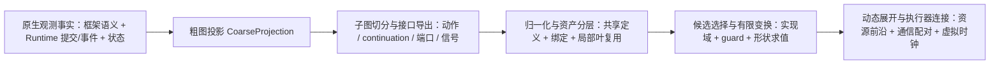

# 粗粒度执行图、子图模板与动态执行模型

Prologue 先将原生 trace、语义切口与资源状态事实规约为**粗粒度执行图（Coarse Graph）**，再从中切分、参数化并归一化为可复用子图模板。正式图不以逐 kernel 物理归属为前提，不维护全量细粒度 DAG。

本文定义共同图表示、模板资产、有限变换与动态展开的核心合同，并将当前 SGLang / PyTorch / Ascend 的具体适配落位集中收口在第六章，保持公共算法与框架细节解耦。实例是否可展开、原生行为是否一致、成本是否具备和精度是否达标各自独立报告。

- **声明解析与模板编译解耦**：框架适配器先解析统一动作、条件、参数与状态成员绑定，再由共同编译器构造模板。
- **目标图只作声明与对照**：原生调用输入可交给固定来源库做独立候选选择与实例化检查；目标图不参与编译或补充来源模板。公有存储绑定作为输入时不授予其生成过程或跨调用历史资格，局部内容对应不能代替控制轨迹与跨调用因果验证。

## 一、原生事实到粗粒度执行图

框架提供统一流程、模型层次、批次成员及输入输出；runtime 提供提交、队列、stream/event、资源生命周期和传输事实。跨异步边界的工作与资源关联必须在采集期确立，禁止事后按线程或相邻时间猜所有权。

### 1. 粗图节点与六类必留边界

粗图节点表达一段具备明确职责、参数、执行资源和对外端口的工作；单个语义区域可包含多个 CPU/设备资源片段，片段不等同于单个原生函数或最终模板。

| 必须保留的边界 | 保留依据 |
| --- | --- |
| 外部输入、输出及必要共享写入 | 决定数据依赖、shape、存储别名与后续可见内容 |
| CPU 进入/返回、必要提交及设备完成 | 决定原生控制何时继续，保持真实异步行为 |
| 跨 stream 信号/等待与中间数据就绪 | 避免丢失依赖或制造虚假全局串行化 |
| collective / P2P / KV / metadata 交接 | 保留参与者、方向、数据范围与完成责任 |
| 分配、驻留、引用与释放的可见效果 | 保障资源池与控制状态的准确提交 |
| 目标变换所需独立处理的内部边界 | 支撑成员数、形状、重复次数与通信变化 |

### 2. 数据消费边界、队列提交与观察标记收束

- **数据消费端口位置**：存储位置不决定消费者在何种资源上执行。普通输入在调用/设备入口就绪；同步主机读取可声明 `at_return=True`（在调用返回前消费完成），该边界保证消费结束而不声称测得内部复制精确时刻，禁止前移到设备入口或 CPU 进入前；核心自声明端口保护读取至消费结束，前置写入与后续物理复用须保留依赖。
- **提交线程与载荷合并**：提交线程按实际设备任务、调用方同步传输和必要等待形成片段；句柄创建/销毁等管理记录仅解释生命周期，观察器自身事件查询与释放显式排除。每次实际取队承接对应主机入队；同一资源、语义区间与释放条件下连续的普通设备载荷可合并，存在独立 driver 提交时保留新起点与上段完成边界。辅助 stream 经 API/队列追溯至提交它的语义范围，用原生事件与等待建立完成依赖，不统一加调用返回屏障。
- **API、设备任务与同步传输分离**：缺少 SDK 任务时，成功返回与非零字节数不足以证明额外设备工作；同缓冲区同步 driver 传输由调用方承担，不生成 stream 命令；数据完成须同时承接调用方作用与必要设备作用，整体服务已承担的内部传输不重复计费。
- **相邻等待合并与逻辑等待**：同一语义片段内，相邻且无新业务提交、不跨子调用或外部端口的 host stream 等待仅保留首次（空流首次等待亦保留以承接目标前沿，事件等待与新流前沿不删除；重复 API 的 CPU 开销仍归片段）。同时无 SDK 设备任务且无原始 driver 队列下发的运行时等待，经核对后仅保留因果条件，不伪造设备时间或成本，也不兼任数据发布、状态访问或通信完成。
- **插桩收束规则**：插桩点只定位边界不独立计费。所有端口、状态访问与同步依赖确立后，设备区间收束至原观察范围内的真实载荷及必要端点；同步 CPU 传输与设备作用需合并完成时保留已测返回 fence 作为显式汇合点（不承担设备成本，也不等同数据最早可见时刻）。收束成单点的区间保留 `boundary`；既无载荷又无显式引用的空区间与隐式端口删除并重映射存活锚点。该规则不删除调用或 CPU 控制工作，不按框架函数、模型或 shape 特判。
- **时间与顺序解耦**：CPU 工作不按 observer 调用切碎；设备命令按 stream 内顺序保留，零耗时等待保留两个逻辑边界，不因时间戳相同合并结构；实测时间留在来源证据。时钟换算归 runtime 层（窗口前后以主机 RAW 时钟包围设备计数器查询，取最短查询区间撤销 SDK 偏移并建线性映射，保留不确定性；窗口外不授时，校准不读目标结果、等待边或模板选择）。

### 3. 同步传输服务、通信与 CPU 协议

- **封闭同步传输服务**：全部内部任务完成后返回的同步传输可封装为封闭粗工作（承接内部协调与搬运，调用线程表达等待不重复计费），线程池派工与私有队列数不进模板。消费不同输入的服务保留各自访问区间，禁止合并先行 KV 与后续 metadata 后把全部读取前移；最终 chunk 端口按实际服务顺序承接全部完成，任务对应依据真实队列顺序与提交数量，不假定一调用一任务或按时间包含关系猜测。
- **设备与 CPU 集合通信**：CPU/设备分类以原生进程组职责为准；无设备控制借 CPU 张量与 Gloo 承载设备元数据不改变其执行类别。共享切口先结束前置 CPU 片段再独立交接组、操作、元素数与根角色，控制须先发布输入再提交通信图，结果保留至全部参与者消费；空归约与单成员组不增汇合，广播仅依赖根。通信成员与每次 `required_peers` 分别维护：适配器显式声明 `required_peers` 绑定时，目标实例化前按本次输入映射到实际成员；局部替换保留组大小、操作与载荷合同，不把来源具体 rank 位置当作算法条件。
- **CPU 点对点元数据协议**：由原生 Gloo 或控制 broker 各自维护消息与 Work，观察层仅记录路由、载荷布局、投递与首次成功等待返回；阻塞调用与其内部异步委托属同一次操作。每次运行内按进程组、端点、tag 与通道顺序识别消息（不用于跨运行配对），投递返回、等待完成与对端等待分别保留；窗口前已投递的 Work 保留原身份。来源按线程严格单调计数器建立协议因果（同计数值不猜序），控制按调用返回与只读协议记录连接（先确认双方投递再连依赖）；协议阻塞墙钟不直接作为纯 CPU/传输成本。

### 4. 缓冲区、KV 区间与存储边界

- **整体 shape 与实际读写区分离**：KV 缓冲区层布局仅作元数据，共享同一 allocation 不意味整块缓冲区均有依赖。KV 等持久状态按池、层、请求及逻辑 token 范围声明访问，不因共用缓存池给无关请求加屏障；内部张量别名仅保留边界可见版本与来源。
- **显式 KV 访问合同**：每条 KV 访问须显式声明资源池绑定、逻辑 token 范围、每 token 逻辑载荷宽度及字节切片、执行起止边界，模板构造校验声明与执行区间一致。共享定义保存按批次成员求值的范围规则，池/层号/切片存于调用绑定；设备地址仅用于源端解释两端逻辑区域，解释后不进模板或跨运行身份。
- **读写与回收偏序**：读开始依赖所读内容就绪，读完成后才允许覆盖或回收；写入同时保留开始与完成边界。attention 取所属设备区间，传输取有完成依据的服务区间，不以提交返回推定设备完成。多个已提交写入可合并覆盖所需区间，但读取须等待所有相交写入完成，部分载荷（如单 head 或仅 K）按各 token 切片展开，不得将整 token 标为已初始化。

## 二、子图切分与调用生命周期

### 1. 层次切分与张量版本归属

- 统一流程划分选择、准备、模型执行、结果处理与输出顶层边界；模型主体按 embedding、重复层、attention、MLP、归一化/残差与输出角色切分，切点服从复用、变换与外部可见作用。子图可跨线程、stream 与 rank，语义归属不自动制造串行 CPU 依赖。
- **分配来源与写入来源分离**：原地修改既有存储仅更新写入来源，分配在动作之外的存储由目标调用方绑定，不因写入变为本地新分配。
- **就绪边界精准传递**：父调用直接转交子调用产出的同一存储版本时，输出端口直接引用子调用原有就绪点，不改用父调用较晚的设备结束（CPU 返回与整调用设备结束各自保留）；跨兄弟或跨动作不借此移动端口。
- **切分清理原则**：动作模板仅保留自身事件，跨动作数据经具名张量端口绑定、串行资源经入口/出口交接；跨边界数据或信号依赖必须对应保留的输入端口，不得静默丢弃。仅细分同一串行资源顺序且无端口/工作/状态/依赖作用的空标记可删，并恢复原串行顺序。

### 2. 调用片段、`continuation` 与 `host_only` / `device_tail` 合同

- **按控制边界切段**：由原生控制决定调用次数的父流程按进入、子调用与返回切分为可复用片段；独立选择动作、资源分配、CPU 元数据投递/等待均暂停父片段。观察端与控制端共用调用生命周期显式声明 `continuation`，模板生产核对操作与切口后直接消费，不再从相邻 scope 反推；包围调用的 scope 仅记 CPU 层次，不独立插设备标记。
- **延迟数值观察核对**：状态数值观察可晚于实际读取，须沿同次原生调用的真实 envelope 或完整 `continuation` 链关联前置访问，不反向补造读写或移动消费边界。
- **`host_only` 与 `device_tail` 严格校验**：适配器可显式声明某调用剩余片段仅作 CPU 控制，或在声明 `device_tail` 时将子调用前及子调用间残留标记为 `host_only`、仅保留返回前设备尾部切口。编译器必须核实每段 `host_only` **恰有控制线程一项工作及进入/返回两端口，且无子图、等待、通信、张量或状态访问**；核验失败即拒绝该声明，严禁借改标签丢弃工作。通过核验后同一操作的控制片段共享结构，不再按相邻子调用排列组合分裂；该合同不是缺候选时的 fallback，也不意味不同片段耗时相同。
- **批次筛选与分配切口**：批次筛选/合并通过共同批次变换边界交接，输入与结果成员数分别参数化，空/不变提前返回不伪造设备访问；输入在原地修改前取证，输出在调用后发布。批次分配沿共同片段保留内部独立释放，每个片段维护自身端口，不把淘汰组合固化进整个分配模板，独立资源调用不使借用输入失效。

### 3. Stream 同步、具名 `signal` 与非阻塞 `query` / `observation`

- **动态 Stream 同步**：stream 同步保留等待起点、目标 stream 与恢复端点；命令按显式 submission 链追溯至入队接受边界（不拖延到 API 执行或设备开始）。目标等待覆盖起点前已接受命令及该 stream 最近已完成命令，不含未来入队工作。来源实测前沿快照不固化进模板；提交证据层次须与等待一致（驱动提交或封闭服务首次下发下界及整组结束边界，落入区间内部且无更细对应时报告前沿不确定）。事件等待、通信与跨 rank 协议不可由 stream 同步替代。
- **具名完成信号（`signal`）**：使用独立 `signal` 端口绑定 `Event.record` 与 CPU/stream 等待（两者不可互换）。模板仅保留端口名与局部位置，删除原生事件 ID；运行时以全 serving 会话唯一代次维护生命周期，依据全体参与者引用回收（发送方须待接收方取得引用后方可释放）。事件记录/等待所在的 stream 角色属于操作输入条件，不同角色可共享图定义但调用绑定须各有来源。异步通信 `Work.wait` 复用同一 signal 合同，禁止在提交返回时伪造完成事件；是否阻塞 CPU 依实测证据与实现决定。
- **非阻塞 `query` 与 `observation` 因果**：非阻塞状态查询独立切分为 `query` 动作，按查询种类分类（结果值与忙轮询次数不生成模板类别）；读取工作返回、原生读取与结果交回在同一模拟时刻发生，不额外连接被查询生产者的等待边（原生 API 自身同步如标量读取的流同步照常保留）。成功查询与完成通知的实际消费以 `observation` 关系表达跨调用因果，切模板时移除来自外部的 `observation`，由目标控制按实际读取重新建立，不固化来源结果或回写已返回查询。

## 三、归一化、资产分层与复用合同

### 1. 五层资产归属

| 资产内容 | 唯一归属位置 |
| --- | --- |
| 稳定工作、参数关系、外部读写规则及局部端口 | 共享定义（Definition） |
| 子调用结构、必要顺序、端口连接及资源关系 | 共享组合（Composition） |
| 层号、权重/KV 池、角色、实际资源、通信组与固定实现常量 | 调用 / 角色绑定（Binding） |
| 请求成员、长度、到达时刻与动态资源状态 | 目标实例（Instance） |
| 原生事件号、绝对时间、设备地址、线程/stream 编号及内部明细 | 来源依据或可选诊断 |

共享身份基于确定的规范化规则生成（排除捕获局部编号与动态取值），不建设通用图同构或数学等价证明平台。模板数量增长须对应新的稳定工作、对外关系或原生实现分支；仅因长度、调用次序、层号或内部 task 数增长导致定义分裂属于生产/归一化缺陷。

### 2. 跨层接口、参数边界与常驻缓冲

- **跨层导出接口与依赖归属**：跨层事件连接逐级经子调用导出边界交接，父调用不直读后代内部事件编号，导出禁止成环。父定义维护被调用角色、入口、参数集、具名端口及导入/导出接口，具体子实现编号唯一存于调用绑定；接口分别保留资源别名、事件别名、端口用途与 dtype/shape 规则。子图内部事件与该子图显式端口、状态访问或工作边界的依赖归子图持有（即使共享端点归父层）；互不包含时归共同父层。具名端口先登记导入身份，避免遍历次序改变语义。
- **参数边界**：模板参数仅表达调用实际输入及必要派生量，外层请求进度、批次与调用栈留在 `work` 观测上下文。连续片段继承同调用输入，独立子调用不复制父参数；保留实际 guard、shape、资源状态与必要特征，不按黑名单裁剪、不填默认值；诊断严格区分参数合同失败与 guard 拒绝。
- **`state_input` 绑定**：定义保存读写方式、成员/区间规则与完成边界；调用 `state_input` 绑定保存池、层号与字节切片，匹配保留池别名、相对层范围与相对字节偏移/宽度（允许整组平移，禁止独立切片重叠，不把具体 peer 或绝对偏移当作算法类）。
- **原生常驻缓冲（`buffer`）**：由适配器以存储所有者名显式声明，独立于调用点与端口名；目标按 worker 隔离常驻存储并为单次调用内写入版本预留区间。单一所有者不得对应多个 allocation，未交接且未声明所有者的外部写入禁止猜为常驻缓冲。
- **同步 CPU 复制归属**：同步 CPU 复制保留在调用线程，仅由真实语义设备 owner 交接至设备返回端口；纯层次调用 envelope 禁止因含观察标记把子 CPU 复制挂到自身 stream 引入虚假设备栅栏。

### 3. 等价角色与多级局部复用

- **重复层与等价 rank**：共享结构定义但独立维护权重、KV、资源与状态绑定；局部模块位置、局部 KV 层号与全局模型层号分离，专家路由按全局层查、模板参数按本阶段专家层位绑定。代表角色等价关系由来源初始化事实授予，目标通信组、参与者、根及 P2P 完整路线由适配器在实例化校验前重绑定。结构等价与观察充分性分开判断（例如 EP 某代表缺输入机会时预先增选观察者补充局部实现，不替换主 worker）。
- **同角色库局部子实现复用**：不同父实现在相同子调用位置满足同条件、参数映射、端口、资源与因果一致时，可复用来源侧在后代绑定不变时观测到的另一种子实现，保留接收方全部后代绑定；生成完全等价工作时去重，仍存多解报歧义。
- **跨角色/辅助来源的闭合叶实现复用**：
  - **严格前提**：核心仅接受无子调用、无请求状态（KV/槽位）作用、无外部信号句柄与外部写入的闭合叶动作（或同域下满足原生方法存在性的闭合纯 CPU 续段），完整核对具名接口、张量别名与版本关系、有序资源绑定（类型/串行性/别名；单 stream 可按职责映射，多 stream 须逐项唯一匹配）与边界可达性。
  - **局部实现域 vs 完整 worker 域**：局部实现域统一限定运行时、初始化模型配置、dtype、权重加载方式、逻辑 TP/PP/EP 与专家层几何（容量、PD 模式与外层 phase 不决定局部实现域）；完整 worker 域继续约束角色、模型、池与 PD 对端装配，不得因局部复用放宽。
  - **保留流等待与不扩权**：允许闭合叶保留流等待合同并在目标按当时提交前沿重建依赖（不搬用来源完成时间）；导入入口不继承来源观察 scope 编号，不授权新原生操作，不扫描历史生产目录。

## 四、参数求值、有限变换与候选选择

- **规则来源与维度区分**：模型尺寸与角色来自原生配置与模块，shape 关系来自明确算子或原生规则，不从少数样本硬拟合。分别表达逻辑请求 token、补齐后模型行数与专家接收行数；采集与目标共用同一批次布局规则，采集端以实际输入独立核对，禁止编译期用观测值覆写参数掩盖不一致。层 shape 规则与代表角色判定共用同一实际通信布局。
- **局部动态特征与分支条件**：每层动态特征在动作入口按逻辑层绑定并转成局部参数名；真实分支（如单元素 vs 多元素张量布局、多本地专家非空反置换）用可验证形状/布局表达式声明 guard，固定常量取自本层绑定，不把动态长度固化为条件；输入输出几何独立校验，不从条件反推。可变维度的零/正值条件存于调用绑定，零元素张量交接形状与存储身份但不产生内容读写依赖。
- **来源域校验**：由适配器从实际生效环境提取（实际缓存类型/禁用状态/淘汰策略、生效 chunk/mixed），核心在选择前核对目标域；域匹配不替代上游版本、控制配置与来源范围的完整核对。
- **局部候选组与无污染实例化**：加载时核对子实现与父接口，按动作、控制条件、调用位置、父结构及本层绑定建局部候选组（共享数据 shape 逐层代入、版本与写入者路径一致；私有子树不再要求整棵绑定树一致，但父结构/共享绑定不同不任意拼接，不推导未观察循环次数）。张量值与存储归属所有使用者与写入者的最近公共作用域，跨子树共享不可经重命名切断别名。候选条件结合原生有限语义路径（如筛选的保持/子集/清空）与可求值局部条件；多可行实现报歧义，候选与子调用在私有构造范围校验通过后再发布，失败不污染调用者。

## 五、动态展开、资源连接与执行器合同

- **持久槽位、KV 与副本发布（`publication`）**：`slot access` 声明池（请求槽位池或独立行池）、字段、读写、动态成员绑定与区间，由核心唯一资源所有者解析物理位置；筛选/合并/换批不改请求内容身份。读取范围须由有效历史写入或图内因果已完写入完整覆盖（可多段合并），释放立即清除内容资格但在途访问继续保护复用。适配器在有原生协议依据确认载荷语义相同时，可为槽位写入声明请求内唯一的 `publication`：同发布写入可并行，读者仍等全写完；不同发布或复用仍保留读写依赖。
- **只读布局查询、值传递与接收缓冲**：控制构造后续张量视图时，经共同接口只读查询输出 dtype/shape（共用候选选择与形状求值，不提交图/不分配/不推进时钟）。动作 CPU 返回交付具名目标存储身份与版本，适配器以弱引用关联（reshape 等视图沿用同一身份），后续动作经根输入显式传回并覆盖子调用别名；批次、张量与信号存活集统一在动作提交时读取，避免父片段误删子调用新对象。原生预分配接收缓冲按具名输出端口绑定（复用时续接上次返回版本），动作内新分配不覆写。
- **通信载荷约束与跨参与者配对**：通信模板可在 `communication.agreements` 声明跨参与者需一致的张量端口（`shape` 检查形状或仅 dtype），核心在 shape 求值后按同轮通信核对，未声明不补造且在 `communication_payloads` 单独统计。TP/EP 按 channel 协议顺序配对，保留输入就绪与本地完成，迟到参与者不提前完成；PP 按工作、组、方向与字段配对。同进程组的框架包装与直接 runtime 调用共用同一通信身份，组批期设备通信同样入图。
- **执行器推进与事件回收**：执行器仅维护事件、整数纳秒时钟与执行资源，不决策或分配 KV；串行资源各自接自身前沿，不统一等待前一动作全部资源。动作边界交出仍引用完成边界，每 stream 仅额外保留最近一条已完成命令，数据层先清已完成访问再回收历史事件（活跃值、资源前沿、未配对通信、在途工作与未结束调用保留）。单独执行给定图须显式声明 `initial_inputs=ready` 并提供非负耗时，仅用于核对图推进。

## 六、框架与平台适配落位规范（SGLang / PyTorch / Ascend）

以下细则属于 `integrations/` 适配层的具体实现合同，不进入 `prologue_core` 公共算法：

### 1. Ascend 与 PyTorch Runtime 适配

- **Ascend 观测配置与导出**：结构取证保留 CPU/NPU 活动及 Level1 API、任务与通信来源，关闭无结构消费者的 AI Core 性能指标；原生记录结束后再离线导出，不在有效窗口内同步分析。
- **任务编号回绕与驱动归属**：依据 `TS_TASK_FLIP` 的 stream、任务号与 SDK 批次识别纯记账命令，同名 placeholder 若具内存或同步作用仍须承接。驱动提交按物理 SQE 计数归属；异步拷贝与外层 API 同队列提交时共用设备工作，无 SDK 任务时仅在同线程嵌套且源/目的地址与字节数完全一致的成功同步 driver 传输下按调用方传输发布。
- **PyTorch 张量构造语义**：`lift_fresh` 虽与输入共享存储，但属当前调用新建存储，在 runtime 层判定，禁止在模型或模板层按函数名补生产者。

### 2. SGLang 流程、缓存与分配切口

- **淘汰与宿主读取**：`evict_from_tree_cache` 以独立 `eviction` 调用（参数 `eviction_tokens`）观察与执行，纯 CPU 片段不继承外层 Prefill/Decode 张量接口，释放循环由原生缓存与核心资源服务推进。固定 token 输出仅在结果张量实际调用 `Tensor.tolist` 时拆出 `host_read`（`at_return=True`）；PP 跳过读取不补造，中间 hidden-state proxy 不声明额外读取；读取、资源操作与 publication 拆出后剩余结果片段按 `host_only` 严格核验并共享结构（去除相邻调用名条件，保留 phase 与状态访问条件）。
- **分页分配、索引循环与延迟回收排序**：NPU 分页 Decode 沿用页尾与新页申请共用 int32 位置向量接口；注意力页表按批次行数、最长序列与页宽区分连续视图与物化布局；即时释放按索引宽度与原列表空/非空状态选执行体。`alloc_for_extend` / `alloc_for_decode`、paged 逐 prefix 表达式与索引 helper 逐请求循环在共享适配器形成切口：核心页池在有序前缀不足时唯一执行 `merge_and_sort_free` 并经 `ordering` 交接排序参数（核心逻辑排序完成不代表设备索引数组就绪）；索引 helper 迭代以 metadata 借用输出存储防未初始化读，异常时恢复 Python 线程 trace（已有 trace 占用时报错）。
- **Radix 缓存与 phase 规约**：启用 Radix 缓存的 `finished` / `unfinished` 调用固定接收页大小、当前缓存 token 数与进入时受保护 token 数（不可被内部新 match 覆盖）。请求缓存、页释放/合并及槽位释放等不读取父批次执行模式的接口，来源编译与目标选择共用适配器条件规约，不以 `phase` 划分类别。
- **数值协调与 FutureMap**：`MLPSyncBatchInfo.all_gather` 作为封闭动作切分，控制先投递数值、再提交动作、最后消费 Work（数值替身不额外计费）。非 speculative `FutureMap` 观察真实 `stash` / `resolve` 并绑定实际 `req_pool_indices`（零成员不绕过读写分支）。

### 3. DeepEP 与 PD 分离传输合同

- **DeepEP normal**：Dispatch 含全组计数交换，Combine 按实际 `input/output_splits` 反向交换；采集读原生 handle，目标由已声明路由、补齐与 token 分片推导，不按总接收量或 rank 名删边。
- **PD 元数据与传输生命周期**：Prefill/Decode 池几何、元数据行宽与多源/多目的分片位置共同判定等价，远端层号按各自原生层范围重绑定；单边搬运在同一图声明两池读写不虚构接收调用，严格保证 metadata 完成不早于对应 KV。首 token 元数据采用独立元数据行池与请求字段合同：`set_buf`（源写）→ `send_aux`（读源写目的）→ `get_buf`（目的读，多张量合并为单一逻辑字段）；预分配与接收按原生阶段分开，Decode 预约发布须等前序索引导出与同步返回；源端待搬运完成释放、目的端待读取完成回收元数据行（与请求槽位生命周期解耦）。末块首 token 元数据可声明 `publication`；协议通知依原生通知组汇合（末块汇总整组及前序分块完成依赖，发送非阻塞，发送发布与各接收可见分别以具名事件推进），无传播实测时不加固定延迟。传输适配器按本次预约迭代顺序绑定各目的端几何，不同排列复用同一骨架。

### 4. 来源与评价独立性原则

来源粗图与目标真实粗图使用同一表示与规约规则；同源还原仅检验模板编译不丢信息，不证明原始规约或评价正确。重复调用须先分别核对来源内容与调用内依赖一致再查预测副本，逐次对应须具备受控消费见证（完整验证体系与对照算法详见 [verification.md](verification.md)）。
