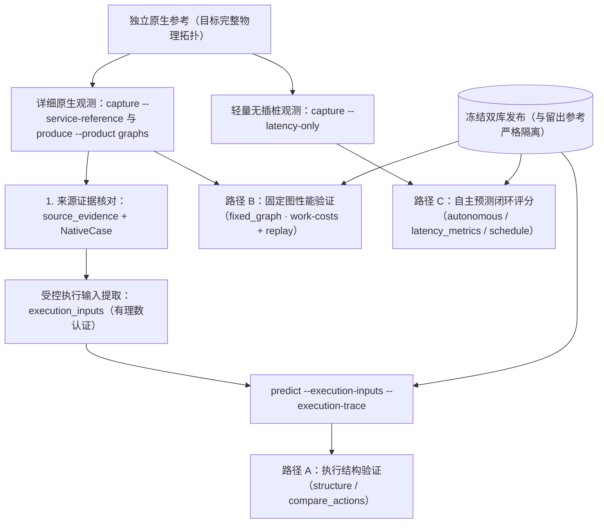

# 独立验证体系、对照算法与证据资格

Prologue 将结构正确性、局部成本建模与端到端时序精度拆分为**三条相互独立的验证路径**，并配以来源证据核对、局部构图验证与冻结留出矩阵，防止结构误差、时钟不确定性与成本误差相互掩盖。所有单案例验证实现集中在 [`src/prologue/verification/`](../../src/prologue/verification/)，场景编排与矩阵驱动归 [`example/coarse_graph/`](../../example/coarse_graph/)。

宿主统一入口为 `python3 -m prologue verify`。证据核对及平台交接在 `verification/core/`。结构、固定真实图和自主预测各有一个子包，共用运行目录、来源隔离检查和原子结果发布。已有执行轨迹可交给 `structure --compare-only`。已有 token 发布可交给 `autonomous --metrics-only`，批次分歧使用 `autonomous --schedule-diff`。这些模式复用正式比较器，各自的 `--help` 列出需要的输入。

## 一、隔离红线与通用资格原则

- **完整物理拓扑真值**：三条路径的独立参考均来自目标完整物理拓扑的原生运行（单 worker 为单卡，多 worker 为实际物理放置联合运行）。同一冻结矩阵内，单卡分片与完整拓扑两种建库来源可共用同一物理目标的详细图（仅投影一次粗图）与轻量参考；仅有单卡分片记录且缺多卡参考时标为缺少完整拓扑真值。
- **训练与留出硬隔离**：三条路径的 `result.json` 均在 `training` 字段登记本次目标原生尝试及与所选模板/成本训练来源的关系。目标曾用于训练返回 `reference_used_for_training`，样本缺少可核对来源身份返回 `training_origin_unverified`。用于返修规则、模板或成本模型的留出案例立即转为开发用途，新的独立结论须另取留出。
- **输入一致与候选拒绝**：验证入口先核对目标模型、配置、请求（含前缀与 EP 路由）及提交分组；详细取证另核对各 rank 实际加载模型，轻量计时核对 `specialization_loads` 与实际提交次序。结构候选因实测布局不符被拒时，`first_rejected_action` 报告原生 rank、调用范围与局部差异。
- **禁止以弱指标替代证明**：不得以总节点数、逐 kernel 名称、相同批次或总时长接近替代因果与结构证明；粗图匹配不代表数值计算或性能精度通过。

## 二、来源证据独立检查（`source_evidence` & `NativeCase`）

`python3 -m prologue verify source` 运行在无设备宿主环境中，涉及校准时钟求解时使用 SciPy，仅加载无设备依赖的原始区间/计数转换与缓冲区布局类型，不安装推理框架或调用生产解释器，不修改任何业务资产。验证已发布双库中的模板时传入 `--libraries`，按原生尝试身份与物理部署逐角色核对发布的定义、绑定与端口是否仍与原生产一致。

### 1. 共享 `NativeCase` 阶段与映射核对

- **原生整组独立构建**：来源检查与预测对照共用 [`native_case.py`](../../src/prologue/verification/core/native_case.py) 与 [`contents.py`](../../src/prologue/verification/core/contents.py) 构成的 `NativeCase` 阶段——仅消费原生记录与粗图，建立全 rank 动作身份、注册池、已观察绑定、通信轮次、CPU 消息与 PD 前置关系，**绝不因预测协议错误取消原生图构建**。
- **声明、端口与 SDK 顺序核对**：
  - 先核对生产清单完整覆盖 `observed_roles`，按共同框架 ABI 检查实现、输入、guard、张量端口（集合/用途/几何/存储版本/写入者/分配所有者，含父转交子就绪点；数据依赖不可重分类为布局元数据）与 shape/token 规则语义（允许二元 `add`/`mul`/`eq` 交换操作数，不按观测值认定公式等价）。
  - 从原始主机记录核对调用进入/返回与 CPU/服务区间计数器和 RAW 测量，核对状态访问声明、`Event`/`Work` 完成代次及异步拷贝/stream 等待；返回 `true` 的查询核对观察路径，`false` 不强加等待。
  - **SDK 编号复用处理**：SDK 任务编号与关联字段非全局实例，编号复用不得导致真实工作合并或拒绝；检查器重建各 stream 实际发生顺序并按 API 关联核对数量、派生坐标与测量（嵌套 API 须指向同一坐标）。
  - **`host_only` 原始核验**：单个显式 `host_only` 片段与合并 CPU 区域均直接核对原始 SDK 任务归属。`outside_scope_tasks` 仅统计窗外或观察器排除区调用；无法关联原生 API 的 SDK 任务仍须被语义 stream 区间与实际计费工作覆盖。
- **PD 载荷独立反演（`pd_payload.py`）**：独立按原生 ABI 将图中逻辑请求范围反向映射到物理页与字节列，对照原始复制覆盖（有效 token 范围排除尾页填充，实传字节单列）；核对元数据预留行字段、偏移、完整覆盖与首 token 生产者到复制读取的数据路径。地址派生的 PD 状态访问单列 `derived_state_accesses`，要求对应其同步服务的原始边界。

### 2. 分段仿射时钟相容检查（`source_clock.py`）

- 保留中点测量上的名义时间倒置，同时检查每个 rank 是否存在同一套、位于实际独立查询区间内的**分段仿射时钟映射**满足全图已测依赖（仅原始采样快照可作分段点，相邻段共享该点校正量，全部 stream 共用映射；两快照只有一段，禁止补中间锚点、逐边独立放宽偏移或回写校正时间）。
- 沿完整 rank 内 DAG 核对实测边界的因果顺序（未测量节点不截断路径），发生倒置即停止，不平移时间或挑拣相容调用。相容不等于精确时钟或跨 rank 时钟已校准，缺测仍为未知。

### 3. `native_case` 四态资格与输出

| `native_case` 状态 | 含义与矩阵处理 |
| --- | --- |
| `consistent` | 所列原生映射与整组检查一致，可进入后续对照 |
| `incomplete` | 存在缺参与者、协议、绑定、操作数或 `unobserved_transfer_peers` 等缺口；仅保留局部证据，不授完整全组因果资格 |
| `differences` | 发现已确认的原生内容矛盾；矩阵停止相关对照 |
| `unverified` | 材料缺失或检查无法完成；矩阵停止相关对照 |

代表来源缺未观测 rank 时不伪造整组资格（预约指向已注册但未观测 peer 记 `unobserved_transfer_peers`；重复预约、未知 endpoint 或已观察 peer 错配直接拒绝）。默认输出精简 Markdown 与每类时间问题前三条的 JSON，`--details` 输出全部位置。

## 三、逻辑上下文、受控执行输入与动作数值证据

### 1. 逻辑上下文与跨运行工作身份

- 采集与无设备控制共用请求进度提取：使用 workload 请求 ID、已生成 token 数、原生已提交 KV 长度与 extend 区间（排除对象地址、物理槽位与 batch 序号），存入 `work.context`。CPU 片段另存 `continuation`（所属操作、进入/退出具名边界与相邻子调用请求上下文），嵌套动作存 `callers`（挂起前快照）。
- **结构对应身份**：由已观察逻辑成员及 token 范围（`work.members`）、动作自身 `context`、`continuation` 与 `callers` 各级 `owner`/`entry` 共同构成；祖先 `context`/`entry_context` 留作诊断与时间资格检查（另一请求留在祖先队列不改变当前请求子调用的身份）。旁路提取与核心消费共用同一身份；无受控消费见证时重复身份不按出现顺序兜底配对。

### 2. 受控执行输入（`execution_inputs`）

在 CPU control 环境运行 `python3 -m prologue verify inputs`，要求全部参与者具备原始记录与带 `--evidence` 的粗图（不读模板或预测）。提取过程先用 SciPy 稀疏优化求候选基，再用 **SymPy 有理数精确重建并认证**原始查询区间、全 rank 必要因果与向上取整开闭区间（同物理设备多记录在重合区间共享同一映射，数值求解成功不替代精确认证）。全部必要事实齐全才发布 `execution-inputs.json` 与 `execution-inputs-report.json`。

| 顶层字段 | 内容与核心校验约束 |
| --- | --- |
| `actors` | 按参与者保存有序 `steps`（`operation`、`identity`、`source`、`bindings`、`boundaries`、`service_ns`）；核心逐步核对身份并推进游标，缺记录、身份不符或结束时仍有未消费条件均失败 |
| `ingress` | 按实例记录 `{time_ns, requests}`（不早于 workload 声明到达）；流程内 input 操作提供返回窗口，范围外空读取按原生停驻取消 |
| `notifications` | 按逻辑生产者身份提供完成窗口，消费一次且须满足实际信号依赖 |
| `transfers` | 引用已核对 CPU post 的 `{group, step}` 及 `service_ns`/窗口，核对两端角色与几何（不按通道计数跨运行配对） |
| `context_values` | 文件内共享上下文值索引表 |
| `layouts` | 经 `prologue action-layouts` 生成的动作切图来源映射；`endpoints` 为 `[source_event, time_ns]`，经 API 与 SDK 证实的纯因果等待标 `null` |

- **动作 `boundaries` 与 `bindings`**：具名端口用 `{port, direction}`（须含 `call.enter`/`call.return`），未命名资源收尾依次按 `{resource: {port, direction}}` 与唯一 `{resource: {kind, role}}` 绑定，不传入原生线程/stream 编号；歧义即失格。PD 的 `bindings.transport_order` 来自独立核对的原生同步服务 CPU 进入顺序与目的池，隔离后台预约到达的非确定性（独立评价须从原始证据重建核对，不读输入文件自证）。
- **单卡来源 `--peer-handoffs`**：需实机参考中有已核对跨 rank 交接边。布局相同的调用用逐端点实测；其余调用用具名端口与同调用同线程职责唯一对应的宿主线程完成点，内部未知工作仍由依赖约束。
- **三类时间条件资格**：分别标记为 `checked_causal_execution_inputs`（局部条件）、`fully_matched_native_endpoints`（全节点端点）与 `measured_action_endpoints_and_checked_cpu_protocol_bounds`（含 CPU 协议范围约束）。

### 3. 状态查询、协议状态与动作数值证据

- **`state_queries`（`event` / `transport` / `metadata`）**：每个 query 动作恰有一条读取记录（无查询存空数组，缺字段不等同无查询）。Event 返回 `true` 仅证完成不晚于查询返回，`false` 仅证不早于查询开始，不替换设备完成时间；单次观察不授予重复就绪读取的跨运行逐次对应。
- **`protocol_states` 与 PD 预约链路**：`protocol_requests` 映射预约号至 workload 请求，`protocol_states` 记录非失败状态单调迁移的 RAW 区间（重叠取交集）；`kv_reservation`、`reservation_receipts` 与 `kv_ready` 缺失分别记入 `missing_publications` 与 `missing_reservation_receipts`。
- **详细观察下的 `action_values`**：在测量区间外获取、不进模板与旁路，覆盖三类载荷核对：① CPU collective（`values.collective.input/output`，广播仅记根输入，独立核对广播/收集/MIN）；② `MLPSyncBatchInfo.all_gather`（`values.batch_sync` 7 项本地输入与 5 项输出，唯一可对应调用做跨运行值比对）；③ 持久字段（`values.state` 记录 PD `set_buf` 与 `commit` 实际值，按逻辑请求比对）。
- **策略时钟与输入拉取**：策略时钟沿声明消费者绑定，核心明细携带 `clock_epoch_ns`（保留原生 `0` 未设置约定）；poll 内时钟记入对应 query 的 `clocks` 数组。可选 `request_input_attempts` 与 `resource_trace`（含 `reads`、`bindings`、`state_slots`）仅作验证证据，不新增业务节点或状态。

## 四、结构比较器与局部构图验证

### 1. 给定真实动作的局部构图验证（`prologue_local_graphs` & `verification.local_graphs`）

- 分离导出输入（`prologue_local_graphs actions`）与构图（`expand`）：`expand` 仅接收冻结来源库与动作输入，容器不挂载目标图、输出 shape、内部依赖或模型文件；EP 通信按 workload 路由、成员与补齐行共用原生控制实现推导逐对端收发行数。
- 每动作输出一条 `local_graph`（失败保留 error 继续收齐），末尾 `local_summary` 核对 `attempted`/`built`。`verification.local_graphs` 仅核对诱导子图与动态流等待合同；同源还原与留出目标须分开，不授予调度、成本、跨图绑定或泛化资格。

### 2. 完整 Serving 结构比较（`verification.structure` & `compare_actions`）

`structure` 串联参考核验、`action-layouts`、`execution_inputs`、`predict --execution-inputs --execution-trace` 与 `compare_actions`，记录各步墙钟。`compare_actions` 先独立运行 `NativeCase` 再消费预测明细，并独立认证分段仿射时钟（不读输入条件中的时钟映射自证）：

| 核对维度 | 算法与判定规则 |
| --- | --- |
| **动作内容与局部依赖** | 按父子调用位置核对层次、参数、端口、张量（dtype/shape/别名/相对版本/生产者）、工作、KV/槽位访问与通信参与者；经原始核验的 `host_only` 片段按共同 CPU 内容类核对，受控运行经 `condition_used` 建立逐次对应（无见证的重复结构仅核共享内容与运行内安全）。 |
| **全 Rank 跨动作次序（`action_order`）** | 先核实模型通信、CPU 协议与 PD 前提并连接全 rank 图，再在完整全 rank 图上投影已配对具名边界（保留路径中未配对调用与远端中转）。活动前沿实时剔除严格祖先、去传递冗余后双向检查最小关系（缺失/额外/反向/跨 rank），事件别名划分须一致。协议不足时明确报证据不足，不退回弱图通过。 |
| **流同步重建（`stream_synchronization`）** | 仅在开启 trace 时于流接收/主机等待边界记录 `activation`，由此独立重建队列前沿并核对动态等待边：须覆盖等待当时已接收工作与最近完成前沿，禁反向阻塞未来命令；缺事实记 `stream_evidence`，漏/多边记 `stream_frontier`。 |
| **跨调用状态生命周期（`state_lifetimes`）** | 核对非空边界可见张量的覆盖冲突、非空 KV 逻辑范围的物理绑定完整性与字段行绑定（释放不擦除在途访问、同 `publication` 可并行写）。资源操作允许两次运行绝对页号/槽位号不同，但同运行内同一物理位置跨释放保持身份以暴露复用变化。 |
| **PD 协议与 Decode 准入** | 核对传输完成、末块元数据、`cross_rank_dependencies`（单列未验证跨 rank 关系）及普通 Decode 准入（连接传输读取、元数据门控、attention-TP 协调组 MIN 输入/输出与准入消费，分报 `native_admission_operands`/`native_admission_decisions`/`pd_read_prerequisites`）。 |
| **CPU P2P 与完整/前缀范围** | 核对两端 post、wire 就绪与消费因果；按末尾 `end` 区分完整运行与停止前缀（`comparison_scope` 标明完整或观察前缀，前缀整例仍为 `partial`）。 |

`actions.json` 默认保留每类首处差异（`--details` 留全部），`actions.md` 为精简入口。`actions_matched` 为真仅代表所列检查通过，整例结论仍须综合 `condition_inputs` 覆盖、未消费输入与时钟校准。

## 五、固定真实执行图性能验证与误差归因（`fixed_graph`）

固定图验证由 `capture --service-reference` 与 `produce --product graphs --keep-intermediates` 取得同次主机活动与实测粗图，经 `prologue work-costs` 与 `prologue replay` 分三步执行：

1. **固定真实执行结构**：保留已发生的批次、工作、实参、角色、到达、初态、因果与资源次序及独立并发；每项真实成本取同次工作中可分离的自身服务，排除观察器活动、设备同步等待与同步搬运（轻量请求时延不能充当内部服务标签）。
2. **建立实测基线**：用共同时间线 `prologue replay` 沿真实服务时长、依赖与外部条件重算事件时刻。无前驱主机入口由实测释放；工作外独立测得的 CPU 活动、采集器开销与抢占作为各场景共享固定时长；请求输出核对发布端口是否重现同一 rank 发送区间末端并报区间宽度。**只有实测基线在测量与校准误差内重现参考，且有效窗口有特化观测并无新增 Triton 特化加载，才有资格进入成本误差归因。**
3. **仅替换服务时长并归因**：换入与自主预测相同的 C++23 成本资产（支持按工作类别、区域、阶段或传输端口身份分组单独换入预测成本，其余沿用实测），输出每组覆盖、带符号服务误差、首个偏离端点与请求指标。对疑似误差源逐类恢复实测重算以定位关键链（关键链可切换，各组改善量不可直接相加）。

### 关键实测边界与调度唤醒处理

- **输入外部释放**：空闲输入绑定宿主线程实测恢复位置（请求提交须落入相邻两次读取间唯一空闲等待）；活动读取绑定完整调用返回作为控制器外部交付时刻。重算同时满足本地进度与外部交付条件，基线另单独核对加约束前本地进度，防约束掩盖回算错误。
- **跨线程 SDK 队列与内核唤醒**：保留已配对的跨线程入队至取队时长及持续运行提交线程的独立活动；软件队列通知按同一描述符核对读写总量并用线程间内核唤醒确认释放方（[Linux eventfd(2)](https://man7.org/linux/man-pages/man2/eventfd.2.html)）。内核在记录线程切出前发出的提前唤醒，仅在定向记录无丢失、执行片段完整、恢复前无更晚唤醒且候选唯一时绑定（[openEuler 唤醒实现](https://github.com/openeuler-mirror/kernel/blob/openEuler-22.03-LTS/kernel/sched/core.c#L2670)）。
- **宿主分段拆分与设备派发**：宿主工作可在实测队列等待处按实测自身服务比例拆分；线程全程运行且设备前驱在进入同步前已就绪时，按 SDK 入口拆分调用准备与就绪后处理。设备派发与载荷共用独立校时，从驱动提交、前项完成与当前启动取证（前项未入图须有原始完成证据，首次校时前结束仅给顺序上界）。采集器补记的设备流标记在未承担计费或真实信号时仅作端口上界，供基线偏差时求未解释局部等待下界。

## 六、自主闭环评分与冻结矩阵工作流

### 1. 自主闭环评分与首次分歧定位

- **端到端评分（`autonomous` & `latency_metrics`）**：对比无 profiler 的轻量原生参考（`capture --latency-only`，核对 `specialization_loads` 与实际提交偏差/次序）。原生 TTFT 从实际提交给 Engine 起算，仿真从 workload 声明到达起算，均在调度器发布首 token 处结束（区分 `ResultProcessed` 与 `RequestOutput`）。逐请求保留带符号误差；TTFT 与 TPOT 各列请求总数、可计分数、实测零分母数（保留绝对误差）与不适用数（单输出 token 的 TPOT 不适用）。**正式自主预测留出精度要求 TTFT 与 TPOT 的 MAPE 各自低于 6%**（启动前固定统计粒度与排除项）。
- **调度分歧归因（`schedule`）**：固定图基线通过后，将自主预测与固定图对照；若固定图接近实测而自主误差显著，`python3 -m prologue verify autonomous --schedule-diff` 对照详细参考的请求阶段、批次成员与 token 范围，定位首个动作/读取/状态分歧及其读入、释放与前次共同批次时序依据，区分“成本经反馈放大”与“输入/结构/资源语义差异”。

### 2. 冻结留出矩阵（`prepare_matrix.py` & `matrix.py`）

1. **声明与冻结**：在覆盖声明中定义配置、训练探针、留出请求的循环 `patterns` 与可选 `draw_group`（成对案例按同序号只改指定因素；MoE 可声明分层专家偏移）；封存实现、镜像、来源与成本，记录交付提交或冻结清单内容摘要作为 `--seed`。
2. **一次抽样**：执行 `prepare_matrix.py` 按种子一次抽出留出目标并通过请求合同校验；固定库域仅复核原集合不占用设备。
3. **分阶段执行**：执行 `matrix.py` 依次推进 `sources`、`detailed` / `light` / `targets`（共用物理目标时分别采集详细与轻量参考）、`compare`、`fixed` 与 `autonomous`。在 `results/<矩阵名>/` 发布精简索引 `sources.json`、`targets.json`、`comparisons.json`，单案例详细输出落在 `cases/<案例名>/`；预测中途失败仍可用 `execution.partial.jsonl` 核对已完成前缀。
