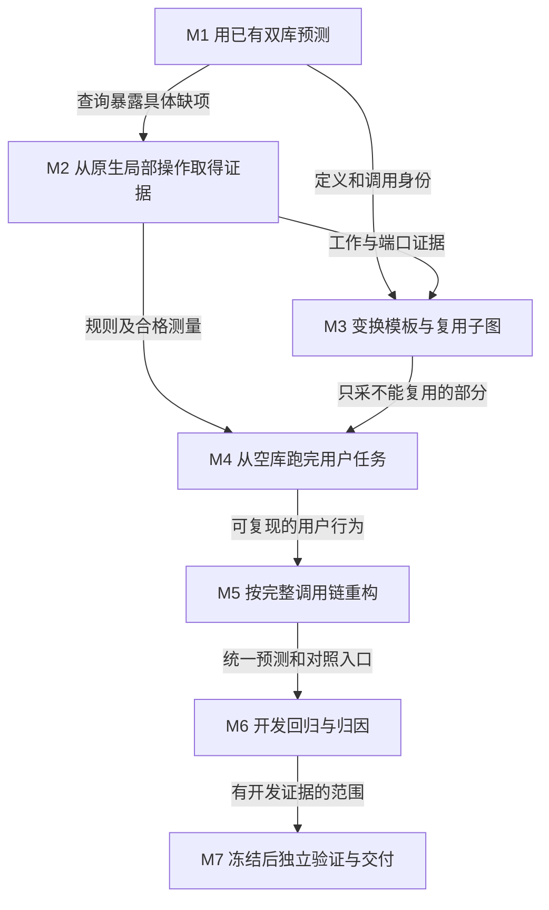

# 双库预测、轻量采集与主流程重构

**开始日期**　2026-11-24

**目标**　用户提交一个模型、多份配置和多组请求，Prologue 用长期维护的模板库生成执行图，用长期维护的性能库为图中的工作提供时延。缺什么就定位到哪一次调用、哪一个端口或哪一种工作，再单独取得所需证据。换一批请求后继续使用这两个库。

**两个关键交付点**　R04 让已经有库的人能移走旧任务目录，直接预测。R20 让第一次使用的人从两个空库出发，通过局部采集得到完整预测。从前者走到后者，要先判断已有模板能推出哪些事实，再确定剩下的事实最少需要运行哪段原生代码。整个窗口分 7 个阶段、40 轮。R01–R33 包含 M5 的 6 轮集中重构，F01–F07 是穿插在其余阶段的 7 轮独立重构。

## 一、一次预测怎样走完

以 Qwen3-8B 为例。用户给出一个模型、两份配置和两组请求，应得到四行结果。两份配置同时改变 KV 池容量和最大并发请求数，适合检查整条流程能否跨配置复用。旧版首次完成四个目标共花了四次原生尝试，显式复用上次任务后，另外四个目标已能零次新增尝试。新版要做到命中时只带上库就能换任务，未命中时能指出缺哪段结构或哪项成本，只为取得这些缺失证据安排采集，并计入所需的准备费用。[公开输入](../../../example/coarse_graph/input.json) · [旧版首次运行与显式复用记录](../../../data/20261121T072804Z_release-validation/verified.json)

1. **确定从什么状态开始。** 每次预测固定模板库和性能库的发布。框架适配器从模型、配置和原生控制入口取得起始角色与初态。遇到只能在初始化时观察的页布局或工作区，立即提出具体查询，转到第 4 步。这样即使两个库都是空的，系统也能提出第一个可回答的问题。
2. **把一次决定展开成工作。** 原生控制代码在模拟时钟和资源状态下决定下一步，例如接纳 A、B 准备 Decode。核心用动作、角色、实参和状态查模板，按已证明的条件计算形状、搬运量、子调用次数，绑定页、缓冲区和依赖。遇到不能复用的边界，带着父调用和缺少的端口转到第 4 步。
3. **给实际工作赋时，再让控制器做下一次决定。** 图中每项需要计时的工作按自身特征查性能库。时延、依赖和资源占用共同决定何时完成。完成事件返回控制器，回到第 2 步，直到最后一个 token 发布。即使结构完全命中，某项成本仍可能超出实测范围，此时只把该工作交给第 4 步。
4. **只补挡住预测的事实。** 只读预测交回原查询即可。允许补库的任务另有采集部署和额度。工作流合并各目标相同的需求，先查已有局部证据，再用登记的规则准备原生状态、执行相应操作、核对证据。只有能回答原查询的结果才进入相应的库。发布后，受影响目标从第 1 步的原始状态重算，其他结果继续有效。遇到规则冲突、无法独立准备、证据不足或额度耗尽，记录确切原因与费用。
5. **让用户读懂这四个结果。** 各配置与请求组列出实际使用的两库发布、完成请求数、P95 首 token 时延、平均 TPOT、吞吐和花费。单输出 token 的 TPOT 标明不适用。部分完成的目标列出第一处阻塞和所缺证据，维护者可以据此判断需要扩展哪条规则。

### 两种采集部署与独立验证

| 要完成的事 | 在哪里执行什么 | 证据怎样使用 |
| --- | --- | --- |
| 单卡建库或补库（`single_device`） | 在一张物理卡上运行目标分片，按需轮流观察代表角色。 | 将可证的结构、端口和本地工作时延交给双库。真实跨卡耗时可引用另行实测、与链路和载荷相符的生产样本。 |
| 完整拓扑建库或补库（`full`，默认） | 目标 rank 在各自物理卡上共同运行，按同一规则只执行缺项需要的原生操作，例如一次 TP2 集合通信。 | 向同一双库提交结构或时延证据。发布跨卡样本须核对实际链路、对端就绪和设备完成的测量依据。 |
| 独立验证 | 在目标完整物理拓扑上另跑留出请求，或读取已独立保存的同条件参考。单 worker 目标用一张卡，多 worker 目标按真实部署共同执行。 | 详细参考用于时间注入和固定真实图，轻量参考用于自主预测结束后的评分。两种采集来源均可对照这些参考，目标记录与生产资产分别存放，禁止用于本次建库、拟合或补缺。 |

采集模式决定如何放置设备，规则决定本次要执行哪段原生代码。两种模式的生产任务都走局部取证，完整服务留给独立目标和开销对照。所选模式缺少设备、对端或合格测量时，返回具体缺项。旧发布和历史原始记录可作标明来源的开发回归材料，空库交付从实际取得的证据开始。

### 两个库分别记什么

| 长期维护的内容 | 记录的最小对象 | 一次更新的影响 |
| --- | --- | --- |
| 模板库 | 局部定义保存自身工作、输入输出端口、必要因果与资源效果。父调用保存对子模板的引用、实参映射和连接方式。可变参数、适用条件及来源随定义保存。 | 新调用优先绑定已有定义。只在内容确实变化处增加定义。父调用能看到的接口发生变化时，重查引用它的父调用。 |
| 性能库 | 工作身份、角色与运行环境、有效特征、测量区间、合格样本、模型族和拟合范围。一个语义子图可以包含若干独立计时的工作。 | 只缺某项工作在给定特征下的时延时，只更新其样本或模型。性能变化可能改变后续组批，因此用到该成本的目标需要重算。 |

两库各自更新。一条轻量发布记录固定两者的引用和适用的实现身份，使运行可以复现。系统负责维护这两个业务库。开发者在对应适配器中维护采集规则及正反例，入库条目记录使用了哪条规则及原生来源。日常使用者只提交任务。任务目录保存输入、摘要、费用和可选明细，移开旧任务目录后仍能预测。

## 二、采集规则怎样写，怎样防止越写越多

**图模板规定如何使用已有结构。采集规则模板规定如何取得一份真实证据。** 每加一种原生取证方法，维护者通过同一登记入口回答下表中的问题。两个例子使用相同的规则格式，状态准备和观察方法落在对应适配器。

| 规则中必填的内容 | PD 页表装配的结构采集 | Decode attention 的性能采集 |
| --- | --- | --- |
| 要回答的查询、适用域 | 哪些已准入成员要写哪些页表片段。声明角色、页布局和端口类型。 | 哪个后端、角色、dtype 的具体工作，在给定 query 和上下文特征下花多久。 |
| 所需前置状态、由谁建立 | 用原生槽位与页池形成实际分配，取得可核对的本地就绪和成员事实。远端传输完成另有依据。 | 用原生分配器和模型运行入口准备活跃请求、实际 KV、读写位置及已预热的工作区。 |
| 执行切口与观测范围 | 调用原生批准备中负责装配的局部操作，记录成员次序、视图、写入范围、子调用以及就绪端口。 | 调用与 serving 相同的 attention 执行路径，回读输入布局、实际设备任务及开始和完成边界。 |
| 交付物与等价判据 | 交付可编译的局部事实。验证等待中的成员未写入，写入覆盖相应切片，消费者依赖成立。 | 交付有单位、有来源的服务区间。核对实际读到的 KV、阶段、设备工作和计时口径。主机 API 返回只证明主机端的边界。 |
| 费用、复用与停止条件 | 复用已存在的复制子定义，记录父调用所付费用和真实执行的子调用次数。缺准入事实时停止。 | 记录一次初始化可服务哪些坐标，合并兼容点。测不到匹配区间或只剩不相容的候选时不发布。 |

核心定义同一份查询、结构与工作身份。采集层按用户所选部署和规则所需的参与者安排会话、记录开销。框架适配器准备分片与原生状态，平台适配器落实物理放置、解释设备与链路证据。两种部署共用规则登记、归一化、发布与预测入口。每次取证记录用途、模式、参与及详采角色、物理设备和观测区间。结构按对外作用判定能否共用，成本按实际运行条件分别验收。

例如换一款模型，两者仍走相同 attention 实现，只是 head 数不同。适配器从实际加载的模型读取 head 数，同一条规则即可采样，性能库按实际特征判断适用性。系统自动发现缺项、执行已登记的规则并入库。只有原生入口、前置状态或观测含义发生变化，已有规则确实无法表达时，才由开发者增加或修订规则。登记使用现有语言的窄接口和有限操作。两个规则在同一条件下给出不同含义时报告冲突。

**数据怎样真正入库。** 结构规则运行一次局部原生调用，输出该切口内的工作、直接子调用及切口上的端口和效果。现有 C++ 投影和模板编译代码据此生成候选定义，并用未展开前的原查询复查。性能规则将同一个模板工作对应的真实服务区间连同特征交给 Python 拟合，再用预测所用的 C++ 求值入口逐点复查。通过哪种核对就更新哪个库，发布一个局部结果不必等整条请求跑完。[原生事实到模板的现有生产链](../../../src/prologue/acquisition/production.py) · [按工作绑定模型](../../../src/prologue/performance/models.py) · [共同成本求值](../../../src/prologue/performance/work_costs.cpp)

**两项需要提前验证的判断。**

- **观察了局部，不代表采集过程独立。** 历史 PD 案例复用了 1 个复制子定义，A、B 两次调用分别写入 `[0,8)`、`[8,16)`，C 仍在等待。但该观察依赖运行中的两侧服务，宿主收据记录了两张卡。它说明父子复用值得保留。可先把已准入成员和本地可读的 KV 定为父调用输入，用原生分配和实际读写验证本地装配。哪个请求获准、远端何时交付仍由控制器和传输依赖负责。这个切口能否单卡独立运行、是否覆盖真实父调用，需要分别证明。[父调用和切片](../../../data/shared-libraries-on-demand-acquisition/s07/pd-delivery/summary.json) · [实际用卡收据](../../../data/shared-libraries-on-demand-acquisition/s07/native-waiting-host-attempt.json)
- **减少 Engine 启动仍可能很贵。** 历史 attention 案例在长度 9 和 17 得到 8 个等价工作点，局部路径启动一次 ModelRunner、零次完整 Engine，用了 98.06 卡秒，完整对照用了 227.20 卡秒。这个结果支持复用模型初始化，尚不能说明每类工作都能超低开销。每类规则分别报告冷启动总量、热会话多采一个点的增量、后处理和每个合格点的费用。[原始开销与 KV 回读](../../../data/shared-libraries-on-demand-acquisition/s08/cost-sampling/delivery-summary.json)

## 三、怎样用少量模板覆盖不同目标

按原生调用中实际可见的边界分层，例如“模型前向 → 一层 decoder → attention → 可计时的设备工作”。仅在能独立复用、能有限变换或必须暴露依赖的位置切分。一个 CPU 调用返回后，设备端可能仍在写 KV。即使隐藏了内部事件，父图也必须能区分“主机已返回”和“该页可读”。父子嵌套的工作各计自身服务，避免重叠计费。[既有父子接口](../../../src/prologue/templates/library.hpp) · [跨动作资源依赖](../../../src/prologue/serving/execution/dependencies.cpp)

| 预测遇到的情况 | 结构与采集如何处理 |
| --- | --- |
| 同一实现，只变了尺寸 | 固定实现、dtype、页布局和分支条件。可变参数由调用实参或真实状态导出。形状、字节数、切片边界用有来源的有限表达式计算，再实例化。采集与选择共用条件。 |
| 工作重复次数变化 | 例如父调用按已准入成员顺序拼页表。每个成员调用同一个复制定义，当前成员的长度决定目标切片的终点，前面成员长度之和决定起点。成员数变化时为每次调用单独绑定输入、输出及依赖。 |
| 同一个父调用中，一个子分支新增 | 查询沿调用树停在第一个不适用的子调用。只采这个子分支。其端口、对外可见读写和就绪条件仍相容时继续共用父定义。若变化会影响兄弟或父调用，则重查实际受影响的边界。 |
| 子定义都在，父连接未知 | 采父调用的成员、次序、映射和因果。已经绑定的子工作可以真实执行，避免重复开启子内部 profiler。任意多份孤立的子图都不能自行证明父调用的连接次序。 |
| 超出有效范围或多个候选成立 | 区分“需要新证据”和“已有条件表述错误”。对前者只采不能复用的部分，对后者修正规则或参数声明。一个已实际观察到的原生分支才可以新增对应结构。 |

**模板不随请求实例增长的判据。** 对处于同一适用分支的不同长度、不同到达或不同重复次数，调用实例可以增加，已覆盖部分的定义数和新增采集数应为零。跨页、换后端、换模型或并行布局时分别检查原生分支、角色分片、端口与工作特征。结构等价可以复用图，跨角色共用时延还需有测量依据。单卡能真实执行本地分片。跨卡服务时间由匹配拓扑、方向及载荷的独立物理样本提供，缺样本时保留通信依赖和成本缺口。

沿同一个例子看各轮为什么相接。历史 PD 记录中，两个成员各复制 8 项，写入 `[0,8)`、`[8,16)`。假设第二个成员变为 12 项。以下是待验证的三种结果，历史记录只覆盖前述 8 项的父调用。

- **只变长度。** R11 依据原生布局计算出第二段是 `[8,20)`，R12 将两次子调用接回同一个父图。若分支、容量和端口条件仍满足，验收时仍应看到两次调用，共用原有定义，第二次绑定新的长度和切片，新增结构采集为零。
- **结构已知，时延未知。** 该工作通过 R03 的成本查询发现 12 项超出测量范围，R17 指出具体模型与特征缺口。R19 据此安排该工作所需的局部测量，经 R18 只发布性能库的增量，再从原始状态重算受影响的目标。
- **出现新的可见作用。** 若原生布局会引入新的同步依赖，R13 先定位到改变的子分支或父连接。相应规则只观测这部分，同一父调用下已能解释的其他子工作继续共用。若同步所需的对端无法在单卡上观察，就报告这个具体缺口。

## 四、代码准备怎样重组

当前有两处直接依赖整次采集任务。探索入口在模板未命中时走 `prepare_sources`，经 `SourcePlanning` 和 `RepresentativeSources` 组织请求。只读预测的 `PredictionProcess.sources` 也通过 `SourcePlanning.primary` 读取以前的主来源。只有把生产端和这条读取依赖一起换掉，双库才真正独立。旧版的参数表达式、父子调用绑定、原生控制、资源时间线和按工作绑定模型都有实际消费者，应保住其行为。[探索主流程](../../../src/prologue/workflow/exploration.py) · [只读预测入口](../../../src/prologue/app/prediction.py) · [起点提交中的代表请求规划](https://github.com/Entwinedime/Prologue/blob/63c3755/src/prologue/integrations/frameworks/sglang/acquisition/planning.py)

恢复基线中的 `DecodeWindow.collect` 能从缺项构造目标特征，随后会调用整服务 `capture`。局部入口须保留对 head、KV 和设备工作的核对，将执行收窄到原生模型中的目标模块。同步搬运可以直接操作设备张量。两类采集各自准备所需状态，共用会话、额度和结果交付。[独立模型入口](../../../src/prologue/integrations/frameworks/sglang/ascend/attention_runner.py) · [单卡同步搬运](../../../src/prologue/integrations/platforms/ascend/copy_sampling.py)

以下是重组后的职责落点。实现时以真实调用链决定文件的合并、删除或整段重写。路径相对 `src/prologue/`，`example/` 位于仓库根。

| 归属 | 唯一负责的事 |
| --- | --- |
| `app/`、`workflow/` | 前者装配公开命令，后者协调目标、需求、额度、恢复和摘要。只读预测独立于采集器。 |
| `templates/`、`graph/`、`serving/` | C++23 分别管理模板和有限变换、共同图与端口、原生控制交互及资源时间线。图负责表达依赖，执行器负责满足依赖。 |
| `performance/` | 工作类型及有效特征、成本模型注册、样本和模型适用域。Python 离线拟合，C++23 统一求值，规划与验证消费同一判断。 |
| 两库共用的本地发布模块 | 从原有单任务 `acquisition/publication.py` 中分离读取与发布。只负责资产归属、配对发布、持久性和复现。模板与性能的适用性各归领域模块。 |
| `acquisition/` 与 `integrations/` | 通用侧拥有采集规则合同和会话生命周期。SGLang 侧维护原生切口、状态和具体规则，Ascend 侧维护设备、时钟和链路。两者结合的特化留在现有框架与平台组合目录。 |
| `verification/`、`example/` | 单案例结构比较、固定图对照和自主评分归正式验证。完整原生参考有独立的取证入口。示例组织输入、留出与矩阵。产品预测和补库均不依赖评价工具。 |

本窗口交付单机 SGLang/Ascend 的两种生产采集部署。同一 Qwen3-8B TP2 案例检验单卡分片和双卡原生操作能否接入同一双库。只有一张卡的用户仍可建库、补库和预测，可导入其他机器测得的合格通信样本。多卡目标的独立结论另需对应的完整物理参考。多机、新框架、NVIDIA 和长流量全量标定留在后续范围。已有 TP、PP、EP、PD、分块、混批和前缀缓存的行为按原已证明的范围保留，迁移资产与本窗口局部建库的能力分别交付。

## 五、实施顺序与每一轮的理由

先解决用户能否使用库，再解决库怎样长出来。局部采集回答“怎样取得证据”，模板变换回答“已有证据能覆盖多远”。读库、采集、模板等接口有了真实调用方，就在更多地方复用它们前安排独立重构。等空库和热库都跑通，M5 再沿完整用户任务整理跨模块的状态、依赖和公开入口。开发回归和独立验证分别检验这些能力在已知和新输入上的表现。

每轮的“交接”按 **输入 → 交付物 → 使用者** 阅读。M1–M7 规定阶段审查和提交的先后，轮次的技术前提看实际输入。比如 R02 和 R03 各自从旧资产开始，R04 才同时依赖两者。R09 与 R14 分别限制可以声明的 PD 和多角色能力，TP1 空库示例用自身的证据验收。前期各轮在隔离的候选资产中复查原查询，长期发布和并发更新集中在 R18。

### M1　先交付一个只读双库就能用的预测器（R01–R04、F01）

用户首先需要带走两个库，在另一项任务中直接预测。先用已经合格的旧资产检验读取端，能把“库读不对”和“新采集方法取错了”分开。模板回答会做什么，性能库回答这些工作各需多久，R02 和 R03 可分别推进，在 R04 汇合。

#### R01　建立恢复基线

- **为什么做**　恢复了旧源码，仍要知道哪些行为能复现、哪些缺口原先就存在。否则改造后看到一个误差或缺项，无法判断是否由改造引入。
- **改动与验收**　用恢复的源码构建正式镜像和 C++23 程序，复算留存的 Qwen 四目标和 PD 固定图。把历史记录、本次复算和已知缺口分开。例如 PD 旧例有 80,020 个实测边界可核对，换预测时延后仍缺成本。
- **交接**　归档前提交 `63c3755`、独立原生参考 → 可复算的输入、产物及已有行为的对照 → R02、R03 用于迁移，R27、R28 用于判断回归。

#### R02　模板库独立可读

- **为什么做**　旧预测器经来源任务的目录找到模板、角色和初态。用户要跨任务共享结构，就必须能单独拿走使一次调用展开所需的内容。
- **改动与验收**　从一份可用来源分离定义、调用、端口、参数和角色绑定。移开原任务目录后，同一实参应展开同一动作。拿掉一个子定义，应指出具体缺失的调用。
- **交接**　R01 的真实模板、调用及角色对照 → 可单独读取的模板发布与结构查询 → R04 接入预测，R10 用于区分定义和实例。

#### R03　性能库独立可读

- **为什么做**　旧版已经能按工作绑定模型。用户要在另一个任务中继续用这些测量，系统还得记得测了哪个工作、适用于什么输入，才能防止错用同名节点。
- **改动与验收**　让工作身份、特征、来源、模型和适用范围可独立读取。用两个目标查询同一合格工作，再查同名但后端不符或形状越界的工作，分别得到时延和缺项。
- **交接**　R01 的工作身份、样本和拟合资产 → 独立的成本查询及越界说明 → R04 组合预测，R17 给新增工作绑定模型。

#### R04　切换预测主入口

- **为什么做**　两个库各自可读，还要检验用户命令有没有绕回代表请求。旧版四目标显式复用也能零采集，但必须指向上次任务，结构未命中时还会重新规划代表请求。
- **改动与验收**　让 `predict`、`explore` 和示例使用固定的双库发布。迁走矩阵对 `plan-sources`、`acquire-sources` 的生产依赖，移除 `SourcePlanning.primary`、缺项即 `prepare_sources` 和 `--reuse` 的旧入口，保留独立原生参考入口。无旧任务目录、无采集设备时四个目标仍能预测，空库时返回缺项。
- **交接**　R02 的结构查询和 R03 的成本查询 → 一个只读预测入口，以及它实际遇到的阻塞位置 → F01 收拢各调用方的读取方式，R05 从缺项开始建库，R20 用同一入口交付用户结果。

#### F01　收拢双库读取入口

- **为什么做**　R04 刚让两个命令读到双库。若命令、探索流程和示例各自查找资产或拼装角色，下一轮补库就得兼顾多种读法。
- **改动与验收**　从 `predict`、`explore` 和示例追到同一对发布，合并重复的发布定位和输入装配，清除只供旧来源目录使用的包装。独立原生参考保有自己的读取入口。移开旧任务目录，以 R04 的同一输入核对命中时的结果和未命中时的首个缺项。
- **交接**　R02、R03 的读取合同和 R04 的实际调用方 → 产品共用的只读入口与缺项表示 → R05 使用它提出查询，R18 用原查询复查发布。

### M2　统一采集规则，验证有状态的原生入口（R05–R09、F02）

R04 可以告诉用户“缺了什么”，空库用户还需要系统说明“去哪里、用什么原生状态取得它”。先规定需求和规则的交接，再分别验证无状态搬运、有 KV 的设备工作、需要准入事实的父调用。三例共用 R06。F02 让 PD 可以直接使用整理后的会话入口，PD 自身的取证资格由准入和就绪证据决定。

#### R05　空库提出第一个需求

- **为什么做**　旧路径从一次代表服务取得初始化布局和首个动作。取消这条路径后，系统必须在没有模板时就能提出一个可执行的问题，否则会陷入先有模板才能建模板的循环。
- **改动与验收**　从模型、配置和原生控制入口取得已知事实，把尚不知道的角色布局或首个调用边界写成第一项需求。在隔离空库上核对对象、已知实参及需要回读的事实。后续批次随模拟时间推进再确定。
- **交接**　用户输入、原生控制合同及 F01 统一入口返回的首个缺项 → 有具体对象和缺失条件的查询 → R06 据此选择采集规则，R14 用于准备角色，R15 用于定位主机入口。

#### R06　实现采集规则模板

- **为什么做**　开发者会面对多种原生操作。如果每接一个对象都由工作流重写状态准备、测量解释与发布判断，换模型或后端就会触碰多层代码。
- **改动与验收**　规则声明适用条件、所需角色或真实对端、原生状态、观测、费用与释放。用同一查询分别选择 `single_device` 和 `full`，由适配器决定如何执行。对只在真实链路成立的测量，单卡返回缺少物理证据。保留无匹配、规则冲突、实际未触发三类原判。新增同类规则只改所属适配器，修改规则能查到受影响的条目。
- **交接**　R05 的具体需求 → 适配器可以实现、工作流可以调用的规则合同 → R07、R08、R09 分别验证三类对象，R19 使用它合并采集任务。

#### R07　第一条无状态规则

- **为什么做**　同步搬运已有直接原生采样方法。用一个不依赖请求或 KV 的对象，能单独检查新规则是否把正确的操作数、完成边界和费用交给了库。
- **改动与验收**　通过 R06 调用原生张量搬运，核对方向、字节数和实际完成依据。取得等价证据时完整 Engine 启动应为零。设备间类型转换等不同工作保留独立身份。
- **交接**　R06 的规则合同、现有单卡同步搬运采样器 → 合格的局部工作证据和测量费用 → R10 用它检查叶子定义，R17 用它查询搬运成本。

#### R08　一条有状态的性能规则

- **为什么做**　无状态复制无法说明 attention 是否读了正确的 KV。恢复后的 Decode 采样能找出目标特征，执行仍通向整次采集。要省掉这次启动，还得保住与 serving 相同的底层工作。
- **改动与验收**　在一个 ModelRunner 会话内准备真实槽位及 KV，测两个已知长度。核对角色、后端、操作数与设备区间，用原查询验收。将初始化、热会话新增点及后处理分别计费，缺 KV 或只看到主机返回的样本不进性能库。
- **交接**　R06 的规则合同、真实模型运行入口 → 可核对的 attention 工作、样本和局部开销 → F02 对照两种规则的实现，R16 复用模型工作，R17 检查成本适用范围。

#### F02　归并两种采集规则共用的会话逻辑

- **为什么做**　同步搬运和 Decode attention 一个只需合法张量，一个还需真实 KV。等两条实现都能检查，就看得出它们真正共用什么，PD 规则也有可直接沿用的入口。
- **改动与验收**　沿规则调用到会话释放，合并重复的会话管理、计费和证据交付。SGLang 负责构造 KV，Ascend 负责解释设备完成，结构事实和时延样本各按原口径验收。用 R07、R08 的开发记录核对搬运方向、attention 的 KV 与设备区间，沿正常结束和异常退出两条路径核对资源释放。
- **交接**　R06 的合同和 R07、R08 的两种具体实现 → 采集层共用的会话入口及归属明确的原生操作 → R09 接入 PD 的状态准备，R19 按会话合并需求。

#### R09　一条有状态的父图规则

- **为什么做**　知道两个子调用都执行复制，还不知道谁被准入、谁写哪一段以及下游何时能读。旧 PD 记录证明父子可以复用，取证却依赖两张卡上的服务。必须单独验证父调用能否局部取得。
- **改动与验收**　用原生操作在一张卡上建立已准入成员、槽位和本地可读的 KV，观察真实写入及就绪边界。涉及远端完成时，分别记录单卡可证的本地作用，以及完整拓扑能通过双方局部操作观察的协议事实。若必要状态只能随整轮服务获得，该局部规则保留缺口，两种模式各按自身证据定级。
- **交接**　R06 的规则合同、F02 的会话入口、既有两卡 PD 的准入和切片记录 → 本地父调用能独立取得的证据及仍依赖对端的边界 → R12 据此判断哪些 PD 父子组合可用，R22 用于划清框架状态责任。

### M3　增强有限变换，多层子图只更新必要部分（R10–R14、F03）

M2 即使把一次采集做得很便宜，按每个长度、每种成员组合各存一套图，费用和维护量仍会随目标增长。M3 要决定已有定义能解释什么、哪个未覆盖的外部作用才值得再采。R09 的独立父调用证据只约束 PD 对应的声明，TP1 的参数变换可以用自己的原生证据推进。

本阶段先用 R09 已取得的两成员调用做 R10，两次调用的总长度同为 27，第二笔写入的起点分别为 8 和 19。R10 要从实例化后的图读出各自的写入范围，并用额外写入或等待检验定义能区分实际差异。R11 引入有来源依据的长度与页参数，R12 再把写入组成可复用的子调用。采集时的读回明细留作对照。R13 检查缺项能否落到最小的子调用或连接，F03 统一绑定解释，R14 最后检查角色与物理放置。

#### R10　拆清定义和实例

- **为什么做**　旧代码已有父子接口。改由独立局部观察建库后，同一操作会带着不同的请求 ID、地址和槽位进来。若把这些值做成定义的一部分，就会为每次调用新增模板。
- **改动与验收**　沿切图、归一化、选择和实例化，把具体资源绑定归给本次调用，将对外端口、资源效果与必要因果留在定义。两个调用共用一个定义却各写正确位置，带额外写入或等待的变体仍可区分。
- **交接**　R02 的模板合同、R07 的局部工作证据 → 稳定的定义身份及可变实例绑定 → R11 声明可变参数，R14 判断哪些角色可以共享。

#### R11　有限参数变换

- **为什么做**　两个调用可以同属一种定义，下一步要回答换长度后怎样得到正确的图。只认已观察过的长度会反复补采，无条件放宽匹配又会错过跨页或缓存分支。
- **改动与验收**　为长度、字节数和页片段写出有原生依据的表达式和适用条件。在 16-token 页上对照页内增长、跨页和已有前缀的偏移。同一分支应零新增定义且形状、读写范围正确，越界和歧义指出触发条件。
- **交接**　R10 的定义和实例边界、原生布局事实 → 带适用条件的变换及计算出的端口范围 → R12 据此连接不同实参的子调用。

#### R12　父子调用的组合与替换

- **为什么做**　单个叶子变长已经可算，仍需知道成员数改变时要调用几次、如何传递数据。这个次序和就绪关系只有父调用才能给出。
- **改动与验收**　按已准入成员绑定或重复子调用，连接张量切片、CPU 提交、设备就绪和资源归属。用两个成员或两个父模板复用同一复制定义，核对写入边界及消费者依赖，保留父调用自身工作。
- **交接**　R11 的参数和端口、所选父调用的观测（PD 使用 R09） → 可实例化的父子组合和暴露给父图的依赖 → R13 定位不能复用的部分，R16 组装模型前向。

#### R13　只补最小缺项

- **为什么做**　旧探索入口把未匹配目标交回来源规划。对一个已有大部分定义的目标，系统现在应能区分“子工作缺了”和“子工作都在，只缺连接”。
- **改动与验收**　在隔离的开发发布中分别留出一个父连接和一个真实子分支，按原查询定位并补回。只缺父时新增子定义与子内部观察为零。只缺子时只补该分支，若可见接口变化，再核对实际引用它的父调用。
- **交接**　R12 的调用树、端口和失败查询 → 待补定义、可复用范围及受影响的调用 → F03 核对模板与查询用的是同一套参数和端口，R18 发布增量，R19 合并需求。

#### F03　统一模板选择、实例化和缺项定位对端口的解释

- **为什么做**　引入多角色后，同一子定义要绑定到更多实际资源。若模板编译、候选选择和实例化已各自推导一次切片或适用条件，每个角色都会放大这种分歧。
- **改动与验收**　沿一条父子调用，把参数声明、变换表达式和可见端口归给 C++ 模板定义，调用保存本次绑定。选择、实例化和缺项定位消费这份定义，删除重复推导。复用 R11–R13 的页边界和局部替换案例，核对定义数、实际切片、就绪依赖和首个缺失位置。候选歧义仍须可见。
- **交接**　R10–R13 的定义、实参、依赖和缺项案例 → 多个调用共用的参数与端口解释 → R14 据此判断角色复用，R16 用于组合模型子图。

#### R14　同等角色复用

- **为什么做**　单机 TP1 的变换只需解释一个角色。多卡预测还要知道不同 rank 是否在做同一种工作。旧版已有代表角色，但依托完整 Engine 观察，用户只有一张卡时需要独立入口。
- **改动与验收**　选 Qwen3-8B TP2 的同一开发查询，各取得一份生产来源。`single_device` 在一张卡上观察两个角色的本地分片，`full` 在两张卡上让原生组共同执行所需操作。核对同一工作、实参和端口能否用已有定义，单列跨卡作用与时延所需证据。TP8 旧例仅在单卡详采 rank 0、1，其余角色映射用独立八卡记录核对。PP 首尾、PD 两池和 EP 路由各保留真实职责差异。[历史角色映射与物理对照](../../../data/architecture-acquisition-performance/f1/configuration-evidence.json)
- **交接**　R05 的角色信息、R10 的定义和 F03 统一的端口解释 → 两种来源的角色绑定、可复用模板及物理证据缺口 → R18、R20 验收发布和预测，R22、R27 检查角色解释与结构。

### M4　从两个空库完成第一次正式预测（R15–R20、F04–F05）

M2 给出局部证据，M3 给出复用方法，二者还不能让一个请求从到达到最后一个 token。R15 补控制与主机工作，R16 补模型前向，两条线都向 R17 提交实际计时对象。R18 负责让一个已核对的局部结果长期生效，R19 才能安全地自动补采，R20 将这些能力合在同一个用户入口验证。

#### R15　补齐主机与控制边界

- **为什么做**　一个 NPU 工作测得再准，也回答不了请求何时获准、批次何时发布、下一步何时可以开始。过去随整服一起出现的主机动作，现在需要有明确来源。
- **改动与验收**　对 TP1 的选择、批准备、结果处理和 token 发布逐项取得原生成员、状态效果、提交与完成边界，区分 CPU 自身服务和等待。每个影响控制推进的主机动作可追溯，无法独立取得的必要作用列为真实阻塞。
- **交接**　R05 的起始动作、R06 的局部取证合同 → 主机工作、控制交接和用户输出端口 → R17 为主机自身服务赋时，R20 从端口读取请求结果。

#### R16　补齐模型前向骨架

- **为什么做**　R08 证明一个 attention 工作可取得，无法据此知道完整 Prefill 或 Decode 经过哪些层。若为每层重新取整图，子模板复用带来的节省就会消失。
- **改动与验收**　用原生子模块或一次批次前向取得 embedding、重复层和输出的真实调用次序，按端口接入已有叶子。核对两种阶段从输入到输出的依赖，新增等价层或已覆盖形状时复用相应定义。
- **交接**　R08 的已确认模型工作、R12 的父子组合 → 模型前向模板及实际工作的清单 → R17 为工作绑定模型，R20 与主机动作连接。

#### R17　按工作绑定成本模型

- **为什么做**　R03 能读已有模型，新规则产生的真实工作仍需绑定到正确模型。设备计算、CPU 服务、搬运和通信各有不同的输入与测量范围。
- **改动与验收**　沿用旧版模型后端，按工作和特征登记候选，Python 拟合，C++ 统一求值。调整一个工作族的绑定，检查规划、固定图和自主预测的结果一致。通信无物理样本时保留依赖并准确报缺。
- **交接**　R03 的成本查询、R07/R08 的局部样本、R15/R16 的工作身份 → 可由同一查询验收的局部成本或准确缺项 → F04 收拢工作入库前的成本查询，R18 持久发布，R25 整理完整性能数据链。

#### F04　统一结构工作交给性能库的查询

- **为什么做**　主机和模型前向都接入后，同一工作会经过采样规划、拟合与预测。若各自拼特征、解释单位或判断模型适用范围，入库后就难以判断两个条目是否在描述同一种工作。
- **改动与验收**　取一个主机工作和一个设备工作，追到图端口、采样输入和成本求值。保留各工作族需要的特征，把重复的身份构造和适用域判断收归性能层，Python 用同一份查询安排测量，C++23 统一判断覆盖与求值。用已有命中点和越界点核对各入口得到的时延或缺项，主机等待保持原有的独立边界。
- **交接**　R15、R16 的实际工作和 R17 的模型绑定 → 结构与性能之间可追溯的工作查询 → R18 按此核对新增成本，R19 据此合并相同测量需求。

#### R18　让局部结果持久入库

- **为什么做**　前面各轮只需在隔离候选中证明“这次补对了”。长期运行的两个库还要保证并发、失败或中断时，其他任务能继续使用一对完整发布。
- **改动与验收**　用 R14 的两种结构来源和 R17 核实的对应成本，经同一入口补入模板或性能样本，以原查询复查。可共享的定义只存一份，保留两种来源，时延样本按真实工作、放置和测量域区分。核对单库增量、重复提交、并发及中断。两个目标能共享一次新增证据，并发发布保住双方增量，失败保留原发布，固定旧发布仍能复算。
- **交接**　R13、R14 的结构增量、经 F04 核对的 R17 成本、R02/R03 的读取合同 → 来源可追溯、可复算的双库发布 → R19 据此重跑任务，R20 验收两种部署，R21 明确库的所有权。

#### R19　让补采按需且有上限

- **为什么做**　一次可靠发布解决了怎么写，尚未决定多个目标同缺一项要启动几次。旧流程已对部分成本缺口去重，新流程还要覆盖结构缺项、原生状态准备及中断恢复。
- **改动与验收**　在所选采集部署内合并同一测量条件的需求，共用兼容会话，累计尝试、卡时、后处理和存储。只重跑依据改变的目标。零预算零启动，恢复不重复已完成的采集。所选设备无法取证时交回缺口与原因，切换部署由用户选择。
- **交接**　R06 的采集条件、R13 的最小缺项、R18 的可靠发布 → 一次有费用上限的补采与受影响目标重算 → F05 整理中断时的归属，R20 跑通用户任务，R21 检查整条任务链。

#### F05　收拢补采中断后的发布与恢复

- **为什么做**　一项测量可能已经发布，任务却还未来得及写结果。此时恢复逻辑若只看任务目录，就可能再次启动设备，或者覆盖别的任务刚发布的证据。
- **改动与验收**　沿“测量完成、发布生效、目标重算”逐段确认事实归属。库负责已发布的证据，任务负责需求和累计费用，采集会话负责尝试及释放。删除重复判断完成、重试和回写的路径。用 R18、R19 的中断情形核对，已发布的证据可直接复用，失败尝试仍计费，未完成的工作可继续，固定旧发布的读者仍可复算。
- **交接**　R18 的发布结果、R19 的补采与恢复行为 → 从同一份已发布证据恢复任务的路径 → R20 验收空库与热库，R21 沿公开命令检查资产与运行目录的寿命。

#### R20　空库和热库的用户交付

- **为什么做**　R04 证明用户能使用现成的库。要证明已经取代代表请求采集，还必须让第一次使用的用户从空目录得到完整预测，再让第二次使用的用户享受到复用。
- **改动与验收**　单卡从两个空库运行既定 Qwen3-8B TP1 两配置 × 两组请求，四个目标均须完成且能追到实际局部取证。更换请求 ID、到达和晚到成员后，热库仍须完成四个目标，新增采集与采集端模型加载均为零。另用 R14 的同一 TP2 开发目标检验两种采集部署。
- **交接**　R04 的公开入口、R14 的两种 TP2 生产来源、R15/R16 的工作、R18/R19 的补库及 F05 的恢复路径 → 空库与热库结果、按采集模式可追溯的 TP2 发布和实付费用 → R21–R26 据此重构，R33 从干净检出复验。

**TP2 的双模式验收。** 两种部署分别从没有该 TP2 模板和样本的候选发布出发。复用 R14、R18 属于该部署的生产证据，按需补齐，再经同一预测入口完成同一短请求。记录补回的模板与成本、实际参与的设备和卡时。双方如共用独立通信微基准，单列该来源及其覆盖，单卡本地暂存的时延只计入采集费用。两种生产采集均要求完整 Engine 启动为零。缺少必要证据的模式记为未完成。分开固定发布是为了核对来源，日常使用仍维护同一套双库。

### M5　六轮大型重构，逐条重组完整的生产与验证链（R21–R26）

M5 以 F01–F05 整理过的局部接口和 R20 的空库、热库记录为起点，沿公开命令追完整调用链。例如 F05 处理“发布后中断怎样恢复”，R21 还要跨命令、部署、运行目录和发布模块厘清任务、会话和资产的寿命。六轮各负责一个完整模块族，处理其上下游、构建和说明。已在前面验收的局部整理直接复用其证据，发现具体的跨模块冲突时再调整对应实现。

#### R21　重组任务、采集与持久化

- **为什么做**　切掉代表请求入口只解决了从哪里读数据。任务能中断和恢复，采集会话会结束，库要跨任务保留。三种寿命混在一起，恢复任务就可能重新采集或依赖旧目录。
- **改动与验收**　沿 `app`、`workflow`、`acquisition` 和发布模块重排启动、查询、计费和恢复。任务拥有本次输入与费用，会话占用设备，库拥有资产。核对公开入口能恢复中断任务，已完成的采集不会再次提交，失败尝试的费用仍计入累计。移走旧任务目录后仍可用库，失去消费者的启动和查找路径随之删除。
- **交接**　R18 的持久发布、R19 的恢复记录、R20 的用户用例 → 各有一个所有者的任务、会话和资产，以及可复现的命令入口 → R26 接入公开示例，R33 在干净环境复验。

#### R22　重组框架适配器

- **为什么做**　组批、PD 准入、局部采样都会读成员、槽位和页表。若三处各解释一遍，换一版框架时，采集以为可读的 KV 可能与控制器看到的状态不同。
- **改动与验收**　在 SGLang 适配器内沿原生决策、观察和局部执行追到同一事实来源，合并重复解释，将私有调用收回适配器。让一条同类采集规则只补入口和状态准备即可，检查主机组批和已有 PD 切口的消费者继续取得相同的事实。
- **交接**　R09 的 PD 切口边界、R14 的角色映射、R15 的组批交接及 R20 的主例 → 有唯一框架来源的成员、角色、槽位与状态变化 → R24 绑定图端口，R27 用于核对多角色结构。

#### R23　重组平台与运行环境

- **为什么做**　同一次异步调用可以有主机返回、设备完成两个时刻，下一次 KV 读取依赖后者。采样和验证如果分别解释 trace，可能在同一工作上给出不同边界。
- **改动与验收**　把 Ascend 队列、时钟、设备任务与完成证据交给平台适配器，把进程和容器寿命交给运行层。合并重复解码与进程管理，删除无消费者的导出。用异步写后读核对实际依赖。可省略的等待仍要能回查原始依据。
- **交接**　R07 的搬运、R08 的设备区间和 R20 的实际运行链 → 统一的设备边界及证据来源、独立的运行环境入口 → R24 接依赖，R25 确定计时口径，R26 接参考采集。

#### R24　重组图、模板与执行器

- **为什么做**　R10–R13 解决了局部图怎样变换和复用。若切图、模板展开和执行器各自解释端口，同一条跨批写后读依赖仍可能在模块交接处丢失。
- **改动与验收**　跨 `graph`、`templates`、`serving` 重画定义、调用、实例到执行的路径，归并形状和端口映射，按需要整文件重写。沿一个父端口跟到子工作和实际资源，核对跨批在途工作、释放和控制反馈。替代实现及其 CMake 引用同时清除。
- **交接**　R12、R13 的父子与缺项合同，R22 的框架事实和 R23 的设备完成证据 → 能从模板端口追到实际资源的执行关系 → R26 接入独立验证，R27、R28 分别展开预测图与读取固定图。

#### R25　重组性能数据链

- **为什么做**　R17 允许换模型。要让换模型的效果能解释，采样、拟合、预测和验证还得对“哪个工作、什么单位、适用于哪段输入”给出相同答案。
- **改动与验收**　贯穿采样需求、测量、拟合、注册、求值和缺项回传，归并工作身份、单位与范围判断。用同一实际工作逐步核对。父包络、主机等待和子设备服务应能分别追源，避免同一段时间被重复计入。
- **交接**　R17 的模型绑定、R23 的主机与设备区间 → 所有模式共用的成本查询及其测量依据 → R26 接入正式验证，R28、R29 分别评价局部成本与最终影响。

#### R26　重组验证、示例与对外入口

- **为什么做**　如果矩阵脚本同时解释原生数据、生成预测又裁定差异，换部署或换案例就得复制评价逻辑，也很难确认目标实测有没有提前流入预测。
- **改动与验收**　把单案例验证与评分放在正式验证模块。结构与固定图用详细原生记录，自主预测完成后才读取轻量实测。示例只组织输入和矩阵。同步包导入、Docker、构建和公开命令，删除旧脚本及闲置字段。核对三类命令的依赖、挂载、摘要和按需明细。
- **交接**　R21 的公开入口、R23 的原生证据、R24 的图和 R25 的成本查询 → 可独立调用、与生产输入分开的三条验证路径 → R27–R29 用于开发回归，R30–R32 复用同一方法做独立验收。

### M6　分三次开发回归，分别定位结构、成本和动态反馈（R27–R29、F06）

重构后跑出一个请求时延，单看偏差无法区分图生成错、某项工作赋时错，还是时延改变了后续组批。旧版已有三条验证路径，本阶段要让它们对同一批新库资产给出可相互解释的证据。R27、R28 各自控制一个变量，可以独立做。R29 自主运行，分析差异时才使用前两轮的结论。这里可以集中修复同一机制，优先复用已保存的原始参考。

#### R27　只查执行结构

- **为什么做**　用户首先要知道，若给定实际发生的时间，控制器和双库模板能否生成正确的工作、依赖和资源访问。单看端到端时延相近，检查不出漏掉的工作。
- **改动与验收**　用能按工作身份对应的实测时间驱动原生决策，让预测端自己展开图。核对 Qwen 页边界、TP2、PD，Mistral PP 交接和已触及的混批、缓存与 EP 路由。逐项比较成员、工作、端口、KV、跨角色依赖及发布时间，指出首个差异和实际消费的时间条件，区分实测、区间与缺测。
- **交接**　R01 的参考与行为对照、R14 的角色边界、R26 的结构入口及详细目标原始记录 → 每种结构范围内已对齐的作用、首处差异和证据缺口 → R29 用于区分结构与反馈误差，R30 据此选择有开发支撑的范围。

#### R28　只查性能层

- **为什么做**　即使图正确，一项成本偏大也可能被并发隐藏，另一项同样大的偏差可能直接推迟首个 token。需要在固定的真实图上定位哪项误差传到了请求。
- **改动与验收**　先用实测服务在真实图上回算，再逐类或整体替换已覆盖的工作时延，保持角色交接、输入条件和并发一致。记录端点偏早或偏晚、首个受影响的请求以及可评数量。实测回算没复现、模型缺成本、模型预测有偏差分别给出依据。
- **交接**　R01 的 PD 实测基线、R25 的成本合同、R26 的固定图入口及同域详细原始记录 → 固定图上由工作成本传播到端点和请求的误差归因 → F06 整理两条开发对照的共同取证路径，R29 对照动态反馈，R31 用于独立核对。

#### F06　收拢开发回归中的身份对齐与差异定位

- **为什么做**　R27 和 R28 各自出结论后，需要把“少了一项工作”和“工作存在但缺少时延”追到同一个请求。如果两边各按案例翻译请求、rank 或端口，R29 就很难解释第一次偏离发生在哪里。
- **改动与验收**　在正式验证模块归并重复的参考读取、工作身份对应和证据定位，删除开发时只服务单例的临时转换。原生事实从原始记录取得，结构对照与固定图成本对照分别作判定。用已保存的开发记录复核首个差异、缺测或缺成本的原因及评分分母。若发现原判有误，保留原结果并写明纠正依据。
- **交接**　R27、R28 的独立开发记录及各自判据 → 能追到同一请求和工作、保留证据来源的诊断结果 → R29 在自主预测结束后据此归因，R30、R31 沿用各自的对照入口。

#### R29　查真实用户闭环

- **为什么做**　结构和成本分别合格，还可能因一项成本改变释放时刻，进而改变下一批成员。用户最终关心一组请求多久结束、两种配置怎样排序。
- **改动与验收**　只给定用户输入和双库，用原生控制器自主组批与预测发布时间。结束后才按请求与独立轻量实测核对，通过 F06 将偏离的请求与 R27、R28 的工作、端口或后续决策对应起来。交出两配置排序、TTFT、TPOT、吞吐和各自可评分母，单输出 token 的 TPOT 标明不适用。
- **交接**　R20 的双库任务和 R26 的自主入口，独立轻量实测用于事后评分 → 用户口径的结果、误差及首次反馈分歧 → R32 用同一口径检验新请求，R33 用于说明结果怎样读。

### M7　冻结后独立验证，最后交付干净仓库（F07、R30–R33）

F07 只使用开发材料。F07 结束后、打开任何留出实测前，一次固定代码、规则、双库发布、输入、评价实现、指标分母与费用口径。TP1 保留两种池容量 × 两组全新请求的四个目标，覆盖同刻、错峰到达及页边界。用 Qwen3-8B TP2 的一个新请求序列检验双模式来源，优先合用原定多角色留出。两份来源分别固定发布，同一个目标在完整双卡拓扑取得详细参考供 R30、R31 使用，另取轻量参考供 R32 评分。每种口径的参考都可用于两组结果，避免因建库模式不同重复运行目标。新声明的 PD、其他角色或成本范围各配同域留出。

R30–R32 的独立真值一律来自目标完整物理拓扑。报告写明用哪种模式建库、参考的实际物理放置和联合运行依据。多卡真值无法取得时保留“缺完整拓扑参考”，继续其他可评项。每份发布的三路原判收齐后再归因，返修改动归入新的候选。

#### F07　冻结前清理正式入口的输入装配

- **为什么做**　即使三个命令分别能运行，若示例仍各自选择镜像、库发布或上次任务目录，冻结后很难确认三项结果来自同一套交付物。若轻量实测被顺手挂进自主预测，用户闭环的比较也会失效。
- **改动与验收**　沿三条命令核对包入口、镜像、发布和挂载，清理重复选择资产或隐式读取旧目录的路径。用开发记录确认每种来源的三条路径均固定其对应发布，目标参考来自另外的完整拓扑原生运行。结构路径只注入允许的实测时间，固定图路径读取真实图，自主预测只见用户输入和双库，完成后评分才读取轻量实测。
- **交接**　R26 的正式入口和 R27–R29 的开发用例 → 按来源固定发布、按验证路径限定可见输入的交付入口 → R30–R32 在冻结发布上独立验证，R33 从干净检出复查。

#### R30　独立核对结构泛化

- **为什么做**　R27 的案例参与过开发。要判断有限变换对新请求是否成立，必须在事前固定的定义上预测，并能说清哪些角色有真实的独立证据。
- **改动与验收**　对冻结目标使用实测时间旁路，从详细原生记录独立核对工作、端口、KV 和跨角色因果。列出逻辑 rank、实际详采角色及物理卡数。每个目标区分已匹配、明确差异和证据不足，保留原判。
- **交接**　R27 有开发证据的范围、冻结输入与详细原生参考 → 每个留出目标的结构比较和可支持的范围 → R33 汇总结构能力及缺口。

#### R31　独立核对固定图性能

- **为什么做**　R28 能解释已知图上的误差，还要检验同一套模型和测量口径在未用于调参的目标上是否仍成立。这个问题只需真实图，R30 即使发现结构差异也可以评。
- **改动与验收**　用冻结的模型在真实图上先复现实测基线，再替换已覆盖工作的成本，逐类核对覆盖、带方向的端点偏差及受影响的请求。把未评分的工作、请求和原因保留在总数内。
- **交接**　R28 的实测回算与成本替换方法、冻结性能库及详细原生参考 → 同一发布在新目标上的局部成本误差与传播证据 → R33 汇总性能能力及缺口。

#### R32　独立核对端到端预测

- **为什么做**　用户使用双库时没有真实调度答案。需要用相同留出目标独立检验用户实际得到的延迟、吞吐及可评分比例。
- **改动与验收**　自主预测全部冻结输入，完成后才读取独立轻量实测。逐目标报告 TTFT、TPOT、吞吐、总数与各自可评分母。只有相应范围的 TTFT 和 TPOT 各自低于 6% MAPE 才声明精度达标。收齐三条结果后再结合 R30、R31 归因。
- **交接**　R29 的用户评分口径、冻结的双库与留出输入，轻量实测用于事后评分 → 独立的用户指标、适用分母和原始判定 → R33 汇总闭环交付结论。

#### R33　从干净检出交付

- **为什么做**　开发机上的数据、旧目录和临时脚本会掩盖交付中的隐含依赖。使用者要知道怎么首次建库、下次怎样复用，以及什么情况下还需要新增规则。
- **改动与验收**　从干净检出经正式的构建、镜像与命令入口复查空库、热库和定向补一处三种用法。汇总来源、费用、能力边界、代码净变化及三路原判，核对文档、数据引用和分层提交推送。必要能力未通过就如实登记。用于返修的留出转为开发证据，新的独立结论另取留出。
- **交接**　R20 的正式用法、R21–R26 的公开入口和 R30–R32 的全部原判 → 可复现的交付示例、逐项能力与费用说明、保留未通过项的验收记录 → 使用者据此预测，适配器维护者据此判断何时需要扩展规则。

## 六、怎样判定开销、控制重构规模和完成交付

**开销以取得同样的证据为分母。** 同一模型、角色、状态、工作点和计时范围下，对照双方都允许复用初始化。分别记实际物理卡数、Engine 与 ModelRunner 启动、准备/测量/导出墙钟、卡秒、保留量及峰值。独立真实参考的费用另列。以下指标用于本窗口，实际结果按采集对象逐项给出。

- 已覆盖请求换到达或长度，新增原生测量为零。只缺父连接，新增子定义及子内部观察为零。多个目标缺同一个工作点，合并为一次合格取证。
- 两种正式局部采集启动完整 Engine 的次数均为零。单卡验收只开放一张物理卡，完整拓扑按目标实际占用的所有卡累计卡时，独立验证另计。兼容的 attention 工作点共用一次 ModelRunner 初始化。针对有历史对照的 8 个点，暂定冷启动总卡时目标为同覆盖完整服务路径的一半以内，同时单列热会话新增点的费用。历史对照启动过两次 Engine，需要在双方均可合批的新口径下重测。这个比例只用于该组工作的优化与评审。其他规则在取证前依据已有合格对照定下费用上限，缺可比依据时只报绝对开销。
- 查不到独立原生入口、观测不到必要作用或实际费用超标时，先判断应缩小观察切口、共用一次初始化，还是原生机制本就依赖外部交接。必需能力未取得证据时标明未交付。不能用沿用旧资产、全服务采集、缩小计时口径或删工作来计作成功。

**独立重构与集中重构分别交付。** F01–F07 每轮至少整理一条本阶段已接通的接口，从生产者追到实际消费者。新行为在功能轮交付，独立重构轮负责删除、合并、拆分或重写这条链上的实现，并保住上文列出的可观察行为。若发现两个入口维护同一判定、适配细节进入核心或同类特例开始重复，在冻结前可把对应重构轮提前到下一个调用方接入之前。已确认且能在本阶段解决的问题当场处理。确需等跨模块证据的，记下缺什么、影响谁、由哪一轮接手。

R21–R26 各自至少覆盖一个完整模块族的入口、生产者、消费者、产物及构建。恢复基线的自有 `src` 有 260 个程序文件、43,764 行，其中 SGLang 适配 12,624 行、Ascend 适配 5,993 行、验证 10,318 行。这些数字决定审查的优先次序，删改以实际消费者、语义和取证需求为据。

每轮在现有日志记下职责归属、实际删改路径、保住的行为和最小核对证据，分别记业务与示例的总行、非空行变化。先静态追踪和集中修改，必要的构建与既有案例核对合并进行，可复用同阶段证据。出现冗余只做目录移动或留下一张问题清单，仍属待处理。若上一轮已经收拢该链，列出唯一实现、调用方和已有证据，记为“核对后无需再改”，代码改动只统计一次。达不到计划工作量时记录原因和剩余范围。

**推进与验证分开。** 各功能轮先静态推演，再集中修改和统一构建。M2 用一组留出的局部工作核对取证等价性，M3 用未参与推导的参数核对变换，M4 检查双库从空到可用，再进入范围更广的 M6。保留必要的开发反例，包括候选冲突、子端口不相容、实际设备任务缺证、预算为零和成本域外。留出的例子一旦用来修复就转为开发证据。M7 在固定资产上收齐三条路径的结果后再归因。[多角色固定图的原始结论](../../../data/architecture-acquisition-performance/rounds/12/independent-protocol-reconfirmation/qwen/results/round-12-qwen-protocol-reconfirmation/fixed/full-short/result.json) · [缓存与调度组合的旧参考](../../../data/architecture-acquisition-performance/rounds/16/independent-combination/assessment.json)

**维护与推送以 M1–M7 为边界。** R01–R33、F01–F07 各有独立交付和进度记录，共 40 轮。每阶段启动时用上一阶段实际证据重排本阶段轮次。阶段收尾从 Git 起点审查关联代码、文档和数据，汇总必要的 Docker 构建和公开入口验证，再按职责分层提交推送开发分支。已有数据、冻结参考、归档和主分支各保留原有归属。窗口关闭后在计划页标明实际完成范围，原地保留记录。
