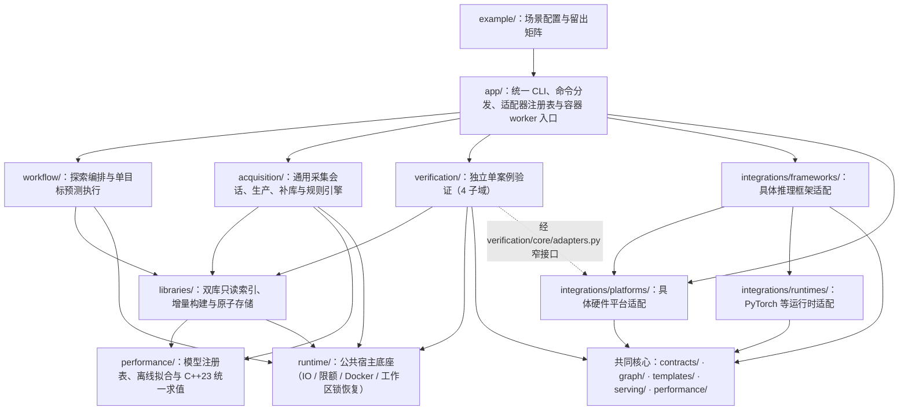
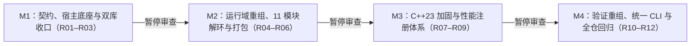

# 全仓架构模块化重构、运行域隔离与统一入口改造

**已关闭**（完成，2026-11-25；代码与回归交付基线 `4e9271a`）。全部 4 阶段 / 12 轮（M1–M4，R01–R12）技术、静态架构、构建打包、代码卫生与零新增卡时回归门禁均通过 AGY 终审。说明：全窗口因全仓 E501 120 列折行、强类型契约显式化及大文件单职责拆分，源码物理行与非空行未实现净收缩（`src/` Python +3,861/+3,553、C++ +205/+128，`example/` +9/+17，`docker/` +52/+44），全部旧入口、转发壳、死分支与冗余基础设施均已清零；本窗口仅在既有开发双库与留存原生参考上完成零新增卡时行为一致性回归，新模型/新框架实机扩展与冻结留出 6% MAPE 精度验收按非目标转交后续独立窗口。

> **协作与人工确认门控**：本计划由 AGY（Gemini）维护，由 Codex 分阶段实施。Codex 执行期间仅更新本窗口 `log.md` 与 `status.md` 的执行态字段，**严禁擅自修改本计划的目标、删除清单、依赖红线、验收标准或约定暂停点**。每个阶段（M1–M4）完成检查并分层推送至开发分支后**必须暂停**，由 AGY 全链审查并经用户确认后再启动下一阶段，不得自动越权跨阶段推进。

**开始日期**　2026-11-25（开发分支 `architecture-modular-refactor`，开窗基线提交 `c7020b3`，源码基线为 M4 交付 `499dd1e`，起始规模 `src/prologue/` 280 文件 / 47,096 行）

**目标**　在严格保持既有预测、局部建库、增量发布、离线拟合与三路验证业务语义不变的前提下，将 Prologue 重构为**运行域 1:1 物理隔离、依赖严格单向无环、职责单一收口、操作入口优雅统一、易于扩展新框架（如 vLLM）/新硬件平台（如 CUDA）/新性能模型族**的整洁模块化架构，并在既有开发发布库与留存原生参考上完成零新增卡时行为回归验收。

## 一、范围、现状诊断与非目标

### 1. 基线问题清单（基于 `499dd1e` 全仓核查）

M1–M4 跑通了双库预测与局部按需补库闭环，但快速演进同时沉淀了以下结构债务，必须在继续扩展新模型、新框架或长窗口验证前一次性清理：

| 类别 | 当前现状与量化事实（`499dd1e`） | 重构目标 |
| --- | --- | --- |
| **通用层硬编码与反向调用** | `acquisition/production.py:142` 硬编码 `"ascend"`，`workflow/exploration.py:30` 硬编码 `"sglang"`，`acquisition/capture.py:89` 硬编码 `/opt/prologue/capture.sh`；`production.py` 与 `costs.py` 存在 4 处子进程反向调 `prologue.app`；`verification/{structure,autonomous}.py` 反向导入 `prologue.app.prediction`。 | 通用编排层零框架/平台硬编码，零 `prologue.app` 反向依赖（含子进程字符串）。 |
| **弱类型 `SimpleNamespace` 透传** | 编排器直接收 `argparse.Namespace`，迫使全仓出现 **19 处** `SimpleNamespace`/`Namespace(...)` 脆弱拼装（含 M4 新增的 `replenishment.py` 与容器 runner）。 | 全部跨层边界改用 `@dataclass(frozen=True, slots=True)` 强类型 Options。 |
| **宿主生命周期与双库存储分散** | 5 个宿主编排器 + `library_store.py` + `shard_transport.py` 重复实现 `fcntl.flock`（7 文件 10 处）、`docker image inspect`（5 处）、二进制快照（`filecmp`/`0o500` 与 `sha256`/`0o700` 分裂）、预留预算状态机（`allowances.py` 与 `limits.py` 重叠）；双库读写与发布散落在 `libraries.py`、`library_store.py`、`library_increment.py`、`templates/publication.py` 四处。 | 沉淀单一公共底座 `runtime/` 与单一双库包 `libraries/`。 |
| **运行域混放与 11 模块循环导入** | `integrations/frameworks/sglang/ascend/` 混放 22 文件（3,557 行：12 宿主 + 9 容器 runner + 1 安装脚本），形成 **11 模块循环导入环**；`platforms/ascend/` 扁平混放 21 个 `.py`（`observation.py` 972 行、`reference.py` 888 行），导致 `sglang/Dockerfile` 既逐文件 cherry-pick 又通配符误拷贝 5 个宿主/验证文件；`__init__.py` 5 有 13 无；Docker 残留 `/workspace/trace-sim`。 | 彻底解散 `sglang/ascend/`，全仓 **0 导入环**，按四大运行域整目录 `COPY`，零误拷贝。 |
| **C++23 契约薄弱与热点函数** | `CoarseProjection::project` 存在 partial-move `use-after-move` 静态风险；`KvPool::plan` 缺负数页差防卫；`local_graphs.cpp` 缺文件打开检查与原子写入；11 处 `read_parameters({{...}}).at(...)` hack；`main.cpp`（456L / 15 命令）、`NativeController::plan`（222L）、`CoarseGraph::validate`（209L）偏大且无框架派发口。 | 补齐基础契约工具与安全防卫，表驱动分发 + 薄框架派发口，拆解热点函数。 |
| **性能模型硬编码双写** | `performance/backends.py`、`models.py` 与 `service_model.cpp` 镜像硬编码模型族名、字段与角色校验，扩展新模型需跨语言改多处分支。 | Python 可注册 `ModelBackend` + 声明式 `BindingRule`，C++ `ServiceModelRegistry` 解耦数学求值与业务角色。 |
| **验证扁平堆积与 CLI 碎片化** | `verification/` 扁平堆 33 文件（10,359 行，20 处散落导入 `sglang`/`ascend`，`compare_actions.py` 单方法 459 行）；公开命令分散在 11 个平铺 `prologue.app` 子命令 + 9 个 `prologue.verification.*` 入口 + 4 个示例脚本。 | `verification/` 按 4 子域解耦重组；交付全新统一的 5 域分层 CLI（`python3 -m prologue <group> <cmd>`），删除旧平铺入口。 |
| **代码卫生积压** | `ruff check src example` 存在 850+ 告警（`E501`/`I001`/`B905`/`B007`），`src/` 残留 30+ 过期 `__pycache__/*.pyc`。 | `ruff check src example` **0 errors**，C++ Release **0 warnings**，清理过期字节码。 |

### 2. 必须保住的既有工程基线与明确非目标

- **必须保住**：`prologue_core` 零越层 include 的洁净性；C++ 核心资源服务对槽位、KV 页与前缀树的唯一所有权；预测无设备无网络隔离与验证独立性（`reference/` 绝不复用 `analysis/observation.py` 的解释结论）；M1–M4 已交付的只读双库预测、局部采集规则、增量发布、自动补库、物理操作数通信拟合与三路验证语义。
- **明确非目标（禁止越界）**：
  - 不实现具体的新推理框架（如 vLLM）或新硬件平台（如 CUDA）后端，不预建空占位目录或万能插件框架；
  - 不开展新的大规模 NPU 真机采集、局部采集冷启动卡时优化（R08 75.5% → 50%）、长流量实验或独立留出 6% MAPE 验收（留归后续窗口）；
  - 不新增独立 test 工程、CTest、pytest、fixture 或 mock；
  - **禁止修改 `.clang-format`**，禁止改动 `third_party/`、`deprecated/`、`data/` 已有实验与发布资产及 `docs/note.md`；
  - 禁止保留旧 CLI 别名、旧路径转发空壳文件或双格式兼容 fallback。

## 二、目标架构蓝图与全新统一 CLI 设计

### 1. 分层依赖图与六条静态红线



重构完成后静态检查必须满足 **0 违规**：
1. `contracts/`、`graph/`、`templates/`、`serving/`、`performance/`、`runtime/`、`libraries/` **零导入** `integrations/`、`app/`、`workflow/`、`acquisition/`、`verification/`、`example/`。
2. `acquisition/` 与 `workflow/` **零出现** `sglang`、`ascend`、`torch_npu`、`hccl` 业务硬编码，**零引用** `prologue.app`（含子进程命令字符串）。
3. `integrations/runtimes/` 与 `integrations/platforms/` **零导入** `integrations/frameworks/`；`platforms/ascend/runtime/` **零导入** `host/` 或 `reference/`。
4. `verification/` **零导入** `prologue.app`。
5. 全仓 Python AST 依赖图 **0 个循环导入环（SCC > 1）**。
6. C++ `prologue_core` **0 条**越层 include，无未编入 `CMakeLists.txt` 的 `.cpp` 或未引用 `.hpp`。

### 2. 目标目录规划（与四大运行域 Host / `sglang` / `control` / `modeling` 1:1 对齐）

```text
src/prologue/
├── __init__.py                        # 全仓所有 Python 子包统一补齐极简 __init__.py
├── __main__.py                        # [Host] 统一 CLI 入口（python3 -m prologue）
├── runtime/                           # [Host + 轻量共享 io.py]
│   ├── io.py                          # read_json / read_jsonl / write_json / content_id / discard_path
│   ├── limits.py                      # AllowanceExhausted / Usage / OperationLimit / retained_bytes
│   ├── docker.py                      # DockerImage.inspect/id / OwnedContainers / ModelingCommand / ModelingProcess
│   └── workspace.py                   # file_lock / TaskWorkspace（原子 staging 初始化、恢复、预算预留）/ BinarySnapshot（SHA-256 + 0o500）
├── libraries/                         # [Host] 唯一双库持久化与只读索引所有者（零反向依赖 acquisition/）
│   ├── release.py                     # LibraryRelease / TemplateCatalog / BoundTemplates / asset_path / summarize()
│   ├── store.py                       # LibraryStore（复用 runtime.workspace.file_lock + 原子 journal）
│   ├── templates.py                   # TemplatePublication（迁自 templates/publication.py）
│   └── increment.py                   # LocalLibraryIncrement（迁自 acquisition/library_increment.py）
├── contracts/                         # [Core: C++ + Python]
│   ├── context_values.hpp · expression.{hpp,cpp}
│   ├── serving.{hpp,cpp}              # 新增 read_integer / read_nonnegative_integer
│   ├── json_io.{hpp,cpp}              # 统一 C++ read_json 与 Publication 原子硬链接写入
│   └── workload/                      # [Host + sglang + control]
├── graph/ · templates/ · serving/     # [Core: modeling C++ + control/host 轻量 Py]
├── performance/                       # [Core: Host + sglang samples.py + modeling C++]
│   ├── registry.py                    # ModelBackendRegistry / BindingRule / ModelBindingRegistry
│   ├── backends.py · models.py · fitting.py · requirements.py · samples.py
│   └── service_model.{hpp,cpp} · work_costs.{hpp,cpp} · work_features.{hpp,cpp}
├── acquisition/                       # [Host 通用采集编排 + sglang 容器 observation/]
│   ├── options.py · adapters.py · budget.py · capture.py · production.py
│   ├── rules.py · replenishment.py · costs.py · fitting.py · recording.py
│   └── observation/                   # [sglang] 通用观测协议（不含原 24L observation.py）
├── workflow/                          # [Host]
│   ├── options.py · prediction.py · exploration.py · targets.py · report.py
├── integrations/
│   ├── runtimes/pytorch/              # [sglang + control]（合并 layouts.py / control/metadata.py）
│   ├── platforms/ascend/              # 按 4 大运行域彻底拆分
│   │   ├── runtime/                   # [sglang 整目录 COPY] 在线采集桥、脚本与 native/
│   │   ├── analysis/                  # [sglang + Host] 原始解码、校时与拆解后的 observation/
│   │   ├── host/                      # [Host] deployment / collectives / transport_profile
│   │   └── reference/                 # [Host 验证] 独立参考核对（仅复用无状态解码，严禁复用解释结论）
│   └── frameworks/sglang/             # 彻底解散 sglang/ascend/，零循环导入
│       ├── shared/                    # [sglang + control 整目录 COPY] 共用 ABI + cache_keys.py + 统一 0/1-based 换算
│       ├── observation/               # [sglang 整目录 COPY] 观测 hooks + local/（全部 9 个容器 runner）
│       ├── control/                   # [control 整目录 COPY] 无设备控制（合并 20L batches.py）
│       ├── acquisition/               # [Host] placement.py / local_base.py / local_*.py / host_cost_samples.py / sampling.py / launch.py（严格 DAG）
│       └── cpp/                       # [modeling C++] prologue_sglang 目标（.hpp/.cpp 同目录）
├── verification/                      # [Host 验证，零导入 prologue.app]
│   ├── runner.py                      # 统一三路单案例验证底座（目录、原子发布、隔离核对、输入校验）
│   ├── core/                          # 公共核验基础 + adapters.py（收敛全部 sglang/ascend 导入）
│   ├── structure/                     # structure / compare_actions（拆分 459L run()）/ local_graphs.{py,cpp} 等
│   ├── fixed/                         # fixed_graph / fixed_reference / fixed_context / host_queues
│   └── autonomous/                    # autonomous / latency_metrics / schedule
└── app/                               # [薄装配层]
    ├── cli.py · registry.py · commands/{predict,library,capture,cost,verify}.py
    ├── capture_worker.py · sglang_plugin.py · control_worker.py
    └── main.cpp · commands.{hpp,cpp} · execution_trace.{hpp,cpp}
```

### 3. 全新统一分层操作入口（M4 交付，替代原 20 个分散命令）

统一通过 **`python3 -m prologue <group> <command>`**（同步在 `pyproject.toml` 注册 console script `prologue-cli = "prologue.app.cli:main"`，保留 `build/coarse-graph/prologue` 作为 C++ 引擎二进制名称）暴露全部用户与开发操作。**不保留任何旧入口兼容别名或转发空壳**，落地时同步更新 `example/coarse_graph/`、`README.md` 与 `docs/design/`：

| 命令域 | 全新命令 | 核心用途 | 取代并删除的旧入口 |
| --- | --- | --- | --- |
| **`predict`** | `predict run` | 单目标预测（自主成本 / 给定耗时 / `--execution-inputs` 受控旁路） | `prologue.app predict` |
| | `predict explore` | 配置集 × workload 集对比探索；传 `--deployment` 启用按缺项自动补库 | `prologue.app explore` |
| **`library`** | `library acquire` | 针对预测缺项执行有界局部结构或性能采集 | `prologue.app acquire-local` |
| | `library publish` | 原子发布双库：`--from-session` 发布局部增量，或 `--from-collection` 导入已有集合 | `prologue.app publish-local`、`example/.../import_assets.py` |
| | `library inspect` | 只读检视双库发布或存储摘要（覆盖域、worker 角色、模板数、成本模型范围与来源） | 新增（填补可读性空白） |
| **`capture`** | `capture run` | 执行或恢复完整/单卡原生采集（含五类互斥观测开关） | `prologue.app capture` |
| | `capture project` | 离线导出并投影为来源模板或实测粗图 | `prologue.app produce` |
| **`cost`** | `cost extract` | 统一样本提取，通过 `--kind device\|transport\|batch\|host` 选择来源 | `cost-samples`、`batch-cost-samples`、`host-cost-samples` |
| | `cost fit` | 离线拟合成本模型，可选 `--check`/`--demand`/`--gap` 走 C++23 复核 | `prologue.app fit-costs` |
| | `cost acquire` | 按需求/缺口执行有界主机与通信采样并拟合发布 | `prologue.app acquire-costs` |
| **`verify`** | `verify source` | 来源证据映射与分段仿射时钟独立检查 | `prologue.verification.source_evidence` |
| | `verify inputs` | 提取有理数认证的受控执行输入 | `prologue.verification.execution_inputs` |
| | `verify local-graphs` | 给定真实动作离线局部构图验证 | `prologue.verification.local_graphs` |
| | `verify structure` | 单案例端到端执行结构验证（含 `--compare-only` 覆盖独立动作比较） | `verification.structure`、`verification.compare_actions` |
| | `verify fixed-graph` | 固定真实图实测基线重算与逐类误差归因 | `prologue.verification.fixed_graph` |
| | `verify autonomous` | 自主闭环时延评分（含 `--metrics-only` 离线复核与 `--schedule-diff` 首分歧定位） | `verification.autonomous`、`latency_metrics`、`schedule` |

> **注**：在 M4（R11）实际交付上述新命令前，不得提前写入 `docs/design/development.md` 或 `README.md`。

## 三、分阶段实施顺序与每轮硬门禁（4 阶段 · 12 轮）



---

### M1　公共契约、宿主基础设施与双库存储收口（R01–R03）

**阶段约定暂停点**：完成 R01–R03 静态审查、容器编译与既有发布只读回归，按职责分层提交推送至 `origin/architecture-modular-refactor` 后**立即暂停**，等待 AGY 审查与用户确认后再启动 M2。

#### R01　清除通用层硬编码、反向子进程调用与宿主 `SimpleNamespace`

- **为什么做**：通用编排层硬编码 `"sglang"`/`"ascend"` 与子进程反向调 `prologue.app`，且全仓 19 处 `SimpleNamespace` 掩盖参数错误，直接阻断多框架/多平台解耦。
- **改动与删除清单**：
  - 新建 `src/prologue/acquisition/options.py`（`CaptureOptions`、`ProductionOptions`、`LocalAcquisitionOptions`、`CostAcquisitionOptions`、`FitCostsOptions`、`ReplenishmentOptions`）与 `src/prologue/workflow/options.py`（`PredictionOptions`、`ExplorationOptions`），全部使用 `@dataclass(frozen=True, slots=True)`。
  - 新建 `src/prologue/acquisition/adapters.py` 定义窄 `Protocol`（`PlatformRuntimeAdapter` 提供 `source_docker_runtime()`、`capture_entrypoint()`；`ProductionAdapter` 提供导出/解释/采样命令与版本检查；`CostSampleAdapter` 替代子进程调 `prologue.app`）。
  - 消除 `acquisition/production.py:142`、L184/L202、`acquisition/capture.py:89`、`acquisition/costs.py:167,214`、`workflow/exploration.py:30` 的硬编码与反向调用；改造 `app/__main__.py` 入口将 CLI 参数转为强类型 Options。
  - **显式删除**：删除 `acquisition/`、`workflow/`、`verification/{structure,autonomous}.py` 中全部宿主侧 `SimpleNamespace`/`Namespace(...)` 拼装（禁止保留兼容 `Namespace` 分支）。
- **验收**：`grep -rnE '\b(sglang|ascend|torch_npu|hccl)\b' src/prologue/acquisition src/prologue/workflow` 为 **0 命中**；`grep -rn 'prologue\.app' src/prologue/acquisition src/prologue/workflow` 为 **0 命中**；上述目录 `SimpleNamespace` 为 **0 命中**；Python 语法与 `ruff check` 无新增错误。
- **交接**：`499dd1e` 源码 → 强类型 Options 与零硬编码通用编排层 → R02 接管宿主工作区基础设施，R04 实现 `sglang/ascend` 适配器契约。

#### R02　沉淀 `src/prologue/runtime/` 底座，合并 5 处宿主生命周期冗余

- **为什么做**：7 文件 10 处 `fcntl.flock`、5 处 `docker image inspect`、2 套二进制快照校验与 4 套预留预算状态机并存，导致 `production.py` 存在非原子初始化残留目录风险。
- **改动与删除清单**：
  - 新建 `src/prologue/runtime/`：`io.py`（迁入 `artifacts.py` 并补充统一 `read_json`/`read_jsonl`/`discard_path`）、`limits.py`（迁自 `workflow/limits.py`）、`docker.py`（迁自 `integrations/runtimes/docker.py` 并新增唯一 `DockerImage.inspect`/`id`）、`workspace.py`（`file_lock`、`TaskWorkspace` 原子 `.staging` 初始化/恢复/预算预留上下文、`BinarySnapshot` 统一 SHA-256 + `0o500`）。
  - 改造 `capture.py`、`production.py`、`costs.py`、`rules.py`、`exploration.py` 与 `acquisition/allowances.py`（收口为 `acquisition/budget.py` 复用 `TaskWorkspace` 预留机制）全部基于 `runtime/` 运行；将 24 行 `acquisition/publication.py` 并入 `acquisition/recording.py`。
  - **显式删除**：删除 `src/prologue/artifacts.py`、`src/prologue/workflow/limits.py`、`src/prologue/integrations/runtimes/docker.py`、`src/prologue/acquisition/publication.py`、`src/prologue/acquisition/allowances.py`，以及 5 处重复 `docker image inspect`、各文件局部 `def read(path)` 和重复锁实现（禁止保留转发文件）。同步更新两个 Dockerfile 中 `artifacts.py` 的复制路径为 `runtime/io.py`（M2 R06 再做整目录收口）。
- **验收**：全仓仅 `runtime/docker.py` 一处调用 `docker image inspect`；宿主编排器仅通过 `runtime/workspace.py` 获取文件锁；在既有 Qwen 发布库上跑通 `explore` 只读预测与二次幂等恢复。
- **交接**：R01 强类型 Options → 统一宿主运行底座 `runtime/` → R03 双库存储与全仓所有编排模块直接消费。

#### R03　收口双库读写、增量编译与原子存储至 `src/prologue/libraries/`

- **为什么做**：双库读写（`libraries.py`）、原子存储（`acquisition/library_store.py`）、模板拼接（`templates/publication.py`）和增量资格核验（`acquisition/library_increment.py`）散落 4 处，且与 `acquisition/` 交错耦合。
- **改动与删除清单**：
  - 新建 `src/prologue/libraries/`：`release.py`（`LibraryRelease`、`TemplateCatalog`、`BoundTemplates`、`asset_path`，并新增只读 `summarize()` 方法输出域/worker/模板/成本覆盖摘要）、`store.py`（`LibraryStore` 复用 `runtime.workspace.file_lock`）、`templates.py`（迁自 `templates/publication.py`）、`increment.py`（迁自 `acquisition/library_increment.py`，通过 `NativeRecording` 协议或只读数据结构解耦对 `acquisition/recording.py` 的直接反向依赖）。
  - **显式删除**：删除原 `src/prologue/libraries.py`、`src/prologue/acquisition/library_store.py`、`src/prologue/acquisition/library_increment.py`、`src/prologue/templates/publication.py`（不留旧路径转发模块）。
- **验收**：`libraries/` 对 `acquisition/`、`workflow/`、`integrations/`、`app/` 依赖为 **0**；`fcntl.flock` 除容器内 `shard_transport.py` 外全仓归零至 `runtime/workspace.py`；在已有双库发布目录上调用 `LibraryRelease.summarize()` 与只读 `explore` 四目标结果与 `499dd1e` 一致。
- **交接**：R02 `runtime/` 底座 → 单一权威双库包 `libraries/` → R04/R11 直接复用存储与只读检视能力。

---

### M2　运行域 1:1 重组、`sglang/ascend` 11 模块解环与打包收紧（R04–R06）

**阶段约定暂停点**：完成 R04–R06 全仓 AST 零环检查、镜像传递依赖零误拷贝审计、重建 `sglang` / `control` 镜像及容器导入自检，分层提交推送后**立即暂停**，等待 AGY 审查与用户确认后再启动 M3。

#### R04　解散 `sglang/ascend/`，按运行域拆分 `sglang/` 并消除 11 模块循环导入

- **为什么做**：`sglang/ascend/` 混放 22 个宿主/容器/安装文件并形成 11 模块导入环，6 条 `local_*.py` 规则与 5 个 `*_runner.py` 存在显著样板重复，严重阻碍框架扩展。
- **改动与删除清单**：
  - 建立 `sglang/shared/`：迁入观测与控制严格共用的 ABI 文件；将 `control/requests.py` 与 `observation/content.py` 重复的 `RadixKey` hook 抽入 `shared/cache_keys.py`；将散落在 `control/resources.py`、`control/prefix_cache.py`、`observation/resource_history.py` 的 0/1-based 页与槽位偏移换算集中到 `shared/resources.py`。
  - 收归 `sglang/observation/`：迁入 `shard_engine.py` 及原 `sglang/ascend/` 全部 9 个容器内文件至 `sglang/observation/local/`（`attention_cuts`、`attention_observation`、`attention_runner`、`batch_runner`、`embedding_runner`、`prebuilt_runner`、`scheduler_runner`、`shard_weights`、`shard_transport`），抽取 5 个 `*_runner.py` 公共启动/状态落盘辅函数并清除容器内无必要 `SimpleNamespace`；整理 `observation/source_scopes.py` 收拢硬编码模型类与 Ascend 平台判断为声明表 + 注入判定。
  - 收归 `sglang/acquisition/`（纯 Host）：迁入 `worker_templates.py` 与原 `sglang/ascend/` 12 个宿主文件（`host_samples.py` 改名 `host_cost_samples.py` 消除同名冲突）；拆出底层 `placement.py`（`SGLangAscendPlacement`、`local_attempt`、`check_local_placement`）与 `local_base.py`（抽取 9 条局部规则共用 rank/card/session 校验与强类型选项构造），由 `launch.py` 单向依赖构成严格 DAG；统一 `sampling.py` 调用 `LocalAcquisition` 公共会话接口，删除旁路恢复与重复匹配判定。
  - 合并微文件：`sglang/control/batches.py`（20L）并入 `control/flow.py` 或 `scheduler.py`；`pytorch/layouts.py`（22L）并入 `pytorch/boundaries.py`；`pytorch/control/metadata.py`（24L）并入 `pytorch/control/cpu.py`；迁 `sglang/ascend/install.sh` 至 `docker/images/sglang/install_sglang.sh`。
  - **显式删除**：整目录删除 `src/prologue/integrations/frameworks/sglang/ascend/` 与上述 3 个已合并微文件（零转发壳）。
- **验收**：全仓 AST 依赖检查 **0 个循环导入环（SCC = 0）**；`sglang/observation/`、`sglang/control/`、`sglang/acquisition/` 之间零非法交叉依赖；容器内 `shard_transport.py` 若需文件锁复用 `runtime.workspace.file_lock` 或独立轻锁并说明理由。
- **交接**：M1 通用底座 → 运行域隔离、零环的 `sglang/` 与 `pytorch/` 适配层 → R06 整目录打包与 R11 注册接入。

#### R05　按 4 运行域重组 `platforms/ascend/` 并拆解超大文件

- **为什么做**：`platforms/ascend/` 扁平混放 21 个 `.py`（导致镜像误拷贝 5 个宿主/验证文件），且 `observation.py`（972L）与 `reference.py`（888L）体量失控并重复底层 SDK 解码。
- **改动与删除清单**：
  - 按运行域拆分为 4 子包：`platforms/ascend/runtime/`（在线钩子、脚本与 `native/`）、`analysis/`（原始解码、校时、队列、通知与拆解后的 `observation`）、`host/`（`deployment`、`collectives`、`transport_profile`）、`reference/`（`reference`、`reference_streams`）。
  - 拆解 972 行 `observation.py` 为 `analysis/observation.py`（薄协调器 ≤ 350L）+ `analysis/device_events.py` + `analysis/port_bindings.py`；评估并将仅被其一处使用的 24 行 `acquisition/observation/observation.py` 内聚清理；评估合并 29 行 `profiling.py`。
  - 让 `reference/reference.py` 仅复用 `analysis/` 中**无状态原始 SDK 行解码与主机坐标还原函数**，严格保持独立参考校验不复用 `analysis/observation.py` 的解释结论，并拆分过长方法。
  - **显式删除**：删除原 `platforms/ascend/` 根层扁平 `.py` 文件与 `acquisition/observation/observation.py`（零转发壳）。
- **验收**：`platforms/ascend/runtime/` 零导入 `host/` 或 `reference/`；`reference/` 零导入 `analysis/observation.py`；`analysis/observation.py` ≤ 400 行；全仓 AST **0 导入环**。
- **交接**：R04 拆包后的框架层 → 4 子域清晰的 Ascend 平台适配层 → R06 容器镜像精准打包与 R10 验证适配器对接。

#### R06　补齐 `__init__.py`、收紧 Dockerfile 整目录 `COPY` 与 `pyproject.toml` 对齐

- **为什么做**：消除 5 有 13 无的隐式包混杂、删除 Dockerfile 逐文件 cherry-pick 与通配符误拷贝，并清理残留历史路径 `/workspace/trace-sim`。
- **改动与删除清单**：
  - 为 `src/prologue/` 及所有 Python 子包补齐极简 `__init__.py`。
  - 改写 `docker/images/sglang/Dockerfile` 与 `docker/images/control/Dockerfile`，改为按运行域整目录 `COPY`（彻底消除 `sglang/ascend/` 文件列举与 `platforms/ascend/*.py`、`sglang/*.py` 宽通配符误拷贝）；同步更新 `pyproject.toml` 的 `[tool.setuptools.packages.find] include` 与 `sglang/Dockerfile` 100% 一致（补全 `prologue.contracts`、`prologue.runtime`）。
  - 将 `docker/compose/inference.yml` 与 3 个 Dockerfile 中的 `/workspace/trace-sim` 统一改为 `/workspace/prologue`。
  - **显式删除**：删除 Dockerfile 中所有旧单文件 cherry-pick 列表与 `/workspace/trace-sim` 残留。
- **验收**：静态传递依赖审计确认 `sglang` 与 `control` 镜像 **0 个宿主/验证专用模块误入**；执行 `./docker/build_inference.sh` 成功重建双镜像；容器内执行 `python3 -c "import prologue.app.capture_worker, prologue.app.sglang_plugin"` 与 `python3 -c "import prologue.app.control_worker"` 均零错误通过。
- **交接**：R04–R05 运行域目录 → 洁净可复现的推理/控制容器镜像 → M3/M4 回归验证与未来新框架镜像模板。

---

### M3　C++23 核心加固与可扩展性能模型注册体系（R07–R09）

**阶段约定暂停点**：完成 R07–R09 后在 `modeling` 容器干净构建全部 C++ 目标（**0 error、0 warning**），用已有训练样本与双库完成 `fit-costs`/`cost-points`/`work-costs`/`serve` 逐项一致核对，分层提交推送后**立即暂停**，等待 AGY 审查与用户确认后再启动 M4。

#### R07　C++23 基础契约加固、去重与生命周期安全修复

- **为什么做**：消除 11 处临时 JSON 单整数解析 hack、修复 `CoarseProjection::project` 的 `use-after-move` 隐患、`KvPool::plan` 负页回绕风险与 `local_graphs.cpp` 非原子裸写，并统一 C++ 重复序列化代码。
- **改动与删除清单**：
  - 在 `contracts/serving.{hpp,cpp}` 新增 `read_integer` 与 `read_nonnegative_integer`，替换全仓 11 处 `read_parameters({{...}}).at(...)` 及 `main.cpp` `nonnegative()`。
  - 新增 `contracts/json_io.{hpp,cpp}` 提供 `read_json`（含打开校验）与 `Publication`（RAII 临时文件 + 硬链接原子发布），由 `app/main.cpp` 与 `verification/local_graphs.cpp` 共用。
  - 统一 `TensorBinding::document()` / `Resource::document()` 与多库链接 `link_serving_libraries(...)`；在 `platforms/ascend/native/native_calls.cpp` 抽出 `record_call(...)` 消除 3 处重复计时块。
  - **安全与性能修复**：修改 `CoarseProjection::project` 签名（在消费语义字段前构造 evidence 并一并返回，彻底消除移动后再读 `observation`）；在 `serving/resources/kv_pool.cpp` `plan()` 补 `if (pages < 0) throw std::invalid_argument(...)`；优化 `app/execution_trace.cpp` 命中缓存时避免重复 `value.dump()`。
  - **显式删除**：删除全部 11 处单整数 hack、重复 `read_json`/`Publication`、`TensorBinding`/`Resource` 重复序列化块与旧的 partial-move 签名。
- **验收**：`modeling` 容器 Release 编译 0 error/0 warning；`clang-tidy` 检查 `app/main.cpp` 与 `graph/projection.cpp` 无 `bugprone-use-after-move`；`platforms/ascend/native` 在推理镜像内编译通过。
- **交接**：M2 稳态仓库 → 契约加固、零重复的 C++23 核心底座 → R08 拆解入口与 R09 注册式性能求值。

#### R08　C++ 适配器归位、薄框架派发口与热点函数拆解

- **为什么做**：`sglang/*.{hpp,cpp}` 混在 Python 根目录，`app/main.cpp` 456 行硬编码 `sglang` 且 15 子命令全堆在 `if/else` 链中，`NativeController::plan`（222L）与 `CoarseGraph::validate`（209L）职责过重。
- **改动与删除清单**：
  - 将 `integrations/frameworks/sglang/*.{hpp,cpp}` 迁至 `integrations/frameworks/sglang/cpp/`（保持 `.hpp/.cpp` 同目录与 `src` include 根），更新 `CMakeLists.txt` 与全部 `#include`。
  - 拆分 `app/main.cpp` 为薄分发入口 + `app/commands.{hpp,cpp}`（表驱动注册 15 个子命令），为 `serve`/`templates`/`work-identities`/`instantiate` 等引入薄框架派发接口（按框架名路由，当前注册 `sglang`）。
  - 拆解 `serving/controller/native.cpp` 的 `NativeController::plan()`（按消息簇拆为 `flush_inputs()`、`try_shutdown()`、`handle_message()`）与 `graph/graph.cpp` 的 `CoarseGraph::validate()`（按资源/事件/边/端口/状态访问拆私有方法）。
  - **显式删除**：删除 `sglang/` 根层旧 `.hpp/.cpp` 与 `main.cpp` 中 150+ 行内联 `if/else if` 分发链（禁留转发头文件）。
- **验收**：`prologue_core` 0 越层 include；`modeling` Release 编译 0 warning；全部 15 个 `prologue` 子命令帮助与既有发布 `serve` 轨迹与基线一致。
- **交接**：R07 加固 C++ 核心 → 可按框架派发、模块清晰的 C++23 引擎 → R09 性能求值与 M4 端到端回归。

#### R09　重构 `performance/` 跨语言可扩展模型注册体系

- **为什么做**：当前 Python 拟合与 C++ 求值硬编码镜像模型族名、字段与角色校验，扩展新性能模型或调整节点绑定需同时改动两语言多处代码。
- **改动与删除清单**：
  - 新增 `src/prologue/performance/registry.py`：`ModelBackendRegistry`（按名注册模型族）+ 声明式 `BindingRule`（匹配 `work.kind`、`scope.role`、操作类型、特征轴与优先级，冲突显式报错）+ `ModelBindingRegistry`（替代 `models.py` 静态字典）。
  - 升级 `performance/backends.py` 为统一的 `ModelBackend` 抽象（支持单轴线性/经验曲线、分段有界曲线、多轴回归），在单点写死并对齐 Python 与 C++ 的数值舍入约定；兼容 M4 已交付的本地搬运（字节）、attention（query×context）、decoder 层（token 数）与通信物理操作数分组。
  - 重构 `performance/service_model.{hpp,cpp}` 为 `ServiceModelRegistry`，将**数学模型求值**与**具体业务角色/操作前置检查**彻底解耦（适用性校验收口在 `WorkCosts`）。
  - 统一全仓 `cost_identity` 与特征构造入口，消除各处重复 `json.dumps(..., sort_keys=True)`。
  - **显式删除**：删除 `models.py` 静态写死规则字典与 `service_model.cpp` 中硬编码业务角色分支的旧构造函数。
- **验收**：新增实验模型族在 Python 仅需注册 `ModelBackend` + `BindingRule`，通用数学形式无需改动 C++ 核心；用既有训练样本跑 `fit-costs` + `cost-points` + 固定图 `work-costs`，结果与 `499dd1e` 逐工作一致。
- **交接**：R08 C++23 引擎 → 可扩展的跨语言性能模型注册层 → M4 统一 `cost` 命令与未来多模型族扩展。

---

### M4　`verification/` 重组解耦、全新统一 CLI 落地与全仓回归收尾（R10–R12）

**阶段约定暂停点**：完成 R10–R12 全仓代码卫生清零、静态架构门禁、双镜像重建与既有数据零新增卡时回归，按职责分层提交推送至 `origin/architecture-modular-refactor` 后**暂停**，交由 AGY 终审与用户确认关窗。

#### R10　下沉 `PredictionProcess`、按 4 子域重组 `verification/` 并拆解 `compare_actions.py`

- **为什么做**：`verification/` 反向导入 `prologue.app`，扁平堆放 33 个文件（10,359 行）且散落 20 处对 `sglang`/`ascend` 内部路径的直接导入，`compare_actions.py` 单方法长达 459 行。
- **改动与删除清单**：
  - 将 `app/prediction.py` 下沉迁至 `workflow/prediction.py`（接收适配器注入，去除直接绑定 `sglang`，顺手修复 `zip(..., strict=True)`），解除 `verification → app` 反向依赖。
  - 将 `src/prologue/verification/` 重组为 4 个子包：`core/`、`structure/`、`fixed/`、`autonomous/`；新增 `verification/runner.py` 统一三路验证的目录初始化、原子 `result.json` 发布、`ReferenceRecording` 训练隔离核对与输入差异校验。
  - 新增 `verification/core/adapters.py` 收拢对 `platforms.ascend.reference` 与 `frameworks.sglang.shared` 的窄接口对接，消除验证层 20 处散落适配器内部导入。
  - 将 `compare_actions.py` 459 行 `ActionComparison.run()` 拆为事件流解码分发总线与独立职责检查器（单方法 ≤ 100 行）；同步更新 `CMakeLists.txt` 中 `local_graphs.cpp` 路径。
  - **显式删除**：删除原 `app/prediction.py` 及原扁平 `verification/*.py` 文件（零转发壳）。
- **验收**：`grep -rn 'prologue\.app' src/prologue/verification` 为 **0 命中**；`compare_actions.py` 单方法 ≤ 100 行；`modeling` 容器构建 `prologue_local_graphs` 0 告警。
- **交接**：M1–M3 洁净底座 → 解耦分包的独立验证子系统 → R11 统一接入 `verify` 命令域。

#### R11　落地全新统一分层 CLI（`python3 -m prologue`）与适配注册表（`app/registry.py`）

- **为什么做**：将 20 个分散命令（11 个平铺 `prologue.app` + 9 个 `verification.*`）与 `import_assets.py` 收口为直觉清晰、零路径依赖的 5 域分层 CLI，并通过 `app/registry.py` 集中装配具体框架与平台适配器。
- **改动与删除清单**：
  - 新增 `src/prologue/__main__.py`、`src/prologue/app/registry.py`（注册 `("sglang", "ascend")` 适配器组合）、`src/prologue/app/cli.py` 与 `src/prologue/app/commands/{predict,library,capture,cost,verify}.py`，交付第二章第 3 节定义的全部 5 域 / 16 个子命令（含只读 `library inspect` 与 `library publish --from-collection`）。
  - 在 `pyproject.toml` 注册 `[project.scripts] prologue-cli = "prologue.app.cli:main"`。
  - 原子迁移 `example/coarse_graph/{run.py,matrix.py,prepare_matrix.py}` 全部改用新入口（删除 `run.py` 硬编码 Ascend 驱动挂载清单，改从平台常量取得；吸收 `import_assets.py` 入 `library publish --from-collection` 并删除重复脚本）。
  - 同步更新 `README.md` 与 `docs/design/{architecture,user_contract,development,verification}.md` 中的目录映射与已交付新命令说明（严守跨层不引用）。
  - **显式删除**：删除原 `src/prologue/app/__main__.py` 平铺命令与 9 个分散的 `verification/*.py` `if __name__ == "__main__"` 重复 CLI 解析器，不留旧别名或转发脚本。
- **验收**：`python3 -m prologue --help` 及五大子域 `--help` 全部清晰可用；`example/coarse_graph/` 无任何旧入口引用或硬编码设备驱动路径。
- **交接**：R10 解耦的验证层与全仓模块 → 统一优雅的公共操作入口与文档 → R12 全仓卫生与回归验收。

#### R12　全仓代码卫生清零、静态架构总审计与零新增卡时行为回归

- **为什么做**：彻底清零 `ruff` 积压与过期字节码，并用既有开发发布库与留存原生参考验证全链路零行为退化，完成干净仓库交付。
- **改动与删除清单**：
  - 全仓修复 `ruff check src example` 全部告警（`B905` 优先换 `itertools.pairwise` 或 `strict=True`、`B007`、`I001`、`E501`），清理全仓过期 `__pycache__/*.pyc`。
  - 执行静态架构总审计、全量构建（`modeling` C++23 Release + `./docker/build_inference.sh` 重建 `sglang`/`control` 镜像与导入自检）与零新增卡时行为回归。
- **验收**：满足第四章全部 Definition of Done 门禁，记录业务与示例代码总行/非空行净变化至 `log.md` 并更新 `status.md`。
- **交接**：R11 完整新架构 → 通过全门禁的整洁、可扩展代码库 → 交由 AGY 终审与后续扩展/独立验证窗口。

## 四、验收门禁、扩展性检验与熔断规则

### 1. 最终交付门禁（Definition of Done）

| 门禁维度 | 必须达成的可核验标准 |
| --- | --- |
| **静态架构** | AST 循环导入 **0 环**；`contracts`/`graph`/`templates`/`serving`/`performance`/`runtime`/`libraries` **0 条**外层依赖；`acquisition`/`workflow` **0 处**框架/平台硬编码与 `prologue.app` 反向引用；`verification` **0 条** `prologue.app` 依赖；`prologue_core` **0 条**越层 include。 |
| **运行域与打包** | `sglang/Dockerfile` 与 `control/Dockerfile` 全部为按运行域整目录 `COPY`，**0 个宿主/验证模块误入镜像**，与 `pyproject.toml` 100% 一致；无 `/workspace/trace-sim` 残留；全仓 Python 子包 `__init__.py` 完整。 |
| **构建与卫生** | `ruff check src example` **0 errors**；`modeling` Release 全目标编译 **0 errors / 0 warnings**；`./docker/build_inference.sh` 重建通过且容器导入自检 0 报错；过期 `__pycache__` 清零；`compare_actions.py` 单方法 ≤ 100 行、`analysis/observation.py` ≤ 400 行。 |
| **零新增卡时回归** | 使用既有开发发布库与留存原生参考（**新增物理卡时 = 0**）：① `predict explore` 完成 Qwen TP1 四目标只读预测且轨迹与 `499dd1e` 一致，空库返回准确首缺项；② `library inspect` 正常输出发布摘要；③ `cost fit` 与 `cost-points` / `work-costs` 与基线逐工作一致；④ `verify source`、`verify structure`、`verify fixed-graph`、`verify autonomous` 在留存开发参考上跑通且结论一致。 |

### 2. 未来扩展性验收视角（重构质量试金石）

重构完成后，新增下列扩展能力时改动必须严格收敛在对应目录内，若仍需修改“零改动层”即说明边界未收紧：

| 扩展场景 | 唯一允许改动的位置 | 必须做到零改动的层 |
| --- | --- | --- |
| 新增推理框架（如 vLLM） | `integrations/frameworks/vllm/{shared,observation,control,acquisition,cpp}/` + `app/registry.py` + 框架 Dockerfile | `contracts/`、`graph/`、`templates/`、`serving/`、`performance/`、`runtime/`、`libraries/`、`acquisition/`、`workflow/` |
| 新增硬件平台（如 CUDA） | `integrations/platforms/cuda/{runtime,analysis,host,reference}/` + `app/registry.py` + 基础镜像 | `contracts/`、`graph/`、`templates/`、`serving/`、`performance/`、`runtime/`、`libraries/`、`acquisition/`、`workflow/` |
| 新增性能模型族或改绑定 | `performance/backends.py` + `performance/registry.py`（新数学形式加 `service_model.cpp` 注册） | `graph/`、`templates/`、`serving/`、`libraries/`、`acquisition/`、`workflow/`、`integrations/`、`verification/` |
| 新增一条局部采集规则 | `integrations/frameworks/<fw>/acquisition/local_<rule>.py` + `observation/local/` runner + `launch.py` 登记 | `acquisition/rules.py`、`acquisition/costs.py`、`workflow/`、`Dockerfile`（整目录自动包含） |

### 3. 失败熔断与未达标处理

- **失败熔断**：同一构建、导入、循环依赖或行为回归问题连续尝试 **2 轮** 仍无新根因进展时，Codex 必须立即停止，禁止通过加转发壳、放宽静态规则、塞 `SimpleNamespace` 或降标绕过问题，须保留现场证据记入 `log.md` 与 `status.md` 交回 AGY 复盘。
- **未达标如实登记**：任一轮次若因上游依赖或既有参考缺失无法达到门槛，在 `log.md` 如实记明应做项、实做项、缺口与证据，在 `status.md` 标记 `限定范围验证` 或 `暂停`，严禁降低判据宣称完成。
- **维护与推送边界**：严格以 **M1 → M2 → M3 → M4** 为阶段审查与分层推送边界；每阶段收尾须完成全链代码审查、文档/数据检查、分层提交推送至 `origin/architecture-modular-refactor`，并按约定暂停交回 AGY 审查。
