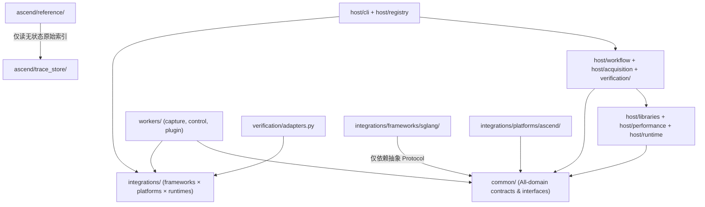
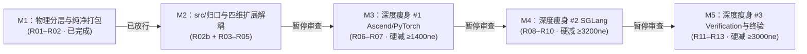

# 顶层物理分层、四维扩展架构收口与不变量锁死深度瘦身

> **协作与人工确认门控**：本计划由 AGY（Gemini）维护，由 Codex 分阶段实施。Codex 执行期间仅更新本窗口 `log.md` 与 `status.md` 的执行态字段，**严禁擅自修改本计划的目标、目录拓扑、删除清单、硬性瘦身门槛、不变量清单或约定暂停点**。每个阶段（M1–M5）完成检查并分层推送至开发分支后**必须暂停**，由 AGY 深度审查并经用户确认后再启动下一阶段，不得自动越权跨阶段推进。

**开始日期**　2026-11-25（开发分支 `topology-extensibility-slimming`，从 `main` 基线提交 `b500cbe` 切出）

**计划修订（2026-11-25，M1 审查后）**　M1 审查发现将 `engine/`、`probes/`、`shared/`、`python/` 直接平铺在仓库根会导致根目录散落偏杂；经用户确认，**全部主体工程实现统一收归至 `src/` 下**（`src/engine/`、`src/probes/`、`src/shared/`、`src/python/`），仓库根目录仅保留 5 个受跟踪目录（`src/`、`docker/`、`example/`、`docs/`、`third_party/`），同时在 `src/` 内部 100% 保持多语言与多运行域物理隔离。该归口动作作为 M2 首轮前置切片 `R02b` 执行，不回滚 M1 已验收的 R01–R02 交付，总轮次由 13 轮调整为 14 轮。

**计划修订（2026-11-25，M2 放行后）**　M1–M2 已在新增物理卡时为 0 的前提下完成目录分层与架构解耦。进入 M3–M5 后，深度瘦身将直接重写在线真机采集与观测代码（`runtimes/pytorch/capture`、`platforms/ascend/runtime`、`frameworks/sglang/observation` 与局部采集规则），仅靠零卡离线回归无法覆盖在线真机路径。经用户确认，**自 M3 起解除零卡限制，建立“逐轮瘦身 + 有界真机实采 + 多拓扑离线对照”的逐轮验证回归机制**：每一轮涉及在线采集/观测/局部规则改动的瘦身均在本轮内经官方公开 CLI 跑通对应最小真机采集、投影与核验闭环，同时叠加多拓扑留存数据与 `b500cbe` 的逐字节离线回归；每次实采前明确声明单轮运行/后处理/存储预算（失败与重试不清零）并按初始化/预热、有效观测、后处理、导出量、保留量及峰值分别记账；明确**功能正确性与真机不变量高于行数指标**，且严禁新增独立测试工程、测试脚本或生产 mock。

**计划修订（2026-11-25，R06 AGY 裁决与减行指标校准）**　R06 实测与逐行源码审查证实，既有代码在既有工程约束下本身已具备很高逻辑密度（例如合并后的 `runtimes/pytorch/` 4 文件 / 774 非空行包含 29 条必要 fail-closed 守卫，几乎无水分）。经用户确认做出三项裁决：① 批准 R06 现行 `runtimes/pytorch/`（4 文件 / 774 非空行）直接通过并提交，取消原 `≤ 550` 非空行硬上限；② 明确 `platforms/ascend/trace_store.py` 共享边界——无状态原始文件只读索引与无状态 `TS_TASK_FLIP` 队列槽位证明均可收入 `trace_store.py`，由 `analysis/` 与 `reference/` 各自基于原始输入独立调用（`reference/` 仍严禁导入 `analysis/` 或读取解释器结论）；③ **保留全部目录与文件数硬性收敛门槛（业务 Python `244 → ≤ 130` 文件）**，将 M3–M5 非空行指标由事前拍定的硬性总减行底线校准为**按真实代码重复度务实压缩**（M3 目标净减 ≥ 400 非空行；M4/M5 以消除真实平行轮子、碎片壳与样板为准，绝不为凑行数删守卫或压行）。

**计划修订（2026-11-25，R09 裁决与路线 B 深度瘦身切换）**　R09 实证表明单卡 TP2（1 请求）与 PD（17-token）新采模板在独立并发参考（2 请求 / 16-token）上触发 `template_gap` 属 workload 覆盖差异而非代码回归，经用户确认批准 R09（候选树 `f9d5c9ec`，`observation/` 41f → 12f、`-350 NE`）直接提交放行；同时针对“全仓净减行幅度仍偏小（R09 后仅较 `b500cbe` 净减 24 NE）且跨层防御偏硬（全仓 1,088 条 `raise`/`require` 含大量内部重复自证与旧诊断格式锁定）”的现状，经用户拍板切换至**路线 B（核心红线死守 + 诊断报告与重复防御审慎松绑）**：
- **绝不放松的硬红线**：物理时钟与因果序（`TS_TASK_FLIP`、双锚点 RAW、SymPy 有理数认证）、分布式协议一致性、预算硬熔断、训练/验证来源隔离、核心预测与拟合数值精度（四目标 211,290 轨迹、16 token 发布、678 样本拟合、43,276 `work-costs` 与 `b500cbe` 逐字节一致）；
- **在 R10 与 M5 审慎松绑并大力压缩的对象**：① 取消对 `verification/`（10,357 NE）与局部采集内部诊断 JSON/MD 细项结构的逐字节锁定，改为**以核心验证结论一致为准**（来源隔离与认证结论、结构动作匹配与首分歧定位、固定图误差归因、自主闭环 TTFT/TPOT 评分），允许 M5 将 `verification/` 真正重写压缩至 **≤ 5,500–6,000 NE**（净减 ≥ 4,000 NE）；② 严格回归“外部边界校验一次、内部靠所有权”原则，清理跨层重复自证（重复 `domain/environment` 核对、内部二次 `requalification`、冗余内部 `type(x) is not int` 与僵化 `keys() ==` 判断），推动 R10（`sglang/acquisition/` 2,647 NE → 净减 ≥ 550 NE）与 M5 共同实现全仓业务 Python **≤ 120 文件、≤ 25,500–26,500 非空行**（较 `b500cbe` 真正净减 **≥ 6,000 非空行**）。

**起始规模基线（`b500cbe`）**：
- 业务源码（原 `src/prologue/`）：346 文件 / **51,240 物理行**（Python 244f / 37,114L / **32,708 非空行**；C++ 93f / 13,978L / 12,204 非空行；Shell/Patch/CMake/JSON 9f / 148L）
- 示例代码（`example/`）：4 文件 / 724L（638 非空行）
- 容器裁剪脚本（`docker/images/package_runtime.py`）：1 文件 / 52L（44 非空行）

**目标**　在严格守住既有工程约束与全部真机不变量（M1–M2 零卡时回归 100% 一致，M3–M5 逐轮有界真机实采 + 多拓扑离线回归 100% 一致）的前提下，完成三项互为因果的深度演进：
1. **顶层物理清晰分层**：全部主体工程实现统一归口于 `src/`，内部按交付物与语言彻底拆分为 `src/engine/`（纯 C++23 仿真引擎）、`src/probes/`（纯底层原生探针/Patch/Shell）、`src/shared/`（跨语言单一真源静态资产）与 `src/python/`（按运行域隔离的纯 Python），彻底消除 8 个多语言混装目录与 `docker/images/package_runtime.py` 构建期裁剪魔法；
2. **四维扩展架构收口与纯推演验证**：在架构层打通**换框架（vLLM）× 同框架多版本（SGLang 多 Profile）× 换后端（NVIDIA CUDA/CUPTI/NCCL）× 换硬件代际**四维扩展边界，消除 `sglang/` 对 `ascend`/`torch_npu` 的 98 处直连耦合与 51 文件 235 处散落 `sglang.srt.*` 版本直导，并以纯静态审计完成四维扩展零副作用推演（不向生产代码写入 mock/stub）；
3. **不丢细节的逐块深度瘦身与结构收敛**：在强模块化与清晰边界确立后，由 AGY 锁定各子系统真机不变量，通过范式升维（声明式 Hook 表、共享无状态 Trace 索引、统一局部规则引擎、验证 Check/Collector 内核）与合并过碎微文件，**硬性将业务 Python 文件数由 244 压至 ≤ 130**，并在绝不削弱任何真机守卫的前提下持续消除全部真实重复与样板代码，彻底摆脱“增量整理越改越胖、从零重写丢失细节”的双重困局。

---

## 一、深度现状诊断与非目标

### 1. 基线结构痛点（基于 `b500cbe` 实测）

| 痛点维度 | 当前实测事实（`b500cbe`） | 本窗口根治目标 |
| --- | --- | --- |
| **多语言与多产物混装** | 原 `src/prologue/` 26 个子目录中有 8 个 `[MIXED]` 混装目录（`app/` 同时含 C++ 引擎入口 + 宿主 CLI + 两个容器 worker；`platforms/ascend/runtime/` 同时含 Py + C++ `LD_PRELOAD` + `.sh` + `.patch` + `CMakeLists.txt`；`verification/structure/` 夹着 `local_graphs.cpp`）；且仅因 5 个共享小文件放错位置，迫使双 Dockerfile 依赖 `package_runtime.py` 做 AST 静态裁剪。 | 仓库根统一归口 `src/`（根仅 5 个受跟踪目录），`src/` 内按 `engine/`、`probes/`、`shared/`、`python/` 物理分家；Python 内部按 `common/`、`host/`、`workers/`、`integrations/`、`verification/` 划分运行域；彻底删除 `package_runtime.py`，Dockerfile 回归 100% 纯整目录 `COPY`。 |
| **框架与后端半粘连** | `platforms/ascend/` 已 0 依赖 `sglang`，但 `frameworks/sglang/` 仍有 **40 文件 98 处**直接引用 `ascend`/`torch_npu`/`hccl`/`aclrt`（`acquisition/` 11 文件、`observation/local/` 9 文件、`shared/` 2 文件、`control/` 1 文件、`cpp/templates.cpp` 1 文件），容器入口也写死 `"torch.npu"` 与 `Ascend*`。 | 抽出 `DeviceRuntime`（容器侧）与 `PlatformBackend`（宿主侧）契约，`frameworks/sglang/` 与 `src/engine/adapters/sglang/` 对 `ascend`/`torch_npu`/`hccl` 硬耦合归零。 |
| **同框架多版本脆弱** | `frameworks/sglang/` 有 **51 文件 235 处**散落引用 **126 个 `sglang.srt.*` 内部私有类/方法**，无版本适配边界，升级或并存双版本必陷入全仓 `if version` 污染或整目录复制。 | 新建 `frameworks/sglang/abi/` 集中承载全部私有符号、声明式 `HookTable` 与可继承覆写的 `VersionProfile`；`abi/` 之外 `sglang.srt.` 命中归零。 |
| **多框架路由未闭环** | 13 处 `AdapterRegistry.select()` 中 12 处无参走默认；`workers` 容器入口与 C++ `local_graphs.cpp` 仍直接硬连 `sglang`。 | 全链路显式传递/推断 `(framework, version_profile, platform)`；C++ 统一通过 `src/engine/adapters/registry` 派发。 |
| **体量庞大与碎片过度** | `integrations/`（22,908L，44.7%）与 `verification/`（11,529L，22.5%）合占全仓 67.2%；全仓存在 60+ 个 `< 90` 行碎片微文件，同时存在平行原始解析（`ascend/analysis` vs `ascend/reference`）、手写 Hook 包装（`sglang/observation`）、重复规则校验（9 条 `local_*.py`）与手工图遍历/报告拼装（`verification/`）。 | 先锁不变量后范式压缩：合并碎片微文件、共享无状态底座、命令式改声明式；业务 Python 文件硬性压至 **`244 → ≤ 130`**，按真实代码重复度持续净减非空行（绝不以牺牲守卫或伪瘦身凑行数）。 |

### 2. 明确非目标（严禁越界）

- **不实现** NVIDIA CUDA/CUPTI/NCCL、vLLM 或 SGLang 第二版本的实机代码，也不向生产目录写入任何 mock 平台、空壳适配器或假测试分支（四维扩展只落地真实抽象契约、SGLang/Ascend 全量迁移与纯静态扩展推演报告）。
- **不放宽**任何工程约束、统计口径、时钟认证、来源隔离或证据资格判据；不删除任何现有核心预测、TP/PP/EP/PD、局部补库、双库发布、5 域/16 子命令 CLI 或三路验证能力。
- **不触发**无明确验证目标的盲目大矩阵采集或脱离公开 CLI 的独立测试工程/mock 脚本；M1–M2 保持新增物理卡时 = 0，M3–M5 按下述逐轮有界预算执行定向真机冒烟与闭环回归（单卡优先，所有预算失败/重试不清零）。不修改 `docs/note.md`、`.clang-format`、`third_party/`、`deprecated/` 及既有 `data/` 资产。

---

## 二、目标深度目录架构与依赖红线

### 1. 全仓目标物理目录树（根清爽、内隔离、零混装）

```text
Prologue/
├── CMakeLists.txt                       # 根构建入口：仅委托构建 src/engine/（C++23 仿真引擎）
├── pyproject.toml                       # 宿主完整包元数据（where = ["src/python"]，含 prologue-cli 与 src/shared/cost_families.json）
├── README.md
├── LICENSE
│
├── src/                                 # 【全部主体工程实现统一归口，内部按语言/交付物 100% 物理隔离】
│   ├── engine/                          # 【纯 C++23 仿真引擎：0 个 .py / .sh / .patch】
│   │   ├── CMakeLists.txt               # 定义 prologue_core、prologue_sglang、prologue、prologue_local_graphs
│   │   ├── core/                        # 100% 框架/平台无关核心（0 条越层 #include，0 框架/平台字样）
│   │   │   ├── contracts/               # expression, serving, json_io, context_values
│   │   │   ├── graph/                   # types, state, observation, graph, projection
│   │   │   ├── templates/               # production, entries, library, bindings, interface, local, families, selection, supplement, validation, instance
│   │   │   ├── serving/                 # session, service_times, execution_inputs, controller/, execution/, resources/
│   │   │   └── performance/             # service_model, work_costs, work_features, families.hpp.in（读取 ../shared/cost_families.json）
│   │   ├── adapters/                    # 框架 C++ 适配器
│   │   │   ├── registry.{hpp,cpp}       # 唯一框架派发注册表（供 prologue 与 prologue_local_graphs 共用）
│   │   │   └── sglang/                  # actions, serving, templates, workers（未来并列 vllm/）
│   │   └── tools/                       # C++ 可执行工具
│   │       ├── main.cpp                 # 薄入口（≤ 25L）
│   │       ├── commands.{hpp,cpp}       # 表驱动 15 子命令（经 adapters/registry 派发）
│   │       ├── execution_trace.{hpp,cpp}# 流式轨迹写出
│   │       └── local_graphs.cpp         # 离线局部构图验证（经 adapters/registry 派发，0 直导 sglang）
│   │
│   ├── probes/                          # 【纯底层原生探针：LD_PRELOAD C++、Profiler Patch、容器脚本，0 个 .py】
│   │   ├── ascend/
│   │   │   ├── CMakeLists.txt           # 编译 libprologue_ascend_{observer,weights}.so
│   │   │   ├── native_calls.cpp
│   │   │   ├── runtime_timing.{hpp,cpp}
│   │   │   ├── thread_activity.cpp
│   │   │   ├── weight_storage.cpp
│   │   │   ├── profiler/                # CMakeLists.txt, install.sh, start.patch
│   │   │   └── scripts/                 # capture.sh, export.sh
│   │   └── pytorch/
│   │       ├── CMakeLists.txt           # 编译 libprologue_gloo.so
│   │       └── gloo_timing.cpp
│   │
│   ├── shared/                          # 【跨语言单一真源静态资产】
│   │   └── cost_families.json           # Python 拟合与 C++ 求值共享的唯一模型族契约目录
│   │
│   └── python/                          # 【纯 Python：0 个 .cpp / .sh / .patch，按运行域严格分层】
│       └── prologue/
│           ├── __init__.py
│           ├── __main__.py              # python3 -m prologue 唯一入口（仅委托 host.cli.cli:main）
│           │
│           ├── common/                  # [运行域: All — 宿主/采集/控制三端共享，0 重依赖、0 框架/平台名]
│           │   ├── io.py                # 原子 JSON/JSONL 读写、内容哈希与路径清理
│           │   ├── cost.py              # cost_identity / cost_features / ServiceSamples
│           │   ├── workload.py          # WorkloadContent / ExpertRoutes
│           │   ├── observation.py       # CapturedCall / SemanticCapture / ScopeParameters / ProfileWindow / CapturedWorkers
│           │   ├── control_peer.py      # 控制协议管道读写
│           │   └── interfaces.py        # 四维扩展核心协议：DeviceRuntime / PlatformBackend / FrameworkVersionABI / FrameworkAdapter
│           │
│           ├── host/                    # [运行域: Host-Only — 物理隔离，绝不进任何推理/控制容器]
│           │   ├── runtime/             # docker.py, limits.py, workspace.py
│           │   ├── libraries/           # release.py, store.py, templates.py, increment.py
│           │   ├── performance/         # backends.py, registry.py, models.py, fitting.py, requirements.py
│           │   ├── acquisition/         # options.py, adapters.py, budget.py, capture.py, recording.py, production.py, rules.py, replenishment.py, costs.py, fitting.py
│           │   ├── workflow/            # options.py, prediction.py, exploration.py, targets.py, report.py, latency.py
│           │   ├── registry.py          # (framework, version_profile, platform) 统一宿主适配注册表
│           │   └── cli/                 # cli.py, arguments.py, commands/{predict,library,capture,cost,verify}.py
│           │
│           ├── workers/                 # [运行域: Container-Only — 薄容器入口，0 框架/平台硬编码]
│           │   ├── registry.py          # 容器侧轻量 (framework, platform) 运行时装配表
│           │   ├── capture.py           # 采集/导出/解释容器入口
│           │   ├── control.py           # 无设备控制容器入口
│           │   └── plugin.py            # 推理框架插件钩子入口
│           │
│           ├── integrations/            # 【运行时 × 硬件平台 × 推理框架 三轴物理正交】
│           │   ├── runtimes/
│           │   │   └── pytorch/
│           │   │       ├── shared.py    # [All] CpuTransfer / CpuProtocolWork
│           │   │       ├── capture.py   # [Capture] boundaries / protocol / signals / gloo_timing 合并模块
│           │   │       └── control.py   # [Control] cpu / collectives / point_to_point / tensors 合并模块
│           │   │
│           │   ├── platforms/
│           │   │   └── ascend/          # [0 个 sglang 字样；未来并列 cuda/]
│           │   │       ├── backend.py   # [Capture/Host] AscendDeviceRuntime + AscendPlatformBackend 契约实现
│           │   │       ├── trace_store/ # [Capture/Host] 共享无状态原始 SDK/RAW/队列/时钟解码与索引层
│           │   │       ├── runtime/     # [Capture] markers, host_profile, copy_sampling, thread_activity, export
│           │   │       ├── analysis/    # [Capture/Host] 精简后的设备/端口/主机对齐解释器
│           │   │       ├── host/        # [Host] deployment, collectives, transport_profile
│           │   │       └── reference/   # [Host/Verify] 精简后的独立参考校验器（仅消费 trace_store，0 导入 analysis）
│           │   │
│           │   └── frameworks/
│           │       └── sglang/          # [0 处 import platforms.ascend / 0 处 torch.npu！未来并列 vllm/]
│           │           ├── abi/         # 【多版本核心】contract.py, hooks.py(声明式 HookTable), registry.py, profiles/rev_4e155ecc.py
│           │           ├── shared/      # [All] 精简高内聚公共契约（≤ 8 文件）
│           │           ├── observation/ # [Capture] 声明式观测核心 + local/（统一 LocalRunner，合计 ≤ 14 文件）
│           │           ├── control/     # [Control] 无设备 CPU 控制与元数据代理（≤ 6 文件）
│           │           └── acquisition/ # [Host] 声明式局部规则基座 + 采样/启动/模板（≤ 8 文件）
│           │
│           └── verification/            # [运行域: Host/Verify-Only — 物理隔离，绝不进推理/控制容器]
│               ├── runner.py            # 统一验证生命周期、隔离与原子发布
│               ├── engine.py            # 统一 FindingLedger / TraceReader / CausalIndex / ReportBuilder 内核
│               ├── adapters.py          # 唯一访问 integrations 的窄适配接口（按 framework × platform 注入）
│               ├── core/                # 精简后的原生案例、来源核对、时钟认证与协议/状态检查（≤ 9 文件）
│               ├── structure/           # 精简后的受控输入、动作对比与局部构图（≤ 5 文件，单方法 ≤ 100L）
│               ├── fixed/               # 精简后的固定图基准重算与误差归因（≤ 3 文件）
│               └── autonomous/          # 精简后的自主闭环评分与调度首分歧定位（≤ 2 文件）
│
├── docker/                              # 【100% 纯整目录 COPY，彻底删除 package_runtime.py】
│   ├── build_inference.sh
│   ├── compose/inference.yml
│   └── images/
│       ├── base/sglang/                 # Dockerfile + install_batch_invariant_ops.sh
│       ├── modeling/Dockerfile
│       ├── sglang/                      # Dockerfile（从 src/probes 与 src/python 纯目录 COPY）+ install_sglang.sh + pyproject.toml
│       └── control/                     # Dockerfile（从 src/python 纯目录 COPY，无任何裁剪脚本）
│
├── example/coarse_graph/                # 保持简洁示例与冻结矩阵编排（PYTHONPATH=src/python）
├── docs/                                # 权威设计文档、窗口文档与项目推进记录
└── third_party/                         # 官方上游子模块（只读，保持干净工作树）
```

### 2. 不可逾越的静态依赖红线



- **物理镜像隔离（从 `src/python/prologue/` 纯目录 COPY 保证）**：
  - `sglang` 镜像**仅 COPY**：`common/`、`workers/{__init__,registry,capture,plugin}.py`、`integrations/runtimes/pytorch/{shared,capture}`、`integrations/platforms/ascend/{backend.py,trace_store/,runtime/,analysis/}`、`integrations/frameworks/sglang/{abi/,shared/,observation/}`。
  - `control` 镜像**仅 COPY**：`common/`、`workers/{__init__,registry,control}.py`、`integrations/runtimes/pytorch/{shared,control}`、`integrations/frameworks/sglang/{abi/,shared/,control/}`。
- **跨轴隔离红线**：
  - `src/engine/core/`：0 处框架/平台名，0 条越层 `#include`；
  - `common/`、`host/{runtime,libraries,performance,acquisition,workflow}`：0 处 `sglang`/`ascend`/`torch_npu`/`hccl` 硬编码，0 反向依赖 `host/cli` 或 `integrations/`；
  - `integrations/frameworks/sglang/`：0 处 `import prologue.integrations.platforms.ascend`，0 处裸调 `torch.npu`，`abi/` 之外 0 处原始 `sglang.srt.*` 路径；
  - `integrations/platforms/ascend/`：0 处提及 `sglang`；`reference/` 0 导入 `analysis/` 解释结论；
  - `verification/`：0 导入 `host/cli` 或 `workers/`，除 `verification/adapters.py`（迁自 `verification/core/adapters.py`）外 0 导入 `integrations/`。

---

## 三、分阶段实施计划与硬门禁（5 阶段 · 14 轮）



---

### M1　物理分层与零裁剪纯净打包（R01–R02，已通过审查）

**阶段约定暂停点**：已完成 R01–R02 交付（`ba07034`、`24ff96b`、`aa49d03`），AGY 审查通过。审查后按用户要求将四棵主体工程目录统一收归 `src/` 下，该轻量归口合入 M2 首轮 `R02b` 执行。

#### R01　拆分 `engine/`（纯 C++23）、`probes/`（原生探针/Patch/Shell）与 `shared/`（跨语言真源）

- **为什么做**：消除 C++ 仿真器、C++ `LD_PRELOAD` 探针、Patch、Shell 与 Python 源码在原 `src/prologue/` 内的全面混装，同时把 `local_graphs.cpp` 纳入统一 C++ 框架注册表。
- **改动与删除清单**：建立 `engine/`、`probes/`、`shared/cost_families.json` 与 `engine/adapters/registry.{hpp,cpp}`；删除原 `src/prologue/` 下全部非 Python 代码与旧构建配置。
- **验收**：Release 全目标构建 0 error / 0 warning；15 命令与 662 局部动作输出与 `b500cbe` 逐字节一致。
- **交接**：`b500cbe` 仓库 → 物理独立的 C++ 仿真器与探针目录 → R02 纯 Python 分层。

#### R02　建立 `python/prologue/` 运行域分层并彻底删除 `package_runtime.py`

- **为什么做**：按 `common/`、`host/`、`workers/`、`integrations/`、`verification/` 物理隔开三套运行域，彻底消除 AST 静态裁剪构建魔法。
- **改动与删除清单**：建立 `python/prologue/` 运行域树；双 Dockerfile 改写为 100% 纯 `COPY`；删除 `docker/images/package_runtime.py` 与旧 `src/`。
- **验收**：0 多语言混装目录、AST 0 环、Ruff 0 错误、双镜像纯 `COPY` 0 泄露 / 0 断链、零卡时四目标回归逐字节一致。
- **交接**：R01 产物 → 纯净分层的实现树 → M2 `R02b` 收归 `src/` 与四维扩展解耦。

---

### M2　`src/` 统一归口、四维扩展架构收口与零副作用推演（R02b + R03–R05）

**阶段约定暂停点**：完成 `src/{engine,probes,shared,python}` 归口、框架/平台解耦、多版本 ABI 层落地、全链路显式路由与四维扩展纯静态推演审计，重建双镜像与 C++ 并完成零卡时回归，分层推送后**立即暂停**，交由 AGY 审查与用户放行 M3 瘦身阶段。

#### R02b　将 `engine/`、`probes/`、`shared/`、`python/` 统一收归 `src/`，保持根目录极简

- **为什么做**：避免 4 个主体实现目录散落仓库根目录，同时 100% 保留 M1 已建立的语言与运行域物理隔离。
- **改动与删除清单**：
  - `git mv engine src/engine`、`git mv probes src/probes`、`git mv shared src/shared`、`git mv python src/python`；
  - 同步更新 `CMakeLists.txt`（`add_subdirectory(src/engine)`）、`pyproject.toml`（`where = ["src/python"]` 与 `"share/prologue" = ["src/shared/cost_families.json"]`）、`docker/images/{sglang,control}/Dockerfile` 的 `COPY` 源路径前缀以及 `example/coarse_graph/run.py`（挂载 `src/python`、`src/shared` 与 `PYTHONPATH=src/python`）；
  - **显式删除**：仓库根目录不得残留 `engine/`、`probes/`、`shared/`、`python/`。
- **验收**：仓库根仅含 `src/`、`docker/`、`example/`、`docs/`、`third_party/` 5 个受跟踪目录；`src/engine/CMakeLists.txt` 与 `src/python/prologue/host/performance/registry.py` 无需硬编码绕路即可正确定位 `src/shared/cost_families.json`；Release 编译与 `ruff check src/python example` 零错误。
- **交接**：M1 分层成果 → 根目录极简且内部 100% 隔离的 `src/{engine,probes,shared,python}` → R03 框架/平台解耦。

#### R03　抽出 `DeviceRuntime` / `PlatformBackend`，清零 `sglang/` 对 `ascend` 的 98 处直连耦合

- **为什么做**：当前 `frameworks/sglang/` 有 40 个文件 98 处直接硬连 `ascend`/`torch_npu`/`hccl`，导致未来接入 NVIDIA CUDA 时必须复制整套 SGLang 适配器。
- **改动与删除清单**：
  - 在 `src/python/prologue/common/interfaces.py` 定义窄协议 `DeviceRuntime`（容器内设备 API、同步、事件、markers、profiling hooks、profile export、host_profile、copy_sampler、scoped_tasks、tensor_layouts、runtime_domain_key、collective_backend）与 `PlatformBackend`（宿主侧 deployment、driver_mounts、runtime/entrypoint、host_alignment、collectives、transport_profile、reference_evidence）。
  - 在 `src/python/prologue/integrations/platforms/ascend/backend.py` 实现 `AscendDeviceRuntime` 与 `AscendPlatformBackend`（注意容器侧与宿主侧分离，确保 `sglang` 镜像导入 `backend.py` 不触碰 `ascend/host/` 或 `ascend/reference/`）。
  - 改造 `frameworks/sglang/{shared,observation,control,acquisition}` 全部通过注入的 `DeviceRuntime` / `PlatformBackend` 交互（规则标识由 `f"{framework}.{platform}.*"` 或平台声明生成，确保既有 Ascend 资产名称与 JSON 结构 100% 兼容）；改造 `src/engine/adapters/sglang/templates.cpp` 去除 `"torch_npu"` 硬编码，改由环境声明的加速器键驱动（保持既有发布 `local_domain` 逐字节一致）。
  - 同步在 `docker/images/sglang/Dockerfile` 加入 `COPY src/python/prologue/integrations/platforms/ascend/backend.py`。
  - **显式删除**：删除 `frameworks/sglang/` 内全部对 `prologue.integrations.platforms.ascend` 的直接导入、裸 `torch.npu.*` 调用与硬编码 `"torch_npu"`/`"ascend"` 分支。
- **验收**：`grep -rn 'platforms\.ascend\|torch\.npu' src/python/prologue/integrations/frameworks/sglang/` 为 **0 命中**；`src/engine/adapters/sglang/` 对 `torch_npu`/`ascend` 硬编码为 **0 命中**；C++ 编译 0 告警，既有双库预测与离线投影逐字节一致。
- **交接**：R02b 清爽目录 → 平台与框架正交解耦的适配器边界 → R04 收拢框架版本耦合。

#### R04　建立 `frameworks/sglang/abi/` 多版本适配层与声明式 Hook 表

- **为什么做**：当前 51 个文件 235 处直接耦合 126 个 `sglang.srt.*` 内部符号，无法优雅维护同框架多版本，同时是后续 M4 瘦身的必备范式底座。
- **改动与删除清单**：
  - 新建 `src/python/prologue/integrations/frameworks/sglang/abi/`：
    - `contract.py`：定义强类型 `SGLangABI`（覆盖模型/池/分配器/缓存/调度器/PD/通信/benchmark 符号访问器与能力位）；
    - `hooks.py`：实现声明式 `HookSpec` 与 `HookTable` 统一安装器，支持按组批量声明与验证 hook 目标；
    - `profiles/rev_4e155ecc.py` 与 `registry.py`：以 `4e155ecc` 为默认基线 Profile 注册，支持基于修订号/版本特征解析并按增量覆写扩展新版本 Profile（无需复制框架主体代码）。
  - 迁移 `frameworks/sglang/{shared,observation,control,acquisition}` 中全部 235 处 `sglang.srt.*` 直接导入与字符串注册至 `abi/`；保持与既有 `framework_revision` 合同 100% 兼容。
  - 同步在 `sglang/Dockerfile` 与 `control/Dockerfile` 加入 `COPY src/python/prologue/integrations/frameworks/sglang/abi`。
  - **显式删除**：删除 `abi/` 之外全部硬编码 `sglang.srt.*` 导入语句与裸字符串 hook 目标。
- **验收**：`grep -rn 'sglang\.srt\.' src/python/prologue/integrations/frameworks/sglang/ --exclude-dir=abi` 为 **0 命中**；双镜像重建并容器内导入自检 0 报错；既有四目标预测与离线拟合逐字节一致。
- **交接**：R03 平台解耦 → 版本隔离且声明式 Hook 化的 SGLang 适配层 → R05 全链路路由与 M4 深度压缩。

#### R05　打通全链路显式 `(framework, version, platform)` 路由并完成四维扩展静态推演

- **为什么做**：封堵剩余 12 处默认 `AdapterRegistry.select()` 与容器入口硬编码，用零副作用静态推演检验重构后的扩展架构是否真正闭环无漏口。
- **改动与删除清单**：
  - 升级 `src/python/prologue/host/registry.py` 为 `(framework, platform, version_profile)` 三维解析，消除 12 处无参 `AdapterRegistry.select()`（CLI 支持显式 `--framework`/`--platform` 或从输入/发布资产自动推断，默认镜像由所选组合提供而非在公共 `arguments.py` 写死单框架）；新增 `src/python/prologue/workers/registry.py` 并升级 `workers/{capture,control,plugin}.py` 按环境/作业声明动态装配对应 `framework × platform` 运行时（同步在双 Dockerfile `COPY src/python/prologue/workers/registry.py`）；更新 `verification/core/adapters.py`（或迁至 `verification/adapters.py`）按选定组合注入。
  - **纯静态四维扩展架构推演（零生产代码副作用）**：基于 AST 依赖、C++ `#include` 树与协议签名，逐一推演并输出结构化审计文件 `data/topology-extensibility-slimming/m2/extensibility-audit.json` 与日志结论：
    1. **换硬件代际**（910B → 910C / H100 → B200）：确认 0 代码改动清单；
    2. **换后端**（Ascend → NVIDIA CUDA/CUPTI/NCCL）：逐接口核对 `src/probes/cuda/` + `src/python/prologue/integrations/platforms/cuda/` 需实现的精确方法集，实证 `src/engine/`、`common/`、`host/`、`verification/`、`frameworks/sglang/` 修改面为 **0**；
    3. **同框架多版本**（SGLang `4e155ecc` + 假设 `vNext` 共存）：实证只需新增 1 个增量 `abi/profiles/` 文件与镜像，核心业务修改面为 **0**；
    4. **换框架**（SGLang → vLLM）：逐接口核对 `src/engine/adapters/vllm/` + `src/python/prologue/integrations/frameworks/vllm/` 接入点，实证 `src/engine/core/`、`common/`、`host/`、`platforms/ascend/` 修改面为 **0**。
  - **显式删除**：删除 `workers/` 中任何直接写死的 `sglang`/`ascend` 顶层导入与 CLI 中无参隐式默认选择。
- **验收**：四维扩展审计中全部“零改动层”实测违例为 **0**；生产代码中 **0 个 mock/stub 扩展文件**；双镜像重建、C++ Release 编译与零卡时四目标回归全部通过。
- **交接**：M2 完整可扩展架构 → 边界锁死的三大瘦身标的 → M3–M5 激进瘦身。

---

### M3　激进瘦身 #1：`platforms/ascend/` + `runtimes/pytorch/` + `common/`（R06–R07）

**阶段约定暂停点**：完成共享无状态 `trace_store` 抽取与 `pytorch/`、`common/`、`ascend/` 深度压缩，每轮同步通过**有界真机实采回归 + 多拓扑离线对照**，达成瘦身与正确性双门禁，分层推送后**立即暂停**交由 AGY 审查。

> **M3 必须锁死的真机不变量（严禁偷删或弱化，正确性绝对高于行数指标）**：
> - `TS_TASK_FLIP` 批号翻转与队列槽位归属证明（含并发提交/跨线程拒绝）；
> - `host/start_info` 与 `device/start_info` 双独立 `CLOCK_MONOTONIC_RAW` 锚点校准（严禁混用）；
> - `aclrt` 同步拷贝归属调用者线程（非排队设备命令）、重复无新工作 host fence 去重、观察器排除区间与私有闭环服务队列隔离；
> - **`reference/` 独立核对原则**：只消费无状态原始事实与索引，**绝不读取 `analysis/` 解释器结论**。

#### R06　合并 `runtimes/pytorch/` 与 `common/` 微文件，抽取无状态 `ascend/trace_store`

- **为什么做**：`runtimes/pytorch/` 13 文件（810 非空行）碎片严重；`ascend/analysis/`（2,423 非空行）与 `ascend/reference/`（1,322 非空行）重复实现了两套 SDK JSON 扫描、区间二分、`TS_TASK_FLIP`、`halSq` 提交解析与时钟还原。
- **改动与删除清单**：
  - 将 `integrations/runtimes/pytorch/` 13 个 `.py` 合并压缩为 4 个文件（`__init__.py` + 3 个业务模块：`shared.py`、`capture.py`、`control.py`），同步更新双 Dockerfile 对应 `COPY` 路径；
  - 将 `common/` 内 14 个微文件彻底收口为 7 个文件（`__init__.py` + `io.py`、`cost.py`、`workload.py`、`observation.py`、`control_peer.py`、`interfaces.py`）；
  - 新建无状态 `platforms/ascend/trace_store`（单文件 `trace_store.py` 或 `trace_store/` ≤ 2 个业务文件），统一原始 SDK 行扫描、`TS_TASK_FLIP`、双锚点 RAW 时钟换算、`Interval`/`ThreadIntervals`、`halSq` 驱动提交与事件代次只读索引，供 `analysis/` 与 `reference/` 共用（同步在 `sglang/Dockerfile` 加入对应 `COPY`）；
  - 顺手将 `workers/plugin.py` 对 `route` 的导入统一收口经 `workers/registry.py`；
  - **显式删除**：删除被合并的 `pytorch/` 旧子目录与 9 文件、`common/{observation,workload}/` 旧子目录与 7 文件，以及 `ascend/analysis/`、`ascend/reference/` 中与 `trace_store` 重复的底层扫描/索引代码。
- **本轮验证回归（真机 + 离线，已通过 AGY 裁决放行）**：
  - **静态与双镜像**：`runtimes/pytorch/` 归并为 4 文件（3 业务 `.py` / 774 非空行，保留全部 29 条显式 `raise` 守卫，AGY 裁决取消原 550 行硬上限）；`common/` ≤ 7 `.py`；`ascend/reference/` 0 导入 `ascend/analysis/`；纯 `COPY` 重建双镜像（111 / 60 模块）0 泄露 / 0 断链。
  - **有界真机实采**（预算上限：单卡运行 ≤ 360s、后处理 ≤ 300s、存储 ≤ 4 GiB，失败重试不清零）：经官方 CLI 在单卡上运行 1 次 Qwen3-8B **TP2 `--local-shards --resource-trace` 真实采集**（直击 `pytorch/capture.py`、`libprologue_gloo.so`、单卡分片重放、`common/`、`trace_store`）→ `capture project` → `verify source`，确认全链路通过、无异常降级。
  - **多拓扑离线对照**：用 `data/` 留存 **TP1 + TP2 + PD（`qwen-pd-isolated`）** 原始记录跑 `interpret` + `verify source`，以及 Qwen TP1 四目标预测 + `cost fit`，全部与 `b500cbe` 逐字节一致。
- **交接**：M2 稳定基线 → 经真机与多拓扑实证的紧凑底层与 `trace_store` → 提交 R06 并进入 R07 压缩上层解释与参考校验。

#### R07　深化 `trace_store` 共享边界并重构压缩 `ascend/{analysis,reference,runtime,host}`

- **为什么做**：消除 `analysis/trace.py` 与 `reference/recording.py` 的平行原始文件索引重复、消除 `NativeQueues` 与 `QueueEvidence` 的平行无状态槽位证明重复、消除 `analysis/` 的跨文件可变状态袋（`ObservedTimeline` 暴露 20+ 属性）与 `reference.py`（645L）的冗长手工校验样板，并收敛 `runtime/` 与 `host/` 碎片文件。
- **改动与删除清单**：
  - 按 AGY 裁决深化 `platforms/ascend/trace_store.py`：将无状态原始文件只读索引（扫描 `raw.json`、`sdk/trace.json`、`runtime/*.jsonl` 构建 `scopes`/`points`/`excluded`/`enqueues`/`dequeues`/`apis`/`host_times`）与无状态 `TS_TASK_FLIP` 队列槽位证明收口进 `trace_store.py`，由 `analysis/` 与 `reference/` 各自基于原始输入独立调用（`reference/` 仍严禁导入 `analysis/` 或读取任何解释器结论）；
  - 将 `ascend/analysis/` 重构为 ≤ 4 个业务 `.py`（核心投影流水线、命令/流/端口绑定、主机对齐、scoped_tasks/services），依托 `trace_store` 消除跨文件状态传递样板；
  - 将 `ascend/reference/` 压缩至 ≤ 2 个业务 `.py`（直接消费 `trace_store`，用紧凑声明式不变量断言替代冗长手工循环，严禁删除任何 fail-closed 拒绝条件）；
  - 将 `ascend/runtime/`（5 业务文件）收敛至 ≤ 3 个业务 `.py`，`ascend/host/`（3 业务文件）收敛至 ≤ 2–3 个业务 `.py`，同步更新 `platforms/ascend/backend.py` 与 `sglang/Dockerfile`；
  - **显式删除**：删除全部被合并的碎片文件、平行原始索引/槽位证明重复代码与过渡辅助类（零转发壳）。
- **本轮验证回归与 M3 硬门禁（真机 + 离线）**：
  - **瘦身门禁**：`platforms/ascend/` + `runtimes/pytorch/` 合计 Python 文件数（含 `__init__.py`）硬性压至 **≤ 20**；M3 较 M2 业务终版（`d48605f`：33,586 非空行）务实净减 Python 非空行 **≥ 400 行**（按真实重复度充分压缩，绝不删守卫或压行凑数）。
  - **有界真机实采**（预算上限：单卡运行 ≤ 600s、后处理 ≤ 420s、存储 ≤ 6 GiB，失败重试不清零）：重建双镜像后，经官方 CLI 在单卡上运行：① Qwen3-8B **TP1 `--service-reference` 真实采集**（直击 `ascend/runtime/{markers,host_profile,export,thread_activity}`、`deployment.py`）→ `capture project` → `verify source` → `cost extract --kind device` → `verify structure`；② 1 次轻量 **`--host-timing` 或 `--local-copy` 真机采样**（覆盖 `host_profile`/`copy_sampling`/`host_alignment`）→ 对应 `cost extract --kind host` 或采样验证，确认全部真机链路通过并按口径完整记账。
  - **多拓扑离线对照**：留存 **TP1 + TP2/TP8 + PD + Host/Transport** 的 `interpret` / `verify source` / `cost extract`，以及 Qwen TP1 四目标 211,290 条轨迹、16 token 发布、678 样本 `cost fit` 与 43,276 项 `work-costs` 全部与 `b500cbe` 逐字节一致。
- **交接**：R06 底座 → 经真机闭环实证的精干 Ascend/PyTorch 平台层 → M4 攻克最大体量 `sglang/`。

---

### M4　激进瘦身 #2：`frameworks/sglang/` 全域范式压缩（R08–R10）

> **M4 启动前实测校准（2026-11-25，基于 M3 终版 `5f33571`）**：`frameworks/sglang/` 现有 **105 文件 / 14,765 物理行 / 12,858 非空行**（299 条显式 `raise`、720 行顶层 import）：`abi/` + 根 7f（442 NE，不动）、`shared/` 22f（2,424 NE）、`control/` 13f（1,971 NE）、`observation/` 29f + `local/` 12f = 41f（5,377 NE）、`acquisition/` 22f（2,644 NE）。经逐目录代码密度实测，M4 保持硬性文件数收敛上限 **`frameworks/sglang/` ≤ 38 文件**（含根与 `abi/` 7f 及全部 `__init__.py`），并将务实无损非空行净减目标校准为 **M4 合计 ≥ 700 非空行**（R08 ≥ 150、R09 ≥ 350、R10 ≥ 200；冲刺 ≥ 1,000 行，功能正确性与真机不变量绝对高于行数指标）。合并时注意保持单模块粒度均衡（避免将不相关职责堆成千行巨文件），且必须保持 6 个动态路由入口模块路径不变：`abi.registry`、`acquisition.bindings`、`acquisition.evidence`、`control.entry`、`observation.entry`、`observation.plugin`。

**阶段约定暂停点**：完成 `sglang/` 四个子域（`shared`、`control`、`observation`、`acquisition`）的声明式重构与瘦身，逐轮通过**有界真机实采回归 + 多拓扑离线对照**，达成瘦身与正确性双门禁，分层推送后**立即暂停**交由 AGY 审查。

> **M4 必须锁死的真机不变量（严禁偷删或弱化，正确性绝对高于行数指标）**：
> - `PoolCoordinates` 0/1-based 页与槽位偏移换算、`RadixKey` 路由键构造与 prefix cache 分裂/驱逐守卫；
> - 模型层/注意力/KV 布局守卫（`FutureMap` 维数剥离、多行 packed value、MoE 逐层 router/expert 配对）；
> - PD 预填充/解码分离传输顺序、接收端 KV 页表与元数据写入顺序校验；
> - 单卡顺序分片重放（`profile_windows`、主机暂存交换、超显存按层暂存）与全部 9 条局部采集规则的真实资格核验语义（不删减有效局部采集规则，而是通过声明式基座压缩其重复样板）；
> - 持久化身份不漂移（保持 `HostReads.invoke` 等自有适配器边界显式声明的 `implementation` 身份不随模块合并改变）。

#### R08　深度合并压缩 `sglang/shared/`（22f → ≤ 8f）与 `sglang/control/`（13f → ≤ 6f）

- **为什么做**：`shared/`（2,424 NE / 22 文件）与 `control/`（1,971 NE / 13 文件）存在大量 15L–130L 碎片文件（`cache_keys.py` 15L、`host_reads.py` 46L、`attention.py` 50L、`groups.py` 55L 等）与跨文件 import / 重复 RPC/slot 包装。
- **改动与删除清单**：
  - 合并压缩 `sglang/shared/` 为 ≤ 8 文件（`__init__.py` + ≤ 7 业务模块，如 `config.py`、`batches.py`、`resources.py`、`calls.py`、`kv.py`、`pipeline.py`、`disaggregation.py`），确保保留 `HostReads.invoke` 的显式持久化 `implementation` 身份；
  - 合并压缩 `sglang/control/` 为 ≤ 6 文件（`__init__.py` + ≤ 5 业务模块，保持 `control/entry.py` 动态入口完整），统一 RPC 往返与状态校验辅助；
  - **显式删除**：删除全部 20+ 个被合并的旧文件，零转发壳。
- **本轮验证回归**：
  - `shared/` ≤ 8 文件、`control/` ≤ 6 文件；按真实重复度务实净减非空行 **≥ 150 行**，保留既有 fail-closed 守卫；
  - 重建双镜像后，运行真实 CPU `control` 容器端到端完成 **TP1 四目标预测（211,290 轨迹 + 空库首缺项）+ 留存 TP1/PD 的 `verify structure` 与 `verify autonomous`**，与 `b500cbe` 逐字节一致；因 `shared/` 同时服务采集端，须在空闲单卡补跑 1 次轻量 TP1 采集 + `capture project` + `verify source` + `verify structure` 冒烟（预算上限：单卡 ≤ 360s、后处理 ≤ 300s、存储 ≤ 4 GiB，失败重试不清零），确认采集侧与控制侧契约同步无漂移。
- **交接**：M3 平台层 → 经真机与控制闭环实证的紧凑 SGLang 共享与控制层 → R09 攻克最重的 `observation/`。

#### R09　深度范式压缩 `sglang/observation/`（41f → ≤ 14f，含 `local/`）

- **为什么做**：`sglang/observation/` 高达 5,377 NE（核心 29f + `local/` 12f），顶层 import 就占 329 行，存在大量小文件（12L–99L）及 5 个 `*_runner.py` 重复的 `ServerArgs`/`ModelConfig`/观测上下文生命周期与重复 `resolve(symbols().*)` 样板。
- **改动与删除清单**：
  - 依托 M2 的 `abi/hooks.py` 声明式 `HookTable` 与统一观察上下文原语，将 29 个核心观察文件合并压缩至 **≤ 10 个模块**（保持 `observation/entry.py` 与 `observation/plugin.py` 动态入口，单文件粒度均衡），消除重复 hook 注册、重复张量端口打包与重复 `resolve(symbols().*)` 样板；
  - 将 `observation/local/` 12 个文件（1,360 NE）重构收敛至 **≤ 4 个模块**（或合理压扁入 `observation/` 省去空 `__init__.py`）：抽取共用 `LocalRunner` / `ServerArgs`+`ModelConfig` 初始化与发布生命周期 + 合并 `shard_staging.py`；
  - **显式删除**：删除全部被合并的 25+ 个旧观察与 runner 微文件。
- **本轮验证回归（真机 + 离线，已通过 AGY 裁决放行）**：
  - `sglang/observation/`（含 `local/`）已压扁收口至 12 文件，净减 350 非空行，299 条显式守卫全部保留，`sglang`/`control` 双镜像缩至 56/38 模块；
  - 单卡 TP2（2 rank）与 PD（3 rank）实采全部通过 `capture project` 与 `verify source`（`consistent`、`local_templates: true`），离线 TP1/TP2/PD 12 份产物及四目标 211,290 轨迹、678 样本拟合与 `b500cbe` 逐字节一致；独立并发参考上的 `template_gap` 经核实系单卡 1 请求/17-token 模板与并发参考 2 请求/16-token workload 覆盖差异所致，非代码回归，批准 R09 放行提交。
- **交接**：R08 共享/控制层 → 经真机与多拓扑实证的轻量化 SGLang 观测层 → 提交 R09 并按路线 B 执行 R10。

#### R10　按路线 B 深度范式压缩 `sglang/acquisition/`（22f → ≤ 9f，净减 ≥ 550 NE）

- **为什么做**：`sglang/acquisition/`（2,647 NE / 22 文件 / 111 条 `raise`）中 6 个 `local_*.py` + `local_base.py`（1,051 NE）和样本提取/采样模块存在大量重复的 `environment` 剥离比对、`missing_root`+`framework`+`runtime_domain_key` 匹配、重复边界类型检查与内部二次读回校验样板。
- **改动与删除清单（路线 B：核心能力与 9 条规则语义全留，清理跨层重复防御与样板）**：
  - 升级声明式 `LocalRule` 基座，统一承接域/rank/环境校验、会话键归一、`local_attempt` 组装、样本资产打包与通用资格应答，**清理跨层重复的内部字段类型/键集重检与不必要的重复内部字段搬运**（保留外部输入边界校验与 9 条规则核心资格判据），将 6 个 `local_*.py` + `local_base.py` 合并压缩至 **≤ 3 个业务文件**；
  - 合并收敛其余 15 个宿主文件至 **≤ 5 个业务文件**（保持 `acquisition/bindings.py` 与 `acquisition/evidence.py` 动态入口，单文件粒度均衡），消除 `device_samples`/`host_cost_samples`/`pd_samples`/`sampling`/`batch_calibration`/`batch_readback` 间的重复样本组装与重复读回样板；
  - **显式删除**：删除全部 13+ 个被合并的旧文件（零转发壳）。
- **本轮验证回归与 M4 硬门禁（真机 + 离线）**：
  - **瘦身门禁**：`frameworks/sglang/` 全目录 Python 文件数（含根、`abi/` 与全部 `__init__.py`）硬性压至 **≤ 36**（当前 R09 后为 48 文件；其中 `acquisition/` ≤ 9 文件）；R10 净减 **≥ 550 非空行**（推动 M4 较 M3 `5f33571` 累计净减 **≥ 1,050 非空行**，全仓业务 Python 降至 **≤ 167 文件、≤ 32,130 非空行**）；
  - **有界真机实采**（预算上限：单卡运行 ≤ 600s、后处理 ≤ 420s、存储 ≤ 6 GiB，失败重试不清零）：重建双镜像后，经官方 CLI 在单卡上执行 1 次有界 **`library acquire`** 局部补采会话（直击新 `LocalRule` 基座与 `LocalRunner` 生命周期，如 `data/architecture-acquisition-performance/f2/binding/` 查询）→ `library publish --from-session` → 增量库 `predict run` 验证；
  - **多拓扑离线对照**：四目标 211,290 条轨迹、16 token 发布、空库首缺项、`library inspect`、`library publish --from-collection`、678 样本 `cost fit`、`cost extract`（device/transport/host/batch）、`cost-points` 与 43,276 项 `work-costs` 全部与 `b500cbe` 逐字节一致（局部采集内部诊断明细字段允许按路线 B 精简，但核心资格结论、发布资产与预测结果必须一致）。
- **交接**：R09 观测层 → 经真机闭环验证的高度精干 SGLang 适配层 → M5 按路线 B 深度重写 `verification/`（主瘦身战场）。

---

### M5　激进瘦身 #3：`verification/` 引擎化压缩与全仓真机闭环终验（R11–R13）

**阶段约定暂停点**：完成 `verification/` 全面引擎化瘦身、文档同步、全仓代码卫生清零，以及最终版代码的**真机端到端闭环验收 + 全量离线基线对照**，分层推送至 `origin/topology-extensibility-slimming` 后**立即暂停**（不要自行关窗），交由 AGY 终审与用户确认关窗。

> **M5 必须锁死的真机不变量（严禁偷删或弱化，正确性绝对高于行数指标）**：
> - `ReferenceRecording` 训练来源隔离核对与输入差异阻断；
> - `source_clock` 的 SciPy 候选基 + **SymPy 有理数精确认证**（严禁以浮点近似替代精确有理数认证）；
> - `NativeCase` 全 rank 独立构建（绝不因预测错误取消原生图构建）、动作配对仅认唯一逻辑锚点或已核对消费前缀（绝不按位置猜测）、数据/信号/通信/状态生命周期全套因果核验；
> - 固定图实测基线重算、单工作服务误差归因与关键链漂移定位；自主闭环 TTFT/TPOT 误差统计口径与首次调度分歧定位。

#### R11　构建 `verification/engine.py` 紧凑内核并激进压缩 `verification/core/`（21f → ≤ 9f）

- **为什么做**：`verification/core/` 高达 6,617 行（21 文件），充斥 15+ 套重复的 `Counter/findings` 收集逻辑、多套手写图遍历/可达算法、多处 `json.dumps(..., sort_keys=True)` 及冗长状态机字典拼装。
- **改动与删除清单**：
  - 新建 `src/python/prologue/verification/engine.py`：提供统一的 `FindingLedger`、`TraceReader`、`CausalIndex` 与 `ReportBuilder`；
  - 合并压缩 `verification/core/` 为 **≤ 9 个高内聚模块**，严守全套真机校验与 SymPy/SciPy 有理数时钟认证不变量；
  - **显式删除**：删除全部被合并的 12+ 个旧文件与重复图遍历/计数样板。
- **验收**：`verification/core/` ≤ 9 文件；按进入 M5 前 AGY 结合源码重复度校准的务实目标充分净减非空行（原预估 ≥ 1,800 行）；在 M3/M4 新采真机资产及留存 TP1/TP2/PD 资产上全量运行 `verify {source, inputs}`，所有留存数据集结论与 `b500cbe` 逐项一致。
- **交接**：M4 业务精简仓 → 轻量化验证共享内核 → R12 压缩三路验证执行器。

#### R12　激进压缩 `verification/{structure,fixed,autonomous}/`（18f → ≤ 10f）

- **为什么做**：三路验证合计 4,869 行 Python，存在大量重复事件消费、窗口归因与百行级报告字典拼装。
- **改动与删除清单**：
  - 基于 `engine.py` 合并压缩 `verification/structure/`（11 Py 文件 → **≤ 5 文件**，严格保持 `compare_actions` 单方法 ≤ 100 行）、`verification/fixed/`（4 文件 → **≤ 3 文件**）与 `verification/autonomous/`（3 文件 → **≤ 2 文件**）；
  - **显式删除**：删除全部被合并的旧文件。
- **验收（M5 路线 B 硬性瘦身总门禁，按 M4 终版 `934c46f` 精确校准）**：
  - `verification/` 全目录 Python 文件数硬性压至 **≤ 16**（原 43 Py 文件，含 `engine.py`/`runner.py`/`__init__.py`；R11 `core/` 21f → ≤ 8f，R12 `{structure,fixed,autonomous}/` 20f → ≤ 6f），推动全仓业务 Python 文件数由 162f 压至 **≤ 135**（较 `b500cbe` 244f 净减 **≥ 109 文件 / −45%**）；
  - 按路线 B（取消旧诊断 JSON/MD 细项逐字节锁定，清理跨层重复类型/键集/写后读回重检，严格保留 SymPy 有理数时钟认证、训练来源隔离、动作因果锚点、PD/CPU 协议前提、固定图重算与自主评分红线），将 `verification/` 从 **10,390 非空行**深度引擎化重写至 **≤ 6,000 非空行**（M5 净减 **≥ 4,390 非空行**，冲刺 ≤ 5,500 非空行；推动全仓业务 Python 降至 **≤ 27,740 非空行**，较 `b500cbe` 净减 **≥ 4,968 非空行**，较 M2 净减 **≥ 5,846 非空行**）；
  - 在 M3/M4 新采真机资产与留存资产上全量运行 `verify {source, inputs, local-graphs, structure, fixed-graph, autonomous}` 全部 6 个验证子命令：留存 PD（配对 5,355 动作、复现 825 处端口差异）、留存 TP1 轻量自主闭环评分（1 请求 3 token、8,601 成本查询、核心指标一致）与 TP2/TP8 参考资格结论与 `b500cbe` 一致。
- **交接**：R11 内核 → 精干且 0 不变量丢失的三路验证系统 → R13 文档同步与全仓真机闭环终验。

#### R13　全仓文档同步、代码卫生清零与真机端到端闭环总验收

- **为什么做**：同步全部公开文档与新目录拓扑，用最终瘦身版源码、双镜像与 C++ 引擎执行全仓静态审计、真机端到端全链路实测与全量离线基线对照。
- **改动与删除清单**：
  - 同步更新 `README.md` 与静态设计文档中的目录映射（`src/{engine,probes,shared,python}`）、CMake/Docker 构建命令、`PYTHONPATH=src/python` 运行示例以及四维扩展边界说明（严守文档跨层零引用，严禁触碰工程约束红线）；
  - 全仓清理 `ruff check src/python example` 至 **0 errors**，清零全仓所有 `__pycache__/*.pyc` 字节码文件；
  - **收官真机端到端全闭环实测**（预算上限：单卡运行 ≤ 480s、后处理 ≤ 420s、存储 ≤ 6 GiB，失败重试不清零）：使用最终瘦身版源码重建双镜像与 C++ Release 二进制，单卡完整跑通 `capture run`（Qwen3-8B TP1 `--service-reference`）→ `capture project` → `cost extract` → `cost fit` → `library publish` → `predict run` → `verify {source, structure, fixed-graph, autonomous}` 全链路；
  - 执行第四章全部 Definition of Done 门禁，将各阶段与全窗口精确物理行/非空行/文件数对比表及累计卡时/存储账本记入 `log.md` 与 `status.md`。
- **验收**：满足第四章全部门禁，推送 `origin/topology-extensibility-slimming` 并停在 AGY 终审点。
- **交接**：R12 瘦身完成态 → 物理清晰、四维可扩展、体量精干且经真机端到端闭环实证的整洁仓库 → AGY 终审与用户确认关窗。

---

## 四、最终交付门禁（Definition of Done）与熔断规则

### 1. 硬性验收门禁

| 门禁维度 | 必须达成的可核验标准 |
| --- | --- |
| **顶层目录纯净度** | 仓库根仅含 `src/`、`docker/`、`example/`、`docs/`、`third_party/` 5 个受跟踪目录；`src/engine/` 0 个 `.py`/`.sh`/`.patch`；`src/probes/` 0 个 `.py`；`src/python/` 0 个 `.cpp`/`.hpp`/`.sh`/`.patch`；全仓 **0 个多语言混装目录**；原 `src/prologue/` 与 `docker/images/package_runtime.py` **彻底删除**。 |
| **四维扩展边界** | `src/engine/core/` 0 越层 `#include` 且 0 框架/平台字样；`common/` 与 `host/{runtime,libraries,performance,acquisition,workflow}` 0 框架/平台硬编码；`frameworks/sglang/` 0 导入 `platforms.ascend`、0 裸调 `torch.npu`、`abi/` 外 0 原始 `sglang.srt.*` 路径；`platforms/ascend/` 0 提及 `sglang`、`reference/` 0 导入 `analysis/`；`workers/` 0 硬编码单框架；`verification/` 0 导入 `host/cli`/`workers/` 且除 `verification/core/adapters.py` 外 0 导入 `integrations/`；M2 四维扩展静态推演报告 0 漏口且生产代码 0 mock/stub。 |
| **硬性瘦身与收敛指标** | **文件数硬底线**：业务 Python 文件数由 `b500cbe` 244 个（M2 后 263 个）压至 **≤ 135**（分阶段：`common` ≤ 7f、`ascend + pytorch` ≤ 20f、`sglang` ≤ 36f、`verification` ≤ 16f）；**路线 B 非空行深度瘦身**：在死守物理因果/时钟认证/预测精度/来源隔离红线前提下，通过清理跨层重复防御与重写精简 `sglang/acquisition/`（R10 已实测净减 554 NE）和 `verification/`（10,390 → ≤ 6,000 NE，净减 ≥ 4,390 NE），使全仓业务 Python 降至 **≤ 27,740 非空行**（较 `b500cbe` 净减 **≥ 4,968 非空行**，较 M2 净减 **≥ 5,846 非空行**；冲刺 ≤ 27,200 NE）；C++ 保持精干不显著膨胀（净增 ≤ +150ne）。 |
| **构建、打包与卫生** | `modeling` Release 全目标编译 **0 error / 0 warning**；`./docker/build_inference.sh` 纯 `COPY` 重建 `sglang`/`control` 双镜像成功，实装核验 0 宿主/CLI/验证模块泄露、入口导入 0 报错；`ruff check src/python example` **0 errors**；全仓过期 `.pyc` **0 残留**；AST **0 导入环**；`compare_actions` 单方法 ≤ 100 行；`python3 -m prologue` 5 域 16 子命令与 `prologue-cli` 全部可用；不新增独立测试工程/mock 脚本。 |
| **逐轮真机实采与多拓扑离线回归** | ① M1–M2 新增物理卡时 = 0；M3–M5 按本计划有界预算逐轮完成对应定向真机实采与闭环验证（R06 TP2 分片采集、R07 TP1 `--service-reference` + 轻量宿主/拷贝采样、R09 TP2+PD 观测实采、R10 `library acquire` 局部补采、R13 最终全链路闭环），每次采集严格单列初始化/预热、有效观测、后处理、导出量、保留量及峰值且失败重试不清零；② 全量离线基线对照与 `b500cbe` 逐字节一致：`predict explore` Qwen TP1 四目标 211,290 条轨迹与 16 次 token 发布（空库返回准确首缺项）、`library inspect`/`publish --from-collection`、`cost fit`（678 样本）+ `cost-points` + `work-costs`（43,276 项固定图工作），以及留存 TP1（1 请求 3 token 闭环评分）、PD（5,355 动作 / 825 端口差异）与 TP2/TP8 参考核验结论完全一致。 |

### 2. 失败熔断与反“假瘦身”规则

- **正确性优先与反假瘦身红线**：**功能正确性与真机不变量永远高于行数字标**。严禁通过压成超长单行（超过 Ruff 120 列）、删除必要注释/错误提示、删掉 fail-closed 校验分支、弱化有理数时钟认证或把多语句塞进分号来凑减行数；减行必须来自**真实消除平行轮子、合并碎片微文件与声明式范式收敛**，由 AGY 在每个阶段暂停点结合真机证据与源码 Diff 审查把关。
- **失败熔断**：同一构建、迁移、瘦身回归或真机验证问题连续尝试 **2 轮** 仍无新根因进展，或单轮卡时/存储预算耗尽，或实测某阶段减行门槛在严格守住全部不变量前提下无法进一步压缩时，Codex 必须立即停止，保留完整证据、预算账本与精确统计记入 `log.md` / `status.md` 交回 AGY 复盘裁决，严禁擅自降标、删守卫硬凑或静默扩大预算。
- **阶段暂停与推送**：严格以 **M1 → M2 → M3 → M4 → M5** 为审查与分层推送边界，每阶段收尾推送至 `origin/topology-extensibility-slimming` 后立即暂停交回 AGY 审查。
