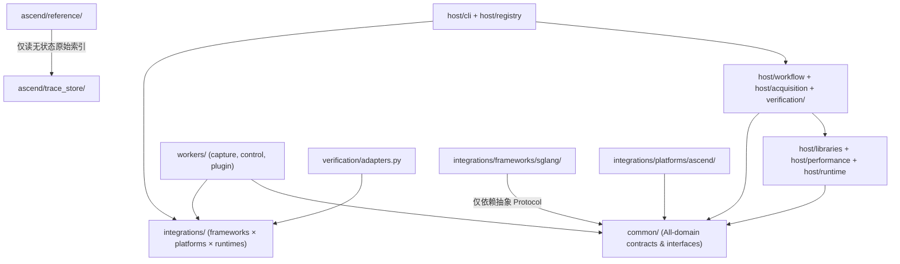
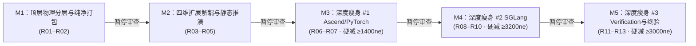

# 顶层物理分层、四维扩展架构收口与不变量锁死深度瘦身

> **协作与人工确认门控**：本计划由 AGY（Gemini）维护，由 Codex 分阶段实施。Codex 执行期间仅更新本窗口 `log.md` 与 `status.md` 的执行态字段，**严禁擅自修改本计划的目标、目录拓扑、删除清单、硬性瘦身门槛、不变量清单或约定暂停点**。每个阶段（M1–M5）完成检查并分层推送至开发分支后**必须暂停**，由 AGY 深度审查并经用户确认后再启动下一阶段，不得自动越权跨阶段推进。

**开始日期**　2026-11-25（开发分支 `topology-extensibility-slimming`，从 `main` 基线提交 `b500cbe` 切出）

**起始规模基线（`b500cbe`）**：
- 业务源码（原 `src/prologue/`）：346 文件 / **51,240 物理行**（Python 244f / 37,114L / **32,708 非空行**；C++ 93f / 13,978L / 12,204 非空行；Shell/Patch/CMake/JSON 9f / 148L）
- 示例代码（`example/`）：4 文件 / 724L（638 非空行）
- 容器裁剪脚本（`docker/images/package_runtime.py`）：1 文件 / 52L（44 非空行）

**目标**　在严格守住既有工程约束与全部真机不变量（零新增物理卡时回归 100% 一致）的前提下，完成三项互为因果的深度演进：
1. **顶层物理清晰分层**：按交付物与语言彻底拆分为 `engine/`（纯 C++23 仿真引擎）、`probes/`（纯底层原生探针/Patch/Shell）、`shared/`（跨语言单一真源静态资产）与 `python/`（按运行域隔离的纯 Python），彻底消除 8 个多语言混装目录与 `docker/images/package_runtime.py` 构建期裁剪魔法；
2. **四维扩展架构收口与纯推演验证**：在架构层打通**换框架（vLLM）× 同框架多版本（SGLang 多 Profile）× 换后端（NVIDIA CUDA/CUPTI/NCCL）× 换硬件代际**四维扩展边界，消除 `sglang/` 对 `ascend`/`torch_npu` 的 98 处直连耦合与 51 文件 235 处散落 `sglang.srt.*` 版本直导，并以纯静态审计完成四维扩展零副作用推演（不向生产代码写入 mock/stub）；
3. **激进且不丢细节的逐块深度瘦身**：在强模块化与清晰边界确立后，由 AGY 锁定各子系统真机不变量，通过范式升维（声明式 Hook 表、共享无状态 Trace 索引、统一局部规则引擎、验证 Check/Collector 内核）与合并过碎微文件，**硬性净削减 Python 非空行 ≥ 7,500 行（冲刺 ≥ 10,000 行），业务 Python 文件数由 244 压至 ≤ 130**，彻底摆脱“增量整理越改越胖、从零重写丢失细节”的双重困局。

---

## 一、深度现状诊断与非目标

### 1. 基线结构痛点（基于 `b500cbe` 实测）

| 痛点维度 | 当前实测事实（`b500cbe`） | 本窗口根治目标 |
| --- | --- | --- |
| **多语言与多产物混装** | `src/prologue/` 26 个子目录中有 8 个 `[MIXED]` 混装目录（`app/` 同时含 C++ 引擎入口 + 宿主 CLI + 两个容器 worker；`platforms/ascend/runtime/` 同时含 Py + C++ `LD_PRELOAD` + `.sh` + `.patch` + `CMakeLists.txt`；`verification/structure/` 夹着 `local_graphs.cpp`）；且仅因 5 个共享小文件放错位置，迫使双 Dockerfile 依赖 `package_runtime.py` 做 AST 静态裁剪。 | 顶层按 `engine/`、`probes/`、`shared/`、`python/` 物理分家；Python 内部按 `common/`、`host/`、`workers/`、`integrations/`、`verification/` 划分运行域；彻底删除 `package_runtime.py`，Dockerfile 回归 100% 纯整目录 `COPY`。 |
| **框架与后端半粘连** | `platforms/ascend/` 已 0 依赖 `sglang`，但 `frameworks/sglang/` 仍有 **40 文件 98 处**直接引用 `ascend`/`torch_npu`/`hccl`/`aclrt`（`acquisition/` 11 文件、`observation/local/` 9 文件、`shared/` 2 文件、`control/` 1 文件、`cpp/templates.cpp` 1 文件），容器入口也写死 `"torch.npu"` 与 `Ascend*`。 | 抽出 `DeviceRuntime`（容器侧）与 `PlatformBackend`（宿主侧）契约，`frameworks/sglang/` 与 `engine/adapters/sglang/` 对 `ascend`/`torch_npu`/`hccl` 硬耦合归零。 |
| **同框架多版本脆弱** | `frameworks/sglang/` 有 **51 文件 235 处**散落引用 **126 个 `sglang.srt.*` 内部私有类/方法**，无版本适配边界，升级或并存双版本必陷入全仓 `if version` 污染或整目录复制。 | 新建 `frameworks/sglang/abi/` 集中承载全部私有符号、声明式 `HookTable` 与可继承覆写的 `VersionProfile`；`abi/` 之外 `sglang.srt.` 命中归零。 |
| **多框架路由未闭环** | 13 处 `AdapterRegistry.select()` 中 12 处无参走默认；`workers` 容器入口与 C++ `local_graphs.cpp` 仍直接硬连 `sglang`。 | 全链路显式传递/推断 `(framework, version_profile, platform)`；C++ 统一通过 `engine/adapters/registry` 派发。 |
| **体量庞大与碎片过度** | `integrations/`（22,908L，44.7%）与 `verification/`（11,529L，22.5%）合占全仓 67.2%；全仓存在 60+ 个 `< 90` 行碎片微文件，同时存在大量平行解析（`ascend/analysis` vs `ascend/reference`）、手写 Hook 包装（`sglang/observation`）、重复规则校验（9 条 `local_*.py`）与手工图遍历/报告拼装（`verification/`）。 | 先锁不变量后范式压缩：合并碎片微文件、共享无状态底座、命令式改声明式；业务 Python 文件 `244 → ≤ 130`，Python 非空行硬性净减 **≥ 7,500 行**（冲刺 ≥ 10,000 行）。 |

### 2. 明确非目标（严禁越界）

- **不实现** NVIDIA CUDA/CUPTI/NCCL、vLLM 或 SGLang 第二版本的实机代码，也不向生产目录写入任何 mock 平台、空壳适配器或假测试分支（四维扩展只落地真实抽象契约、SGLang/Ascend 全量迁移与纯静态扩展推演报告）。
- **不放宽**任何工程约束、统计口径、时钟认证、来源隔离或证据资格判据；不删除任何现有核心预测、TP/PP/EP/PD、局部补库、双库发布、5 域/16 子命令 CLI 或三路验证能力。
- **不触发**任何新的 NPU 物理采集（全程新增物理卡时 = **0**）；不修改 `docs/note.md`、`.clang-format`、`third_party/`、`deprecated/` 及既有 `data/` 资产。

---

## 二、目标深度目录架构与依赖红线

### 1. 全仓目标物理目录树（零多语言混装、零运行域混装）

```text
Prologue/
├── CMakeLists.txt                       # 根构建入口：仅委托构建 engine/（C++23 仿真引擎）
├── pyproject.toml                       # 宿主完整包元数据（where = ["python"]，含 prologue-cli 与 shared/cost_families.json）
├── README.md
├── LICENSE
│
├── engine/                              # 【纯 C++23 仿真引擎：0 个 .py / .sh / .patch】
│   ├── CMakeLists.txt                   # 定义 prologue_core、prologue_sglang、prologue、prologue_local_graphs
│   ├── core/                            # 100% 框架/平台无关核心（0 条越层 #include，0 框架/平台字样）
│   │   ├── contracts/                   # expression, serving, json_io, context_values
│   │   ├── graph/                       # types, state, observation, graph, projection
│   │   ├── templates/                   # production, entries, library, bindings, interface, local, families, selection, supplement, validation, instance
│   │   ├── serving/                     # session, service_times, execution_inputs, controller/, execution/, resources/
│   │   └── performance/                 # service_model, work_costs, work_features, families.hpp.in（读取 shared/cost_families.json）
│   ├── adapters/                        # 框架 C++ 适配器
│   │   ├── registry.{hpp,cpp}           # 唯一框架派发注册表（describe/compile/observed_work/domain/link/serve/local_builder）
│   │   └── sglang/                      # actions, serving, templates, workers（未来并列 vllm/）
│   └── tools/                           # C++ 可执行工具
│       ├── main.cpp                     # 薄入口（≤ 25L）
│       ├── commands.{hpp,cpp}           # 表驱动 15 子命令（经 adapters/registry 派发）
│       ├── execution_trace.{hpp,cpp}    # 流式轨迹写出
│       └── local_graphs.cpp             # 离线局部构图验证（经 adapters/registry 派发，0 直导 sglang）
│
├── probes/                              # 【纯底层原生探针：LD_PRELOAD C++、Profiler Patch、容器脚本，0 个 .py】
│   ├── ascend/
│   │   ├── CMakeLists.txt               # 编译 libprologue_ascend_{observer,weights}.so
│   │   ├── native_calls.cpp
│   │   ├── runtime_timing.{hpp,cpp}
│   │   ├── thread_activity.cpp
│   │   ├── weight_storage.cpp
│   │   ├── profiler/                    # CMakeLists.txt, install.sh, start.patch
│   │   └── scripts/                     # capture.sh, export.sh
│   └── pytorch/
│       ├── CMakeLists.txt               # 编译 libprologue_gloo.so
│       └── gloo_timing.cpp
│
├── shared/                              # 【跨语言单一真源静态资产】
│   └── cost_families.json               # Python 拟合与 C++ 求值共享的唯一模型族契约目录
│
├── python/                              # 【纯 Python：0 个 .cpp / .sh / .patch，按运行域严格分层】
│   └── prologue/
│       ├── __init__.py
│       ├── __main__.py                  # python3 -m prologue 唯一入口（仅委托 host.cli.cli:main）
│       │
│       ├── common/                      # [运行域: All — 宿主/采集/控制三端共享，0 重依赖、0 框架/平台名]
│       │   ├── io.py                    # 原子 JSON/JSONL 读写、内容哈希与路径清理
│       │   ├── cost.py                  # cost_identity / cost_features / ServiceSamples
│       │   ├── workload.py              # WorkloadContent / ExpertRoutes
│       │   ├── observation.py           # CapturedCall / SemanticCapture / ScopeParameters / ProfileWindow / CapturedWorkers
│       │   ├── control_peer.py          # 控制协议管道读写
│       │   └── interfaces.py            # 四维扩展核心协议：DeviceRuntime / PlatformBackend / FrameworkVersionABI / FrameworkAdapter
│       │
│       ├── host/                        # [运行域: Host-Only — 物理隔离，绝不进任何推理/控制容器]
│       │   ├── runtime/                 # docker.py, limits.py, workspace.py
│       │   ├── libraries/               # release.py, store.py, templates.py, increment.py
│       │   ├── performance/             # backends.py, registry.py, models.py, fitting.py, requirements.py
│       │   ├── acquisition/             # options.py, adapters.py, budget.py, capture.py, recording.py, production.py, rules.py, replenishment.py, costs.py, fitting.py
│       │   ├── workflow/                # options.py, prediction.py, exploration.py, targets.py, report.py, latency.py
│       │   ├── registry.py              # (framework, version_profile, platform) 统一宿主适配注册表
│       │   └── cli/                     # cli.py, arguments.py, commands/{predict,library,capture,cost,verify}.py
│       │
│       ├── workers/                     # [运行域: Container-Only — 薄容器入口，0 框架/平台硬编码]
│       │   ├── registry.py              # 容器侧轻量 (framework, platform) 运行时装配表
│       │   ├── capture.py               # 采集/导出/解释容器入口（替代原 app/capture_worker.py）
│       │   ├── control.py               # 无设备控制容器入口（替代原 app/control_worker.py）
│       │   └── plugin.py                # 推理框架插件钩子入口（替代原 app/sglang_plugin.py）
│       │
│       ├── integrations/                # 【运行时 × 硬件平台 × 推理框架 三轴物理正交】
│       │   ├── runtimes/
│       │   │   └── pytorch/
│       │   │       ├── shared.py        # [All] CpuTransfer / CpuProtocolWork
│       │   │       ├── capture.py       # [Capture] boundaries / protocol / signals / gloo_timing 合并模块
│       │   │       └── control.py       # [Control] cpu / collectives / point_to_point / tensors 合并模块
│       │   │
│       │   ├── platforms/
│       │   │   └── ascend/              # [0 个 sglang 字样；未来并列 cuda/]
│       │   │       ├── backend.py       # [Capture/Host] AscendDeviceRuntime + AscendPlatformBackend 契约实现
│       │   │       ├── trace_store/     # [Capture/Host] 共享无状态原始 SDK/RAW/队列/时钟解码与索引层
│       │   │       ├── runtime/         # [Capture] markers, host_profile, copy_sampling, thread_activity, export
│       │   │       ├── analysis/        # [Capture/Host] 精简后的设备/端口/主机对齐解释器
│       │   │       ├── host/            # [Host] deployment, collectives, transport_profile
│       │   │       └── reference/       # [Host/Verify] 精简后的独立参考校验器（仅消费 trace_store，0 导入 analysis）
│       │   │
│       │   └── frameworks/
│       │       └── sglang/              # [0 处 import platforms.ascend / 0 处 torch.npu！未来并列 vllm/]
│       │           ├── abi/             # 【多版本核心】contract.py, hooks.py(声明式 HookTable), registry.py, profiles/rev_4e155ecc.py
│       │           ├── shared/          # [All] 精简高内聚公共契约（≤ 8 文件）
│       │           ├── observation/     # [Capture] 声明式观测核心 + local/（统一 LocalRunner，合计 ≤ 14 文件）
│       │           ├── control/         # [Control] 无设备 CPU 控制与元数据代理（≤ 6 文件）
│       │           └── acquisition/     # [Host] 声明式局部规则基座 + 采样/启动/模板（≤ 8 文件）
│       │
│       └── verification/                # [运行域: Host/Verify-Only — 物理隔离，绝不进推理/控制容器]
│           ├── runner.py                # 统一验证生命周期、隔离与原子发布
│           ├── engine.py                # 统一 FindingLedger / TraceReader / CausalIndex / ReportBuilder 内核
│           ├── adapters.py              # 唯一访问 integrations 的窄适配接口（按 framework × platform 注入）
│           ├── core/                    # 精简后的原生案例、来源核对、时钟认证与协议/状态检查（≤ 9 文件）
│           ├── structure/               # 精简后的受控输入、动作对比与局部构图（≤ 5 文件，单方法 ≤ 100L）
│           ├── fixed/                   # 精简后的固定图基准重算与误差归因（≤ 3 文件）
│           └── autonomous/              # 精简后的自主闭环评分与调度首分歧定位（≤ 2 文件）
│
├── docker/                              # 【100% 纯整目录 COPY，彻底删除 package_runtime.py！】
│   ├── build_inference.sh
│   ├── compose/inference.yml
│   └── images/
│       ├── base/sglang/                 # Dockerfile + install_batch_invariant_ops.sh
│       ├── modeling/Dockerfile
│       ├── sglang/                      # Dockerfile（纯目录 COPY）+ install_sglang.sh + pyproject.toml（仅声明插件入口）
│       └── control/                     # Dockerfile（纯目录 COPY，无任何裁剪脚本）
│
├── example/coarse_graph/                # 保持简洁示例与冻结矩阵编排（PYTHONPATH=python）
└── docs/                                # 权威设计文档、窗口文档与项目推进记录
```

### 2. 不可逾越的静态依赖红线



- **物理镜像隔离（纯目录 COPY 保证）**：
  - `sglang` 镜像**仅 COPY**：`common/`、`workers/{__init__,registry,capture,plugin}.py`、`integrations/runtimes/pytorch/{shared,capture}.py`、`integrations/platforms/ascend/{backend.py,trace_store/,runtime/,analysis/}`、`integrations/frameworks/sglang/{abi/,shared/,observation/}`。
  - `control` 镜像**仅 COPY**：`common/`、`workers/{__init__,registry,control}.py`、`integrations/runtimes/pytorch/{shared,control}.py`、`integrations/frameworks/sglang/{abi/,shared/,control/}`。
- **跨轴隔离红线**：
  - `engine/core/`：0 处框架/平台名，0 条越层 `#include`；
  - `common/`、`host/{runtime,libraries,performance,acquisition,workflow}`：0 处 `sglang`/`ascend`/`torch_npu`/`hccl` 硬编码，0 反向依赖 `host/cli` 或 `integrations/`；
  - `integrations/frameworks/sglang/`：0 处 `import prologue.integrations.platforms.ascend`，0 处裸调 `torch.npu`，`abi/` 之外 0 处原始 `sglang.srt.*` 路径；
  - `integrations/platforms/ascend/`：0 处提及 `sglang`；`reference/` 0 导入 `analysis/` 解释结论；
  - `verification/`：0 导入 `host/cli` 或 `workers/`，除 `verification/adapters.py` 外 0 导入 `integrations/`。

---

## 三、分阶段实施计划与硬门禁（5 阶段 · 13 轮）



---

### M1　顶层物理分层与零裁剪纯净打包（R01–R02）

**阶段约定暂停点**：完成 `engine/`、`probes/`、`shared/`、`python/` 物理拆分与双 Dockerfile 纯 `COPY` 改造，删除 `src/` 与 `package_runtime.py`，在 `modeling` / `sglang` / `control` 完成全量构建与零新增卡时基准回归，按职责分层推送后**立即暂停**，等待 AGY 审查与用户放行 M2。

#### R01　拆分 `engine/`（纯 C++23）、`probes/`（原生探针/脚本）与 `shared/`（跨语言真源）

- **为什么做**：消除 C++ 仿真器、C++ `LD_PRELOAD` 探针、Patch、Shell 与 Python 源码在 `src/prologue/` 内的全面混装，同时把 `local_graphs.cpp` 纳入统一 C++ 框架注册表。
- **改动与删除清单**：
  - 建立 `engine/`：迁入 `core/{contracts,graph,templates,serving,performance}`、`adapters/sglang/` 与 `tools/{main,commands,execution_trace,local_graphs}`；新增 `engine/adapters/registry.{hpp,cpp}` 统一为 `commands.cpp` 与 `local_graphs.cpp` 提供按框架名派发；将 `performance/families.json` 迁至 `shared/cost_families.json` 并由根 `CMakeLists.txt` + `engine/CMakeLists.txt` 统一配置生成。
  - 建立 `probes/`：迁入 `probes/ascend/`（原 `platforms/ascend/runtime/native/*` 与 `capture.sh`/`export.sh` 入 `scripts/`）与 `probes/pytorch/`（原 `runtimes/pytorch/native/*`）。
  - **显式删除**：彻底删除 `src/prologue/` 下全部 `.cpp`/`.hpp`/`.h`/`.sh`/`.patch`/`.hpp.in`/`.json` 与 `CMakeLists.txt`（零转发头文件）。
- **验收**：`engine/` 与 `probes/` 均 0 个 `.py` 文件；`engine/core/` 0 越层 `#include`；`modeling` 容器 Release 全目标构建 **0 error / 0 warning**；`prologue` 15 子命令帮助与既有 `serve`/`local_graphs` 结果与 `b500cbe` 一致。
- **交接**：`b500cbe` 仓库 → 物理独立的 C++ 仿真器 `engine/` 与探针目录 `probes/` → R02 接手纯 Python 分层与 Dockerfile 改造。

#### R02　建立 `python/prologue/` 运行域分层并彻底删除 `package_runtime.py`

- **为什么做**：按 `common/`、`host/`、`workers/`、`integrations/`、`verification/` 物理隔开三套运行域，彻底消除 AST 静态裁剪构建魔法与双运行域混放。
- **改动与删除清单**：
  - 建立 `python/prologue/`，迁入并理顺：`common/{io,cost,workload,observation,control_peer}`、`host/{runtime,libraries,performance,acquisition,workflow,registry,cli}`、`workers/{capture,control,plugin}`、`integrations/`、`verification/`（将 `serving/latency.py` 归入 `host/workflow/latency.py`；将 `integrations/runtimes/pytorch/` 先按 `shared`/`capture`/`control` 隔离目录以便纯 COPY）。
  - 改写 `docker/images/sglang/Dockerfile` 与 `docker/images/control/Dockerfile` 为 **100% 显式整目录/模块 `COPY`**（直接引用 `probes/` 与 `python/prologue/` 的对应子域，以及更新 `capture.sh` 入口为 `python3 -m prologue.workers.capture`、`control/Dockerfile` 入口为 `python3 -m prologue.workers.control`、`docker/images/sglang/pyproject.toml` 插件入口为 `prologue.workers.plugin:install`）；更新根 `pyproject.toml`（`where = ["python"]`，`prologue-cli = "prologue.host.cli.cli:main"`，`shared/cost_families.json` 打包可读性）；同步更新 `example/coarse_graph/` 的 `PYTHONPATH=python` 与模块导入路径。
  - **显式删除**：彻底删除 `docker/images/package_runtime.py` 与整个旧 `src/` 目录（零转发壳、零旧路径别名）。
- **验收**：全仓 **0 个多语言混装目录**；`python/` 下 0 个非 `.py` 代码文件；AST 0 导入环；`ruff check python example` 0 错误；执行 `./docker/build_inference.sh` 重建 `sglang`/`control` 双镜像，核验双镜像 **0 个 `host/`、`verification/`、`sglang/acquisition/`、`ascend/host/`、`ascend/reference/` 文件**，入口导入 0 报错；Qwen TP1 四目标 211,290 条轨迹与 678 离线样本拟合与 `b500cbe` SHA-256 逐字节一致，新增物理卡时 = 0。
- **交接**：R01 C++/探针分离 → 顶层彻底清爽、零裁剪脚本的仓库骨架 → M2 四维扩展解耦。

---

### M2　四维扩展架构收口与零副作用扩展推演（R03–R05）

**阶段约定暂停点**：完成框架/平台解耦、多版本 ABI 层落地、全链路显式路由与四维扩展纯静态推演审计，重建双镜像与 C++ 并完成零卡时回归，分层推送后**立即暂停**，交由 AGY 审查与用户放行 M3 瘦身阶段。

#### R03　抽出 `DeviceRuntime` / `PlatformBackend`，清零 `sglang/` 对 `ascend` 的 98 处直连耦合

- **为什么做**：当前 `frameworks/sglang/` 有 40 个文件 98 处直接硬连 `ascend`/`torch_npu`/`hccl`，导致未来接入 NVIDIA CUDA 时必须复制整套 SGLang 适配器。
- **改动与删除清单**：
  - 在 `python/prologue/common/interfaces.py` 定义窄协议 `DeviceRuntime`（容器内设备 API、同步、事件、markers、profiling hooks、profile export、host_profile、copy_sampler、scoped_tasks、tensor_layouts、runtime_domain_key、collective_backend）与 `PlatformBackend`（宿主侧 deployment、driver_mounts、runtime/entrypoint、host_alignment、collectives、transport_profile、reference_evidence）。
  - 在 `python/prologue/integrations/platforms/ascend/backend.py` 实现 `AscendDeviceRuntime` 与 `AscendPlatformBackend`。
  - 改造 `frameworks/sglang/{shared,observation,control,acquisition}` 全部通过注入的 `device_runtime` / `platform_backend` 交互（规则标识由 `f"{framework}.{platform}.*"` 或平台声明生成，确保既有 Ascend 资产名称与 JSON 结构 100% 兼容）；改造 `engine/adapters/sglang/templates.cpp` 去除 `"torch_npu"` 硬编码，改由环境声明的加速器键驱动（保持既有发布 `local_domain` 逐字节一致）。
  - **显式删除**：删除 `frameworks/sglang/` 内全部对 `prologue.integrations.platforms.ascend` 的直接导入、裸 `torch.npu.*` 调用与硬编码 `"torch_npu"`/`"ascend"` 分支。
- **验收**：`grep -rn 'platforms\.ascend\|torch\.npu' python/prologue/integrations/frameworks/sglang/` 为 **0 命中**；`engine/adapters/sglang/` 对 `torch_npu`/`ascend` 硬编码为 **0 命中**；C++ 编译 0 告警，既有双库预测与离线投影逐字节一致。
- **交接**：M1 清爽目录 → 平台与框架正交解耦的适配器边界 → R04 收拢框架版本耦合。

#### R04　建立 `frameworks/sglang/abi/` 多版本适配层与声明式 Hook 表

- **为什么做**：当前 51 个文件 235 处直接耦合 126 个 `sglang.srt.*` 内部符号，无法优雅维护同框架多版本，同时是后续 M4 瘦身的必备范式底座。
- **改动与删除清单**：
  - 新建 `python/prologue/integrations/frameworks/sglang/abi/`：
    - `contract.py`：定义强类型 `SGLangABI`（覆盖模型/池/分配器/缓存/调度器/PD/通信/benchmark 符号访问器与能力位）；
    - `hooks.py`：实现声明式 `HookSpec` 与 `HookTable` 统一安装器，支持按组批量声明与验证 hook 目标；
    - `profiles/rev_4e155ecc.py` 与 `registry.py`：以 `4e155ecc` 为默认基线 Profile 注册，支持基于修订号/版本特征解析并按增量覆写扩展新版本 Profile（无需复制框架主体代码）。
  - 迁移 `frameworks/sglang/{shared,observation,control,acquisition}` 中全部 235 处 `sglang.srt.*` 直接导入与字符串注册至 `abi/`；在 `domain["implementation"]` 或运行时校验保持与既有 `framework_revision` 合同 100% 兼容。
  - **显式删除**：删除 `abi/` 之外全部硬编码 `sglang.srt.*` 导入语句与裸字符串 hook 目标。
- **验收**：`grep -rn 'sglang\.srt\.' python/prologue/integrations/frameworks/sglang/ --exclude-dir=abi` 为 **0 命中**；双镜像重建并容器内导入自检 0 报错；既有四目标预测与离线拟合逐字节一致。
- **交接**：R03 平台解耦 → 版本隔离且声明式 Hook 化的 SGLang 适配层 → R05 全链路路由与 M4 深度压缩。

#### R05　打通全链路显式 `(framework, version, platform)` 路由并完成四维扩展静态推演

- **为什么做**：封堵剩余 12 处默认 `AdapterRegistry.select()` 与容器入口硬编码，用零副作用静态推演检验重构后的扩展架构是否真正闭环无漏口。
- **改动与删除清单**：
  - 升级 `host/registry.py` 为 `(framework, platform, version_profile)` 三维解析，消除 12 处无参 `AdapterRegistry.select()`（CLI 支持显式 `--framework`/`--platform` 或从输入/发布资产自动推断，默认镜像不再写死单框架）；升级 `workers/{registry,capture,control,plugin}.py` 按环境/作业声明动态装配对应 `framework × platform` 运行时；更新 `verification/adapters.py` 按选定组合注入。
  - **纯静态四维扩展架构推演（零生产代码副作用）**：基于 AST 依赖、C++ `#include` 树与协议签名，逐一推演并输出结构化审计文件 `data/topology-extensibility-slimming/m2/extensibility-audit.json` 与日志结论：
    1. **换硬件代际**（910B → 910C / H100 → B200）：确认 0 代码改动清单；
    2. **换后端**（Ascend → NVIDIA CUDA/CUPTI/NCCL）：逐接口核对 `probes/cuda/` + `platforms/cuda/` 需实现的精确方法集，实证 `engine/`、`common/`、`host/`、`verification/`、`frameworks/sglang/` 修改面为 **0**；
    3. **同框架多版本**（SGLang `4e155ecc` + 假设 `vNext` 共存）：实证只需新增 1 个增量 `abi/profiles/` 文件与镜像，核心业务修改面为 **0**；
    4. **换框架**（SGLang → vLLM）：逐接口核对 `engine/adapters/vllm/` + `frameworks/vllm/` 接入点，实证 `engine/core/`、`common/`、`host/`、`platforms/ascend/` 修改面为 **0**。
  - **显式删除**：删除 `workers/` 中任何直接写死的 `sglang`/`ascend` 顶层导入与 CLI 中无参隐式默认选择。
- **验收**：四维扩展审计中全部“零改动层”实测违例为 **0**；生产代码中 **0 个 mock/stub 扩展文件**；双镜像重建、C++ Release 编译与零卡时四目标回归全部通过。
- **交接**：M2 完整可扩展架构 → 边界锁死的三大瘦身标的 → M3–M5 激进瘦身。

---

### M3　激进瘦身 #1：`platforms/ascend/` + `runtimes/pytorch/` + `common/`（R06–R07）

**阶段约定暂停点**：完成共享无状态 `trace_store/` 抽取与 `pytorch/`、`common/`、`ascend/` 激进压缩，达到硬性净减行与文件数门槛且零卡时回归逐字节一致，分层推送后**立即暂停**交由 AGY 审查。

> **M3 必须锁死的真机不变量（严禁偷删或弱化）**：
> - `TS_TASK_FLIP` 批号翻转与队列槽位归属证明（含并发提交/跨线程拒绝）；
> - `host/start_info` 与 `device/start_info` 双独立 `CLOCK_MONOTONIC_RAW` 锚点校准（严禁混用）；
> - `aclrt` 同步拷贝归属调用者线程（非排队设备命令）、重复无新工作 host fence 去重、观察器排除区间与私有闭环服务队列隔离；
> - **`reference/` 独立核对原则**：只消费无状态原始事实与索引，**绝不读取 `analysis/` 解释器结论**。

#### R06　合并 `runtimes/pytorch/` 与 `common/` 微文件，抽取无状态 `ascend/trace_store/`

- **为什么做**：`runtimes/pytorch/` 12 个小文件（973L）碎片严重；`ascend/analysis/`（2,911L）与 `ascend/reference/`（1,443L）重复实现了两套 SDK JSON 扫描、区间二分、`TS_TASK_FLIP`、`halSq` 提交解析与时钟还原。
- **改动与删除清单**：
  - 将 `integrations/runtimes/pytorch/` 12 个 `.py` 合并压缩为 3 个高内聚模块：`shared.py`（`CpuTransfer`/`CpuProtocolWork`）、`capture.py`（合并 `boundaries`/`protocol`/`signals`/`gloo_timing`）、`control.py`（合并 `cpu`/`collectives`/`point_to_point`/`tensors`）。
  - 将 `common/` 内微文件彻底收口为 6 个模块（`io.py`、`cost.py`、`workload.py`、`observation.py`、`control_peer.py`、`interfaces.py`）。
  - 新建 `platforms/ascend/trace_store/`（≤ 3 文件），统一无状态原始 SDK 行扫描、`TS_TASK_FLIP`、RAW 时钟换算、`Interval`/`ThreadIntervals` 区间树、`halSq` 驱动提交与事件代次只读索引，供 `analysis/` 与 `reference/` 共用。
  - **显式删除**：删除被合并的 `pytorch/` 旧 9 文件、`ascend/analysis/{sdk_rows,clock,notifications,queues,trace}.py` 中的重复底层解析以及 `ascend/reference/{recording,queue_evidence,reference_streams}.py` 中与 `trace_store/` 重复的扫描/索引代码。
- **验收**：`runtimes/pytorch/` 仅 3 个业务 `.py` 且总非空行 ≤ 550L；`ascend/reference/` 0 导入 `ascend/analysis/`；`source-evidence` 与 worker facts 投影逐字节一致。
- **交接**：M2 稳定基线 → 紧凑共用原始索引底座 → R07 激进压缩上层解释与参考校验。

#### R07　重构并激进压缩 `ascend/analysis/`、`ascend/reference/` 与 `ascend/runtime/`

- **为什么做**：消除 `analysis/` 的 4 文件可变状态袋（`ObservedTimeline` 暴露 20+ 属性）与 `reference.py`（645L）的冗长手工校验样板。
- **改动与删除清单**：
  - 将 `ascend/analysis/` 重构为 ≤ 5 个高内聚文件（核心投影流水线、命令/流绑定、主机对齐、scoped_tasks/services），消除 `timeline.py` / `device_events.py` / `port_bindings.py` / `observation.py` 跨文件状态传递样板。
  - 将 `ascend/reference/` 压缩至 ≤ 2 个文件（依托 `trace_store/`，用紧凑声明式不变量断言替代冗长手工循环与字段比对），将 `ascend/runtime/` 5 个小文件收敛至 ≤ 3 文件（合并 `export.py` 38L 与薄包装）。
  - **显式删除**：删除全部被合并的碎片文件与过渡辅助类。
- **验收（硬性瘦身门禁）**：
  - `platforms/ascend/` + `runtimes/pytorch/` 合计 Python 文件数压至 **≤ 20**；
  - 较 M2 结束净减少 Python 非空行 **≥ 1,400 行**；
  - 双镜像纯 `COPY` 重建通过；既有 worker facts（16,285,280 B）、`source-evidence.json`、678 离线样本与四目标预测与 `b500cbe` 逐字节一致。
- **交接**：R06 底座 → 精干高内聚的 Ascend/PyTorch 平台层 → M4 集中攻克最大体量 `sglang/`。

---

### M4　激进瘦身 #2：`frameworks/sglang/` 全域范式压缩（R08–R10）

**阶段约定暂停点**：完成 `sglang/` 四个子域（`shared`、`control`、`observation`、`acquisition`）的声明式重构与激进瘦身，达成硬性净减行与文件数上限，双镜像重建及零卡时回归全部通过，分层推送后**立即暂停**交由 AGY 审查。

> **M4 必须锁死的真机不变量（严禁偷删或弱化）**：
> - `PoolCoordinates` 0/1-based 页与槽位偏移换算、`RadixKey` 路由键构造与 prefix cache 分裂/驱逐守卫；
> - 模型层/注意力/KV 布局守卫（`FutureMap` 维数剥离、多行 packed value、MoE 逐层 router/expert 配对）；
> - PD 预填充/解码分离传输顺序、接收端 KV 页表与元数据写入顺序校验；
> - 单卡顺序分片重放（`profile_windows`、主机暂存交换、超显存按层暂存）与全部 9 条局部采集规则的真实资格核验语义（不删减有效局部采集规则，而是通过声明式基座压缩其 9 份重复样板）。

#### R08　深度合并压缩 `sglang/shared/`（22f → ≤ 8f）与 `sglang/control/`（12f → ≤ 6f）

- **为什么做**：`shared/`（2,868L / 22 文件）与 `control/`（2,274L / 12 文件）存在大量 14L–130L 碎片文件与重复参数/守卫/RPC 包装代码。
- **改动与删除清单**：
  - 合并压缩 `sglang/shared/` 为 ≤ 8 个清晰模块：`config.py`（配置/角色/入队）、`batches.py`（批次/选择/专家）、`resources.py`（资源/分配/缓存键）、`calls.py`（动作帧/状态读取/时钟）、`kv.py`（KV 布局/对端/布局下沉/注意力目录）、`pipeline.py`、`disaggregation.py`（PD 调用/元数据搬运与集合通信）。
  - 合并压缩 `sglang/control/` 为 ≤ 6 个清晰模块：`workers.py`、`scheduler.py`（含 `flow` 与 `requests`）、`resources.py`（含 `prefix_cache`）、`runner.py`、`pipeline.py`（含 `signals` 与 `transfers`）、`pd.py`（含 `kv_transfer`）；统一 RPC 往返与状态校验辅助。
  - **显式删除**：删除全部 20+ 个被合并的旧文件，零转发壳。
- **验收**：`shared/` ≤ 8 文件、`control/` ≤ 6 文件；本轮净减非空行 **≥ 1,000 行**；`control` 镜像重建与四目标预测轨迹逐字节一致。
- **交接**：M3 平台层 → 紧凑的 SGLang 共享与控制层 → R09 攻克最重的 `observation/`。

#### R09　深度范式压缩 `sglang/observation/`（39f → ≤ 14f，含 `local/`）

- **为什么做**：`sglang/observation/` 达 5,983 行（39 文件），充斥大量命令式手写 around-hook 包装、重复上下文栈、手动 scope/port 字典拼装，以及 5 个 `*_runner.py` 重复的局部探针生命周期。
- **改动与删除清单**：
  - 依托 M2 的 `abi/hooks.py` 声明式 `HookTable` 与统一 `ScopeBuilder` 装饰器/上下文原语，将 27 个核心观察文件合并压缩至 **≤ 10 个模块**（收拢 `hooks`、`flow`、`model`、`kv`、`communications`、`pipeline`、`resources`、`session`、`timing`、`profiles`），彻底消除重复 hook 注册、重复张量端口打包与重复资源历史记录样板。
  - 将 `observation/local/` 12 个文件（1,543L）重构为 **≤ 4 个模块**：统一 `LocalRunner` 通用生命周期驱动（设备初始化、runtime 目录、warmup/flush、分阶段计时、多 rank spawn、facts 与 manifest 发布）+ 精简探针体 + 合并 `shard_staging.py`（整合 `shard_engine`/`shard_weights`/`shard_transport`）。
  - **显式删除**：删除全部被合并的 25+ 个旧观察与 runner 微文件。
- **验收**：`sglang/observation/`（含 `local/`）总文件数 ≤ 14；本轮净减非空行 **≥ 1,400 行**；`sglang` 镜像重建、入口导入与离线投影/worker facts 逐字节一致。
- **交接**：R08 共享/控制层 → 声明式轻量化 SGLang 观测层 → R10 压缩宿主采集与局部规则。

#### R10　深度范式压缩 `sglang/acquisition/`（20f → ≤ 8f）

- **为什么做**：`sglang/acquisition/`（2,839L / 20 文件）中 6 个 `local_*.py`（9 条规则 1,083L）和样本提取/采样模块存在大量重复的域/rank 校验、临时模型调用、会话打包与样本构造样板。
- **改动与删除清单**：
  - 升级声明式 `LocalRule` 基座，统一承接域/rank/环境校验（全部统一 `WorkerDomain.execution_domain`）、会话键归一、`local_attempt` 组装、样本资产打包与通用资格应答，将 6 个 `local_*.py` + `local_base.py` 合并压缩至 **≤ 3 个文件**（`local_rules.py` / `local_structure.py` / `local_work.py`）。
  - 合并收敛其余宿主文件至 **≤ 5 个文件**：`launch.py`（含 `placement`）、`worker_templates.py`（含 `worker_capture`/`batch_readback`/`batch_calibration`）、`sampling.py`、`samples.py`（合并 `device_samples`/`host_cost_samples`/`host_scopes`/`pd_samples`/`cost_reuse`）。
  - **显式删除**：删除全部 12+ 个被合并的旧文件。
- **验收（M4 硬性瘦身总门禁）**：
  - `frameworks/sglang/` 全目录 Python 文件数压至 **≤ 38**（原 95 文件）；
  - M4（R08–R10）累计较 M3 结束净减少 Python 非空行 **≥ 3,200 行**；
  - 双镜像纯 `COPY` 重建、四目标 211,290 条轨迹、空库首缺项、678 离线样本与 `cost fit` 全部与 `b500cbe` 逐字节一致，新增物理卡时 = 0。
- **交接**：R09 观测层 → 高度精干的 SGLang 适配层 → M5 攻克最后一块万行大户 `verification/`。

---

### M5　激进瘦身 #3：`verification/` 引擎化压缩与全仓收官验收（R11–R13）

**阶段约定暂停点**：完成 `verification/` 全面引擎化瘦身、文档同步、全仓代码卫生清零与全链路零卡时回归，分层推送至 `origin/topology-extensibility-slimming` 后**立即暂停**（不要自行关窗），交由 AGY 终审与用户确认关窗。

> **M5 必须锁死的真机不变量（严禁偷删或弱化）**：
> - `ReferenceRecording` 训练来源隔离核对与输入差异阻断；
> - `source_clock` 的 SciPy 候选基 + **SymPy 有理数精确认证**（严禁以浮点近似替代精确有理数认证）；
> - `NativeCase` 全 rank 独立构建（绝不因预测错误取消原生图构建）、动作配对仅认唯一逻辑锚点或已核对消费前缀（绝不按位置猜测）、数据/信号/通信/状态生命周期全套因果核验；
> - 固定图实测基线重算、单工作服务误差归因与关键链漂移定位；自主闭环 TTFT/TPOT 误差统计口径与首次调度分歧定位。

#### R11　构建 `verification/engine.py` 紧凑内核并激进压缩 `verification/core/`（21f → ≤ 9f）

- **为什么做**：`verification/core/` 高达 6,617 行（21 文件），充斥 15+ 套重复的 `Counter/findings` 收集逻辑、多套手写图遍历/可达算法、多处 `json.dumps(..., sort_keys=True)` 及冗长状态机字典拼装。
- **改动与删除清单**：
  - 新建 `python/prologue/verification/engine.py`：提供统一的 `FindingLedger`（计数/代表样本/差异与证据缺口分级/outcome 汇总）、`TraceReader`（流式 JSONL 解码 + `ContextValues` 展开）、`CausalIndex`（全 rank 图索引/拓扑/可达性/最小关系比较原语）与 `ReportBuilder`。
  - 合并压缩 `verification/core/` 为 **≤ 9 个高内聚模块**：`reference.py`（含 `publications`、`metrics`）、`native_case.py`、`actions.py`（合并 `contents`）、`dependencies.py`、`connections.py`、`state.py`（合并 `bindings`、`lifetimes`、`resource_effects`）、`pd_protocol.py`（合并 `pd_payload`、`protocol_reads`、`batch_sync`）、`cpu_protocol.py`（合并 `ingress`）、`source_evidence.py`（含 `source_clock` 或独立保留 `source_clock.py` 保证清晰）。
  - **显式删除**：删除全部被合并的 12+ 个旧文件与重复图遍历/计数样板。
- **验收**：`verification/core/` ≤ 9 文件；本轮净减非空行 **≥ 1,800 行**；留存 PD（`source-evidence` 一致）与 TP2 来源核对结果与 `b500cbe` 完全一致。
- **交接**：M4 业务精简仓 → 轻量化验证共享内核 → R12 压缩三路验证执行器。

#### R12　激进压缩 `verification/{structure,fixed,autonomous}/`（18f → ≤ 10f）

- **为什么做**：三路验证合计 4,869 行 Python，其中 `fixed_reference.py`（943L）、`fixed_context.py`（604L）、`execution_inputs.py`（594L）、`compare_actions.py`（337L）存在大量重复事件消费、窗口归因与百行级报告字典拼装。
- **改动与删除清单**：
  - 基于 `engine.py` 合并压缩 `verification/structure/`（11 Py 文件 → **≤ 5 文件**：`structure.py`、`compare_actions.py`、`invocations.py`、`execution_inputs.py`、`local_graphs.py`，整合 `trace_events`/`execution_times`/`stream_queues`/`action_report`/`state_values` 并严格保持 `compare_actions` 单方法 ≤ 100 行）。
  - 合并压缩 `verification/fixed/`（4 文件 → **≤ 3 文件**：`fixed_graph.py`、`fixed_reference.py`、`fixed_context.py`，吸收 `host_queues.py` 并去除重复唤醒/回放样板）。
  - 合并压缩 `verification/autonomous/`（3 文件 → **≤ 2 文件**：`autonomous.py`、`metrics.py`，整合 `latency_metrics` 与 `schedule`）。
  - **显式删除**：删除全部被合并的旧文件。
- **验收（M5 硬性瘦身总门禁）**：
  - `verification/` 全目录 Python 文件数压至 **≤ 20**（原 43 Py 文件）；
  - M5（R11–R12）累计较 M4 结束净减少 Python 非空行 **≥ 3,000 行**；
  - 留存 PD（配对 5,355 动作、复现 825 处端口差异）、留存 TP1 轻量自主闭环评分（1 请求 3 token、8,601 成本查询、全部指标逐项一致）与 TP2 参考资格结果与 `b500cbe` 完全一致。
- **交接**：R11 内核 → 精干且 0 不变量丢失的三路验证系统 → R13 文档同步与全仓终验。

#### R13　全仓文档同步、代码卫生清零与零新增卡时总回归

- **为什么做**：同步全部公开文档与新目录拓扑，执行全仓静态架构、构建、打包、瘦身账本与零新增卡时端到端验收。
- **改动与删除清单**：
  - 同步更新 `README.md` 与静态设计文档中的顶层目录映射（`engine/`、`probes/`、`shared/`、`python/`）、CMake/Docker 构建命令、`PYTHONPATH=python` 运行示例以及四维扩展边界说明（严守文档跨层零引用，严禁触碰工程约束红线）。
  - 全仓清理 `ruff check python example` 至 **0 errors**，清零全仓所有 `__pycache__/*.pyc` 字节码文件。
  - 执行第四章全部 Definition of Done 门禁，将各阶段与全窗口精确物理行/非空行/文件数对比表记入 `log.md` 与 `status.md`。
- **验收**：满足第四章全部门禁，推送 `origin/topology-extensibility-slimming` 并停在 AGY 终审点。
- **交接**：R12 瘦身完成态 → 物理清晰、四维可扩展、体量精干的整洁仓库 → AGY 终审与用户确认关窗。

---

## 四、最终交付门禁（Definition of Done）与熔断规则

### 1. 硬性验收门禁

| 门禁维度 | 必须达成的可核验标准 |
| --- | --- |
| **顶层目录纯净度** | `engine/` 0 个 `.py`/`.sh`/`.patch`；`probes/` 0 个 `.py`；`python/` 0 个 `.cpp`/`.hpp`/`.sh`/`.patch`；全仓 **0 个多语言混装目录**；旧 `src/` 与 `docker/images/package_runtime.py` **彻底删除**。 |
| **四维扩展边界** | `engine/core/` 0 越层 `#include` 且 0 框架/平台字样；`common/` 与 `host/{runtime,libraries,performance,acquisition,workflow}` 0 框架/平台硬编码；`frameworks/sglang/` 0 导入 `platforms.ascend`、0 裸调 `torch.npu`、`abi/` 外 0 原始 `sglang.srt.*` 路径；`platforms/ascend/` 0 提及 `sglang`、`reference/` 0 导入 `analysis/`；`workers/` 0 硬编码单框架；`verification/` 0 导入 `host/cli`/`workers/` 且除 `verification/adapters.py` 外 0 导入 `integrations/`；M2 四维扩展静态推演报告 0 漏口且生产代码 0 mock/stub。 |
| **硬性瘦身指标** | 相对 `b500cbe`（业务 Python 244f / 37,114L / 32,708ne）：**Python 非空行累计净减 ≥ 7,500 行（冲刺 ≥ 10,000 行）**，分阶段达标（M3 ≥ 1,400ne、M4 ≥ 3,200ne、M5 ≥ 3,000ne）；**业务 Python 文件数压至 ≤ 130**；C++ 保持精干不显著膨胀（净增 ≤ +150ne）。 |
| **构建、打包与卫生** | `modeling` Release 全目标编译 **0 error / 0 warning**；`./docker/build_inference.sh` 纯 `COPY` 重建 `sglang`/`control` 双镜像成功，实装核验 0 宿主/CLI/验证模块泄露、入口导入 0 报错；`ruff check python example` **0 errors**；全仓过期 `.pyc` **0 残留**；AST **0 导入环**；`compare_actions` 单方法 ≤ 100 行；`python3 -m prologue` 5 域 16 子命令与 `prologue-cli` 全部可用。 |
| **零新增卡时回归** | 全窗口新增原生尝试 = **0**、新增物理卡时 = **0**：① `predict explore` Qwen TP1 四目标 211,290 条轨迹与 16 次 token 发布逐字节一致，空库返回准确首缺项；② `library inspect` 与 `library publish --from-collection` 摘要与校验和一致；③ `cost fit`（678 样本）+ `cost-points` + `work-costs`（43,276 项固定图工作）逐项一致；④ `verify {source, structure, fixed-graph, autonomous}` 在留存 TP1（1 请求 3 token 闭环评分）、PD（5,355 动作 / 825 端口差异）与 TP2 参考上与 `b500cbe` 结论一致。 |

### 2. 失败熔断与反“假瘦身”规则

- **反假瘦身红线**：严禁通过压成超长单行（超过 Ruff 120 列）、删除必要注释/错误提示、删掉真机校验分支、弱化有理数时钟认证或把多语句塞进分号来凑减行数；减行必须来自**真实消除平行轮子、合并碎片微文件与声明式范式收敛**，由 AGY 在每个阶段暂停点逐文件源码审查把关。
- **失败熔断**：同一构建、迁移、瘦身回归或门禁问题连续尝试 **2 轮** 仍无新根因进展，或实测某阶段硬性减行门槛在严格守住全部不变量前提下无法进一步压缩时，Codex 必须立即停止，保留完整证据与精确统计记入 `log.md` / `status.md` 交回 AGY 复盘裁决，严禁擅自降标或删功能硬凑。
- **阶段暂停与推送**：严格以 **M1 → M2 → M3 → M4 → M5** 为审查与分层推送边界，每阶段收尾推送至 `origin/topology-extensibility-slimming` 后立即暂停交回 AGY 审查。
